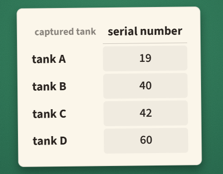

## Counting tanks

In World War II, the Allies wanted to know how many tanks Germany had built. Each tank carried a serial number: 1, 2, 3, and so on up to the total, N.

Suppose they capture four tanks with serial numbers 19, 40, 42, and 60, and each capture is equally likely to be any of the N tanks, independently. Then the chance of these four serial numbers is $(\frac{1}{N})^4$  when N is at least 60, and 0 when N is smaller. Which N makes these serial numbers most likely?

#### **Answer:** 60 tanks

---

**Explanation**

**The idea**
The most likely value can sit at the edge of what is possible, not on top of a hill.

**Solution**
N = 60. The chance $(\frac{1}{N})^4$ shrinks as N grows, so the best N is the smallest one allowed, and N cannot be less than 60, because tank 60 exists. The maximum likelihood estimate is the biggest serial number seen. There is no hill to climb: the score only falls as N grows, and below 60 it is impossible.

The biggest serial number seen can never be too big, so it tends to be too small. The Allied statisticians added the average gap between serial numbers, here (60−4)÷4=14, to guess 74. For June 1941 their method gave 244 tanks a month, spies said 1,550, and German records later showed 271 (Ruggles and Brodie, 1947).
