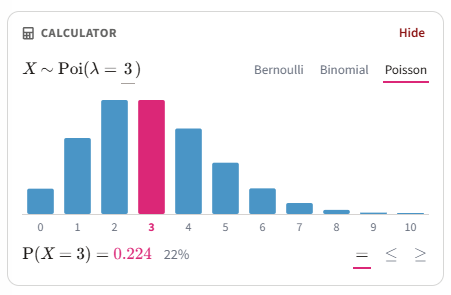
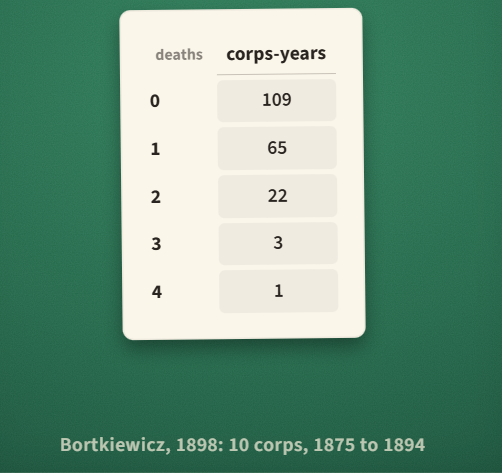

## Death by horse kick

For a spooky day, a grim classic. In 1898, Ladislaus Bortkiewicz counted soldiers in 10 corps of the Prussian army who were killed by horse kicks, year by year from 1875 to 1894. That makes 200 corps-years. The table shows how many corps-years had 0, 1, 2, 3, or 4 deaths; none had more.

Suppose the deaths in one corps-year follow a Poisson story with parameter θ, the average number of deaths per corps-year. Which θ gives the highest score, the $log_{10}$ likelihood of all 200 counts? Give your answer to three decimal places.

#### **Answer:** 0.61

---

**Explanation**

**The idea**
For a Poisson story, the most likely θ is the average count.

**Solution**
The best θ is the average number of deaths per corps-year. The deaths add up to 1 × 65 + 2 × 22 + 3 × 3 + 4 × 1 = 122, so θ= $\frac{122}{200} =0.61.$

With θ = 0.61, the Poisson story predicts how many of the 200 corps-years have each count:
* no deaths: $200 × e ^{−0.61} ≈108.$7, and Bortkiewicz counted 109
* one death: 66.3, against 65
* two deaths: 20.2, against 22

A story with one parameter matches a count made more than a century ago almost exactly.