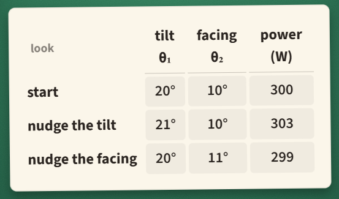

## Tilt and turn

A solar panel has two parameters: θ₁, its tilt up from flat, and θ₂, how far it faces east of south, both in degrees. The score is the power it makes. Each look means setting the parameters and reading the power meter.

The table shows three looks: where the panel starts, a nudge of the tilt alone by 1°, and a nudge of the facing alone by 1°. The nudges are only looks, so the step starts from where the panel starts. With a step size of 2, where do the parameters go next?

A. Tilt 26°, facing 8°

B. Tilt 26°, facing 12°

C. Tilt 23°, facing 9°

D. Tilt 22°, facing 10°

#### **Answer:** Option A. Tilt 26°, facing 8°

---

**Explanation**

**The idea**
With two parameters, nudge each one alone, then step them both together.

**Solution**

For the tilt, 
$∂score/∂θ _1 ≈(303−300)÷1=3$ watts per degree, so the tilt goes up to $20+2×3=26°$. For the facing, $
∂score/∂θ _2 ≈(299−300)÷1=−1$, so the facing goes down to 
$10+2×(−1)=8°$.

The pair $
(∂score/∂θ _1, ∂score/∂θ _2)=(3,−1)$ is the gradient, and one step moves every parameter at once. The climb goes on until every nudge makes the power drop: a top, though not always the highest one.