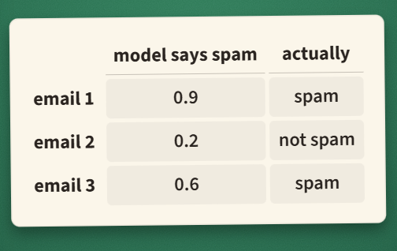
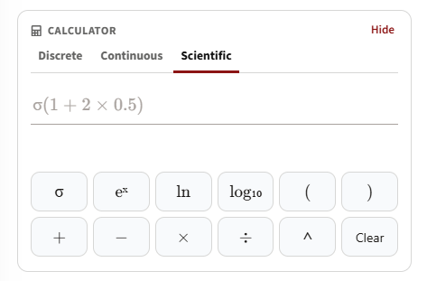

## Three labels

A spam model gives three training emails these chances of spam. What is the likelihood of the true labels: the chance, under the model, that all three emails get the labels they actually have? Treat the emails as independent. Give your answer to three decimal places.

#### **Answer:**  0.432

---

**Explanation**

**The idea**
A classifier's likelihood multiplies the chance it gave each true label.

**Solution**

Each email contributes the chance the model gave its true label: 0.9 for email 1, $1−0.2=0.8$ for email 2, and 0.6 for email 3. Multiply them:

$$0.9×0.8×0.6=0.432.$$

Training logistic regression means finding the weights that make this product as big as possible.