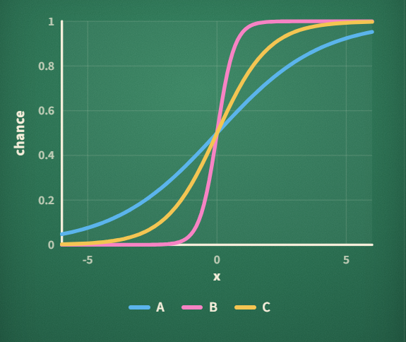

## The steepest curve

Each curve is $σ(θx)$ for a different weight θ. Which curve has the biggest θ?

A. A

B. B

C. C

#### **Answer:**  Option B. B

---

**Explanation**

**The idea**
Bigger weights make sharper, more confident predictions.

**Solution**
B, the steepest. Its weight is 3, so a small step in x moves the weighted sum a lot, and the chance swings from near 0 to near 1 over a short range. C has weight 1 and A, the flattest, has weight 0.5. A bigger weight makes the model more sure of itself away from 50%.

