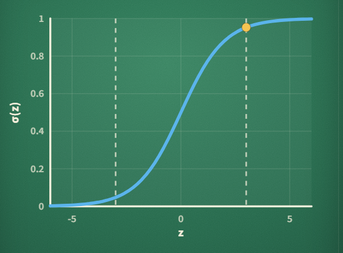
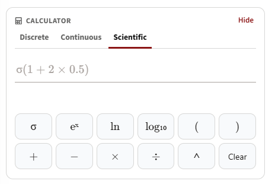

## Mirror image

$σ(3)≈0.953$. What is $σ(−3)$? Give your answer to three decimal places.

#### **Answer:**  0.047

---

**Explanation**

**The idea**

$σ(−z)=1−σ(z)$.

**Solution**

The sigmoid is symmetric: 
$σ(−z)=1−σ(z)$, so $σ(−3)≈1−0.953=0.047$. Flipping the sign of the weighted sum flips which outcome it favors.
