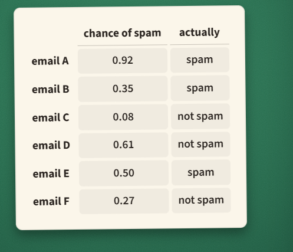
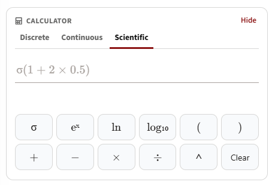

## How many did it get right?

A spam filter labels an email spam when its chance of spam is 0.5 or more. How many of these six emails does it label correctly?

#### **Answer:**  4 emails

---

**Explanation**

**The idea**
A threshold turns probabilities into decisions.

**Solution**

A (0.92) and E (exactly 0.50) are labeled spam and are spam. C (0.08) and F (0.27) are labeled not spam and are not. B (0.35) is spam the filter missed, and D (0.61) is a false alarm. That is 4 of 6.