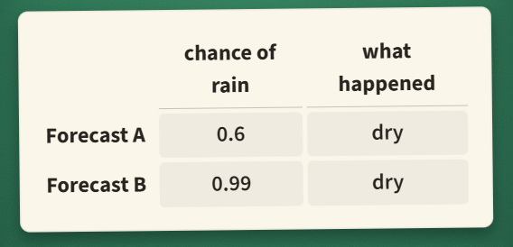

## Which mistake costs more?

Two forecasts gave a day that stayed dry these chances of rain: Forecast A said 0.6, and Forecast B said 0.99.

Which forecast’s score takes the bigger hit from this day?

A. Forecast A

B. Forecast B

C. The same hit

#### **Answer:** Option B. Forecast B

---

**Explanation**

**The idea**
A score punishes confident mistakes most.

**Solution**
Forecast B, by far. A gave "dry" a chance of 
$1−0.6=0.4$, so its score adds 
$log _{10} 0.4≈−0.40$. B gave "dry" only 0.01 and adds 
$log_{10} 0.01 = −2$: five times the hit for the same mistake.

The log punishes confident mistakes hardest, which pushes a fitted model to stay humble when its evidence is weak.

