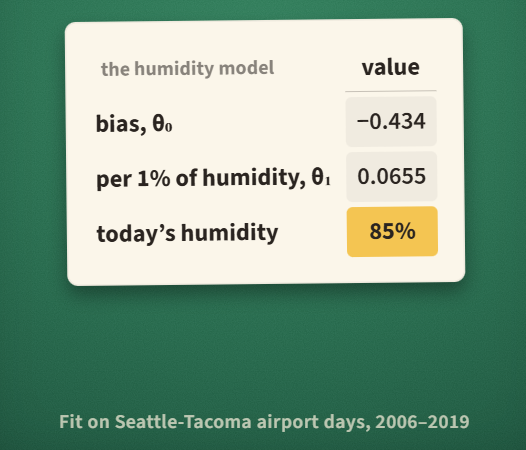
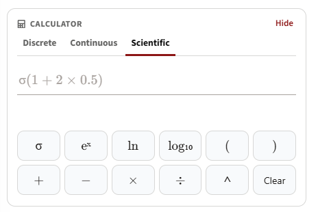

## After a humid day

A logistic regression model gives each Seattle day a chance of rain tomorrow from one feature, $x_1$, the day’s humidity minus 70%. A 90% day has $x_1=20$. Its fitted parameters are $θ_0 =−0.434$ and $θ_1=0.0655$. The weighted sum is $z=θ _0 +θ _1 x_1$, and the chance is $σ(z)= \frac{1}{1+e^{-z}}$.

Today was 85% humid. What chance of rain does the model give tomorrow? Give your answer to three decimal places.

#### **Answer:** 0.633788

---

**Explanation**

**The idea**
Feature in, weighted sum, σ, chance out.

**Solution**

Today’s feature is $x_1=85−70=15$, so the weighted sum is

$$
z=−0.434+0.0655×15=0.5485
$$,

and the chance is

 $$σ(0.5485)= \frac{1}{1+e^{-0.5485}}≈0.634.$$

About 63 in 100. A 70% day has $x_1=0$ and gets only $σ(−0.434)≈0.393$, so the extra humidity adds a lot.

