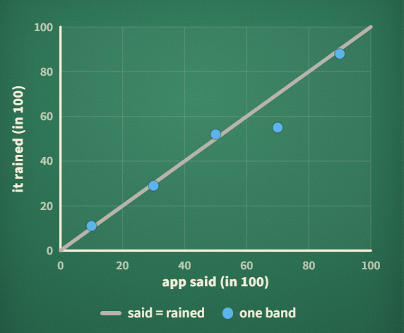

## Where did it overpromise?

Suppose a weather app’s chances of rain are sorted into five bands by what it said, with about 300 days in each band. Each dot shows what the app said in that band and how often it actually rained.

In which band did the app overpromise rain?

A. Said 10

B.Said 30

C. Said 50

D. Said 70

E. Said 90

#### **Answer:** Option D: Said 70

---

**Explanation**

**The idea**
Below the line of a calibration chart, the model promised more than happened.

**Solution**

Said 70. On days the app said about 70 in 100, it rained on only 55 in 100. That dot sits below the line, so the app promised more rain than fell.

The other four dots sit close to the line, so in those bands the app’s chances mean what they say. That is what calibrated means: when it says $p, p$ happens.

