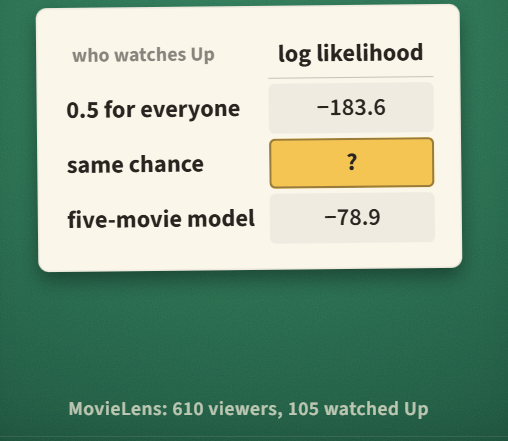
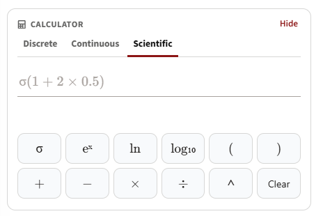

## The best single guess

Your teammate trained the movie model from the Logistic Regression lesson. It reads which of five movies each of 610 viewers watched and gives each viewer a chance of watching Up. Training started with every θ at 0, which gives every viewer 0.5. “Training raised the log likelihood from −183.6 to −78.9!” they say.

Is that impressive? Compare the model with a baseline that ignores the five movies and gives every viewer the same chance: the share of the 610 who watched Up. 105 of them did.

What is the baseline’s log likelihood, using 
$log_{10}$ as the lesson does? Give your answer to one decimal place. The calculator below has a log₁₀ key.

#### **Answer:** -121.66

---

**Explanation**

**The idea**
Judge a model against the best single guess, not against 50-50.

**Solution**

The baseline gives every viewer 
$105÷610≈0.1721$. Each of the 105 who watched Up adds 
$log_{10} 0.1721≈−0.7641$, and each of the other 505 adds $log_{10} 0.8279≈−0.0820$:

$$105×(−0.7641)≈−80.23$$

$$505×(−0.0820)≈−41.43$$

Together they make $−80.23−41.43≈−121.7$.

Line up the three scores: $0.5$ for everyone gets $−183.6$, the same chance gets $−121.7$, and the model gets −78.9. More than half of the climb from $−183.6$ comes from learning one fact: few viewers watch *Up*. The five movies earn the rest, from $−121.7$ to $−78.9$, and that is still a big step. This is why every model gets compared with a simple baseline.

Data: MovieLens (ml-latest-small), GroupLens Research, University of Minnesota.