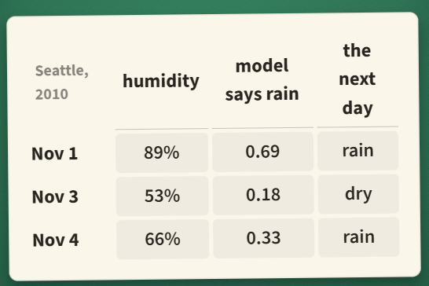

## Score three days

A logistic regression model that uses only humidity gave three November 2010 days in Seattle these chances of rain the next day. Its score on them is the log likelihood: add 
$log_{10}$ of the chance it gave what happened the next day.

What is the model’s score on these three days? Give your answer to three decimal places. The calculator below has a log₁₀ key.

#### **Answer:** -0.728823
---

**Explanation**

**The idea**
The score adds one log per day: the log of the chance the model gave what happened.

**Solution**

The day after Nov 1 brought rain, so the chance of what happened is 0.69. After Nov 3 it stayed dry: $1−0.18=0.82$. After Nov 4 it rained: 0.33. The score adds their logs:

$$log_{10} 0.69≈−0.1612$$

$$log_{10} 0.82≈−0.0862$$

$$log_{10} 0.33≈−0.4815$$

Together they make $−0.729$. The day after Nov $4$ lowers the score most: the model gave that rain only $33$ in $100$.