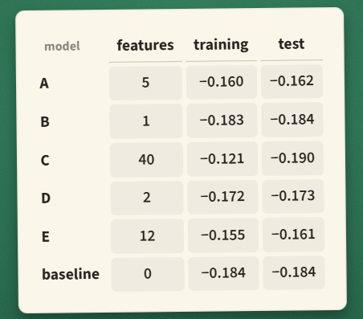

## Which model overfits?

Suppose a hospital builds five models that predict whether a patient comes back within 30 days of going home. Each model trains on the years 2015 to 2021, the training set. After training, the team opens the test set, 2022 and 2023, once.

Each score is an average log likelihood: the average, over patients, of $log_10$ of the chance the model gave what happened. Higher is better. The last row is a baseline, not a model: it gives every patient the same chance.

Which model is overfitting?

A. Model A

B. Model B

C. Model C

D. Model D

E. Model E

#### **Answer:** Model C
---

**Explanation**

**The idea**
Overfitting shows up as a gap: much better on the training set than on the test set.

**Solution**

Model C. Its training score, −0.121, is far better than its test score, −0.190. Its 40 features let it fit quirks of the training years that don’t come back in 2022 and 2023. On the test set it does worse than giving every patient the same chance (−0.184).

Model B is not overfitting either: its training and test scores are almost equal. Its one feature says almost nothing about who comes back, so it only ties the baseline on the test set. A, D and E score about as well on the test set as on the training set, and all three beat the baseline.