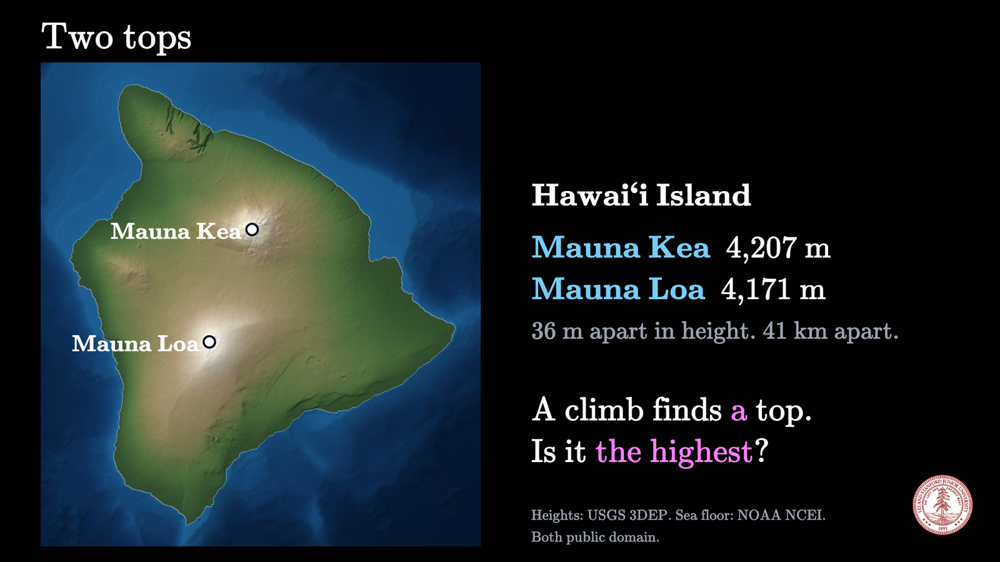
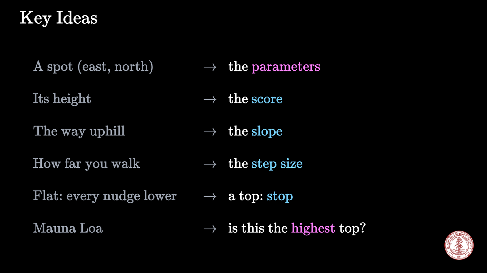
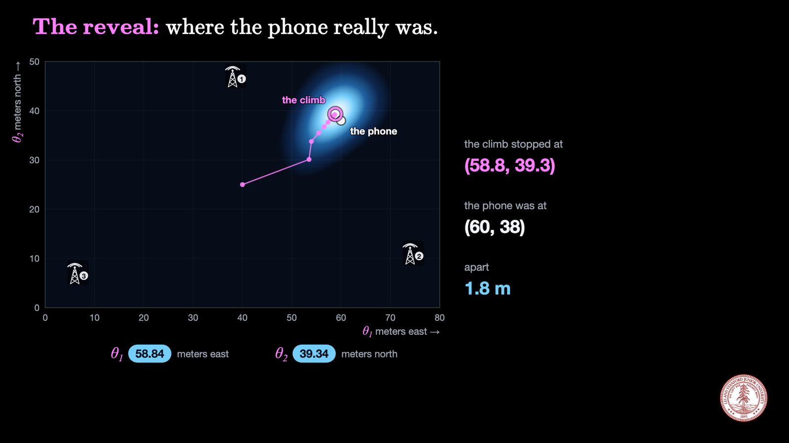
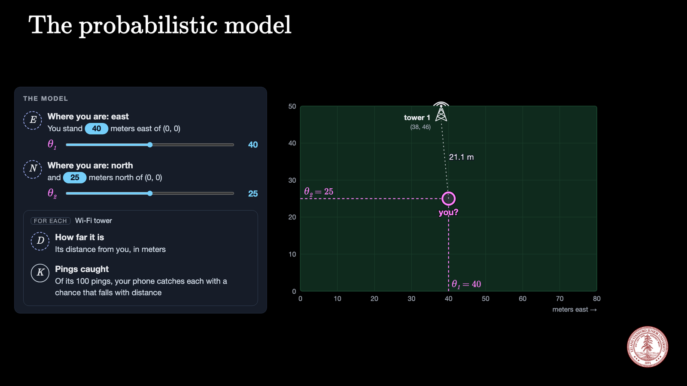
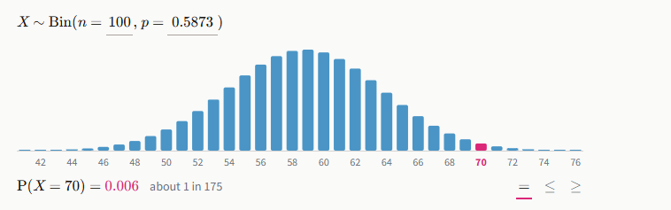
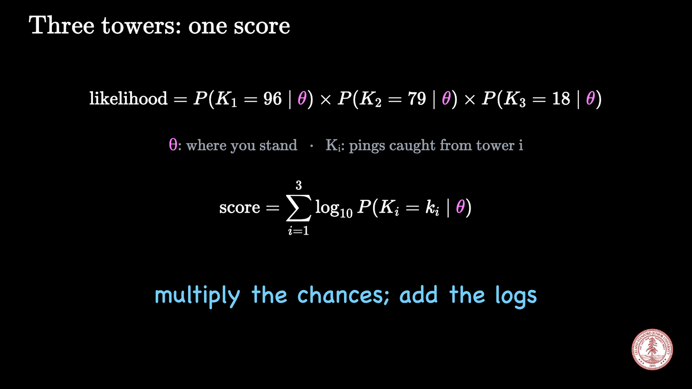
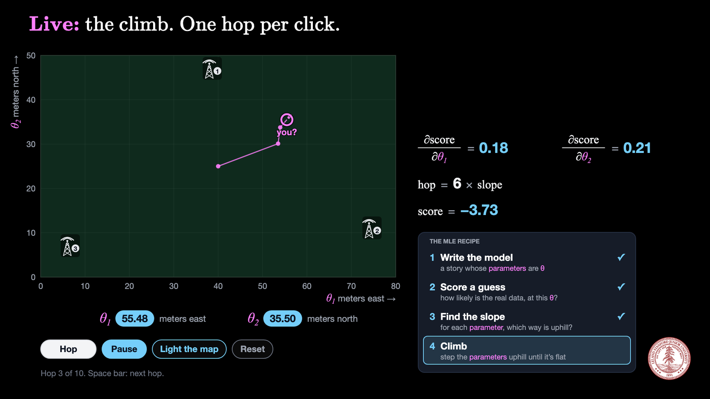

## Section 3 Key: Where Am I?

Today you did what every model in this course does when it learns: you climbed. This key walks through what we did and why, one step at a time, in words and pictures. If you like formulas, they are all in a box at the end, "The deep math, in case you're curious." You don't need the box to understand any of this.

### Part 1: Find the top in the fog

**What we did.** A real island was hidden under fog, and the whole room shared 7 readings. Each reading told us the height at one spot. A navigator picked each spot while everyone else made the case, out loud, for where to go next.

**What was under the fog.** Round 1 was Hawaiʻi Island, and it has two tops. Mauna Kea, 4,207 m, is the highest. Mauna Loa, 4,171 m, is only 36 m lower and 41 km away. Climbing uphill always takes you to a top, but which top depends on where you start. That is why scouting a faraway spot can be worth a reading.

Round 2 was East Maui, with one top: Haleakalā, 3,051 m. This time every reading also came with an arrow pointing uphill. With the arrows, you know which way to step instead of guessing, and the arrows get shorter as the ground flattens near the top. When there is no uphill left, you are standing on a top, so you stop.

**Why it matters.** The game is exactly how a computer learns. The spot you pick is the computer's parameters. The height is the score. The arrow is the slope. How far you walk is the step size. And "flat in every direction" is how it knows to stop.

### Part 2: Where am I?

**The puzzle.** Your phone is somewhere on a lawn 80 m east by 50 m north. Three Wi-Fi towers each send 100 pings, and the farther away you are, the fewer pings get through. Your phone caught these:

| Tower | Where it stands (east, north) | Pings caught (of 100) |
| --- | --- | --- |
| 1 | (38, 46) | 96 |
| 2 | (74, 10) | 79 |
| 3 | (6, 6) | 18 |

**The answer:** About 58.8 m east and 39.3 m north. The phone was really at (60, 38), less than 2 m away. We found it from three numbers\!

Here is how we got there. It is the recipe from the slides, one step at a time.

#### Step 1: Write the model

The model is a story of how the pings were made. It has two parameters, the things we don't know: how far east you stand (θ₁) and how far north (θ₂). The story goes like this:

1. Pick a spot where you might be.
2. Each tower is some distance from that spot.
3. The farther the tower, the smaller the chance each ping gets through. That is physics: radio signals weaken as they travel.
4. Each tower sends 100 pings, each one caught or missed with that chance, so the number caught is a binomial.

The pink ring on the slide says "you?" with a question mark, because it is a guess, not where you really are.

#### Step 2: Score a guess

To score a guess, ask: if I really stood here, how likely is what my phone actually caught? Try the guess (70, 20). Tower 1 is 41.2 m away from it, so each of its pings gets through with chance 0.59. The number caught out of 100 is then Binomial(100, 0.59). Here are its bars. Click around: most of the time you would catch around 59.

The real count was 96, way out on the right, where the bar is too small to see. Its chance is about 7 in a billion billion (7.4 × 10⁻¹⁸). That chance is the likelihood, and it is our score for the guess. A tiny likelihood is the data telling us: probably not here.

Chances this small are hard to say out loud, so we take the log base 10 and get −17.13. Scores come out negative, and higher is still better: −3 beats −17. Every step up by 1 means the real data is 10 times more likely.

With all three towers, a guess gets three chances, one per tower. The towers ping on their own, so we multiply the chances, and the score adds up their logs. A good guess is one that makes all three real counts likely at once.

#### Step 3: Find the slope

Which way should we step? In section we asked the Code Agent, and it gave us the slope: one number for each parameter. At the guess (40, 25) it says 2.25 for east and 0.85 for north. Both are positive, so east and north are both uphill, and east is steeper.

Here is the idea behind its formula, in words. Each tower pulls or pushes. Tower 3 caught only 18 pings, but from (40, 25) we would expect about 64, so we must be too close to it: it pushes us away, toward the east. A tower that caught more pings than we expected pulls us toward it.

#### Step 4: Climb

Each hop is the step size, 6, times the slope. The first hop goes 6 × 2.25 = 13.5 m east and 6 × 0.85 = 5.1 m north, and the score jumps from −23.41 to −6.23. Then we ask for the slope again, and hop again.

The step size never changes, but the hops get smaller and smaller, because the hill flattens near its top. After 10 hops the next one would be shorter than 10 cm, so we stop at (58.84, 39.34). One meter away in any direction, the score is lower: we are on top.

**Why not exactly on the phone?** The pings are random. Three counts point to a spot within a couple of meters, not to the exact centimeter. Another 300 pings from the same phone would put the top somewhere else nearby.

### The recipe

When we asked "What are the main steps to find the phone?", this is the answer the room was reaching for. It is called maximum likelihood, and it is how the models in this course learn:

1. Write the model: a story whose parameters are θ.
2. Score a guess: how likely is the real data, at this θ?
3. Find the slope: for each parameter, which way is uphill?
4. Climb: step the parameters uphill until it is flat.

#### Exit ticket
1. Higher score: better or worse? **Better**. The score is how likely the real pings are from your guess.
2. Tower 1 caught 96 of 100. Is your phone near it or far? **Near**. When you are close to a tower, almost all of its pings arrive.
3. Every nudge reads lower. Hop or stop? **Stop**. You are on a top.

#### Things that trip people up
* Both scores are negative, so which is better? The higher one, closer to 0: −3 beats −17.
* The three towers' chances multiply. It is their logs that add.
* A hop is the step size times the slope: a slope of 0.85 means a hop of 6 × 0.85 = 5.1 m, not 0.85 m.
* A top is not always the highest top. In the fog, Mauna Loa was a real top, but not the highest one.

#### If you want to keep going

**Why does a phone need three towers?** With only tower 1, every spot at the same distance from it gets the same score: a whole ring of equally good guesses. Two towers leave two spots where their rings cross. The third tower picks one.

**What if the step size were 60?** The first hop would be 135 m east, right off the lawn. A step that is too big jumps past the top; one that is too small takes forever.

The deep math, in case you're curious

Nothing in this box is something you need to memorize or compute by hand. It is here for anyone who wants to see what the computer is doing.

The model. Tower $i$ stands at $(x_i,y_i)$. Your distance to it, the chance each ping gets through, and the count caught are

$$
D_i=\sqrt{(\theta_1-x_i)^2+(\theta_2-y_i)^2},\quad
c(D)=\frac{1}{1+(D/45)^4},\quad
K_i\sim\operatorname{Bin}(100,c(D_i))
$$

Half of the pings get through at 45 m.

One tower's likelihood. From (70, 20), tower 1 is $\sqrt{32^2+26^2}\approx41.2$ m away, so $c\approx0.587$, and

$$
P(K_1=96\mid\theta)=
\binom{100}{96}(0.587)^{96}(0.413)^4
\approx7.4\times10^{-18}
$$

$$
\log_{10}(7.4\times10^{-18})\approx-17.13
$$

Three towers. The towers ping independently, so the likelihood is a product and its log is a sum. With the real counts $k_1,k_2,k_3=96,79,18$:

$$
\text{score}(\theta)=
\sum_{i=1}^{3}\log_{10}P(K_i=k_i\mid\theta)
$$

Some scores: (70, 20) is −49.16, the start (40, 25) is −23.41, the phone's true spot (60, 38) is −3.18, and the top (58.84, 39.34) is −2.94.

The slope. The Code Agent's formula, for each parameter (the same for $\theta_2$ with $\theta_2-y_i$):

$$
\frac{\partial\,\text{score}}{\partial\theta_1}
=
\frac{4}{\ln 10}
\sum_{i=1}^{3}
\frac{(100c(D_i)-k_i)(\theta_1-x_i)}{D_i^2}
$$

$100c(D_i)$ is the number of pings you would expect from tower $i$, and $4/\ln 10\approx1.74$. At (40, 25) the three towers give −0.00 + 0.46 + 1.79 = 2.25 east and 0.05 − 0.20 + 1.00 = 0.85 north.

Every hop of the climb. Each hop is $\theta_{\text{new}}=\theta+6\times\partial\,\text{score}/\partial\theta$, with each slope rounded to 2 decimals as the slide shows it:

| Hop | Position (east, north) | Score | Slope (east, north) |
| --- | --- | --- | --- |
| 0 | (40.00, 25.00) | −23.41 | (2.25, 0.85) |
| 1 | (53.50, 30.10) | −6.23 | (0.08, 0.61) |
| 2 | (53.98, 33.76) | −4.50 | (0.25, 0.29) |
| 3 | (55.48, 35.50) | −3.73 | (0.18, 0.21) |
| 4 | (56.56, 36.76) | −3.33 | (0.13, 0.15) |
| 5 | (57.34, 37.66) | −3.12 | (0.09, 0.11) |
| 6 | (57.88, 38.32) | −3.02 | (0.07, 0.07) |
| 7 | (58.30, 38.74) | −2.97 | (0.04, 0.05) |
| 8 | (58.54, 39.04) | −2.95 | (0.03, 0.03) |
| 9 | (58.72, 39.22) | −2.95 | (0.02, 0.02) |
| 10 | (58.84, 39.34) | −2.94 | (0.01, 0.01) |

The next hop would be 8 cm, under the 10 cm stop. One meter east, west, north and south of the top the score is −2.98, −3.01, −2.98 and −3.00. The very best spot on a fine grid is (59.05, 39.50), 0.26 m from where the climb stopped.

The deep math, in case you're curious

Nothing in this box is something you need to memorize or compute by hand. It is here for anyone who wants to see what the computer is doing.

**The model.** Tower $i$ stands at $(x_i, y_i)$. Your distance to it, the chance each ping gets through, and the count caught are

$$D_i = \sqrt{(\theta_1 - x_i)^2 + (\theta_2 - y_i)^2}, \qquad c(D) = \frac{1}{1 + (D/45)^4}, \qquad K_i \sim \operatorname{Bin}(100,\ c(D_i))$$

Half of the pings get through at 45 m.

**One tower's likelihood.** From (70, 20), tower 1 is $\sqrt{32^2 + 26^2} \approx 41.2$ m away, so $c \approx 0.587$, and

$$\operatorname{P}(K_1 = 96 \mid \theta) = \binom{100}{96}\, 0.587^{96}\, (0.413)^{4} \approx 7.4 \times 10^{-18}, \qquad \log_{10}\left(7.4 \times 10^{-18}\right) \approx -17.13$$

**Three towers.** The towers ping independently, so the likelihood is a product and its log is a sum. With the real counts $k_1, k_2, k_3 = 96, 79, 18$:

$$\text{score}(\theta) = \sum_{i=1}^{3} \log_{10} \operatorname{P}(K_i = k_i \mid \theta)$$

Some scores: (70, 20) is −49.16, the start (40, 25) is −23.41, the phone's true spot (60, 38) is −3.18, and the top (58.84, 39.34) is −2.94.

**The slope.** The Code Agent's formula, for each parameter (the same for $\theta_2$ with $\theta_2 - y_i$):

$$\frac{\partial\, \text{score}}{\partial \theta_1} = \frac{4}{\ln 10} \sum_{i=1}^{3} \frac{(100\, c(D_i) - k_i)(\theta_1 - x_i)}{D_i^2}$$

100 c(D_i) is the number of pings you would expect from tower i, and 4/ln 10 ≈ 1.74. At (40, 25) the three towers give −0.00 + 0.46 + 1.79 = 2.25 east and 0.05 − 0.20 + 1.00 = 0.85 north.

**Every hop of the climb.** Each hop is $\theta_{\text{new}} = \theta + 6 \times \partial\,\text{score}/\partial\theta$, with each slope rounded to 2 decimals as the slide shows it:

* Hop 0: (40.00, 25.00), score −23.41, slope (2.25, 0.85)
* Hop 1: (53.50, 30.10), score −6.23, slope (0.08, 0.61)
* Hop 2: (53.98, 33.76), score −4.50, slope (0.25, 0.29)
* Hop 3: (55.48, 35.50), score −3.73, slope (0.18, 0.21)
* Hop 4: (56.56, 36.76), score −3.33, slope (0.13, 0.15)
* Hop 5: (57.34, 37.66), score −3.12, slope (0.09, 0.11)
* Hop 6: (57.88, 38.32), score −3.02, slope (0.07, 0.07)
* Hop 7: (58.30, 38.74), score −2.97, slope (0.04, 0.05)
* Hop 8: (58.54, 39.04), score −2.95, slope (0.03, 0.03)
* Hop 9: (58.72, 39.22), score −2.95, slope (0.02, 0.02)
* Hop 10: (58.84, 39.34), score −2.94, slope (0.01, 0.01)

---

| Hop | Position (east, north) | Score | Slope (east, north) |
| :--- | :--- | :--- | :--- |
| **0** | (40.00, 25.00) | −23.41 | (2.25, 0.85) |
| **1** | (53.50, 30.10) | −6.23 | (0.08, 0.61) |
| **2** | (53.98, 33.76) | −4.50 | (0.25, 0.29) |
| **3** | (55.48, 35.50) | −3.73 | (0.18, 0.21) |
| **4** | (56.56, 36.76) | −3.33 | (0.13, 0.15) |
| **5** | (57.34, 37.66) | −3.12 | (0.09, 0.11) |
| **6** | (57.88, 38.32) | −3.02 | (0.07, 0.07) |
| **7** | (58.30, 38.74) | −2.97 | (0.04, 0.05) |
| **8** | (58.54, 39.04) | −2.95 | (0.03, 0.03) |
| **9** | (58.72, 39.22) | −2.95 | (0.02, 0.02) |
| **10** | (58.84, 39.34) | −2.94 | (0.01, 0.01) |

---

The next hop would be 8 cm, under the 10 cm stop. One meter east, west, north and south of the top the score is −2.98, −3.01, −2.98 and −3.00. The very best spot on a fine grid is (59.05, 39.50), 0.26 m from where the climb stopped.

