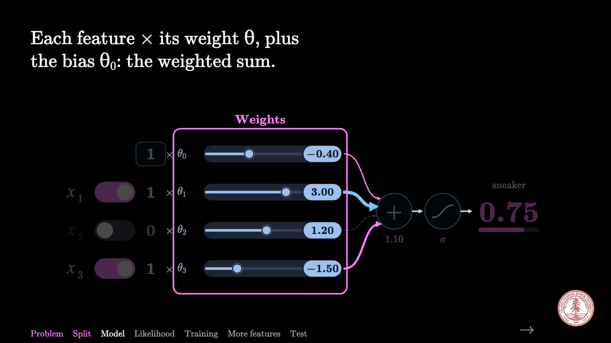
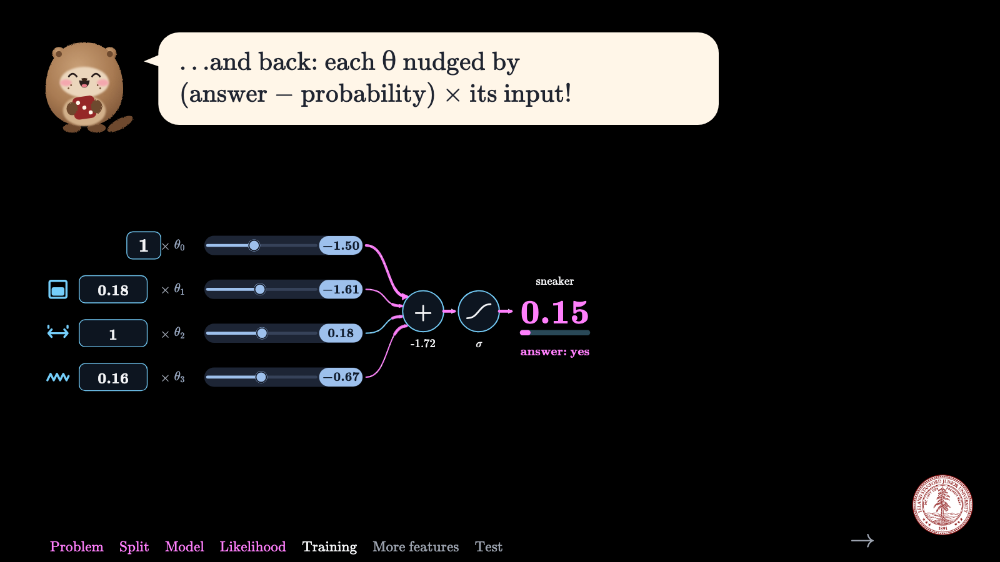
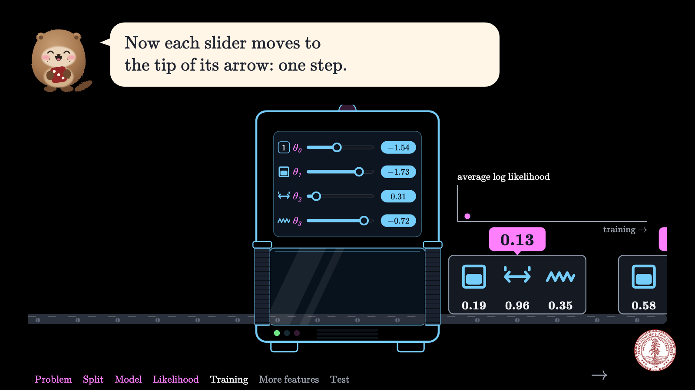
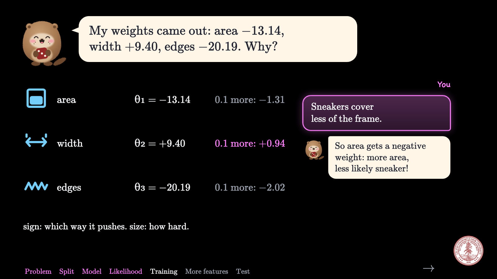
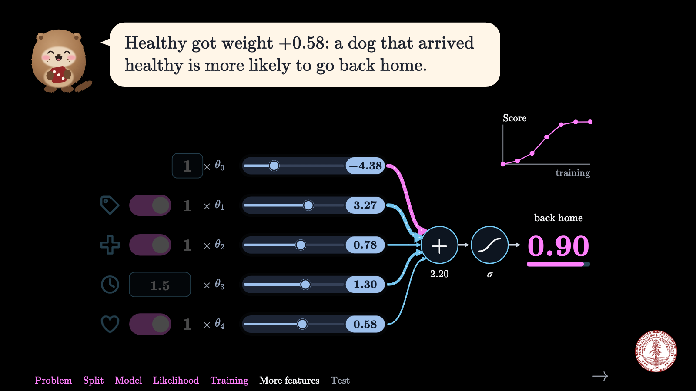
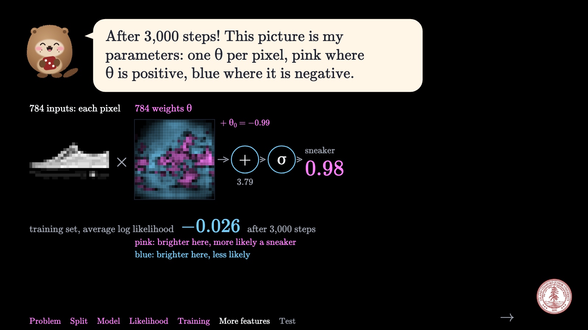
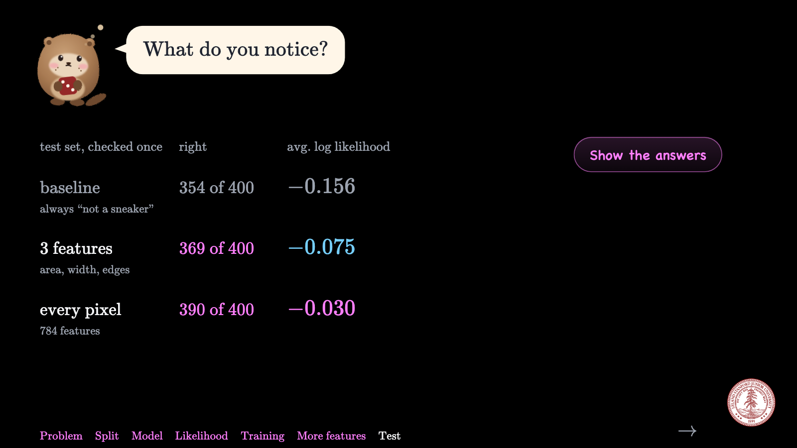
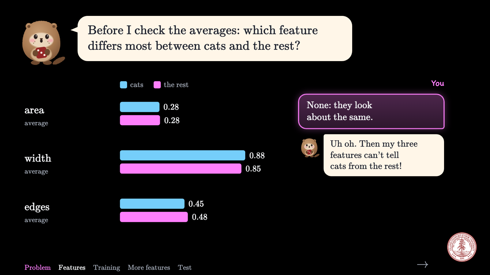

## Section 4 Key: Teach Ollie

Today the room taught Ollie to build a logistic regression model, end to end. This key walks through what each slide did and why, with every number the slides show, the right answer to every question Ollie asks, and a box of the math at the end for anyone who wants it. The three problems follow the same steps, so the walk-through uses sneakers for its pictures and gives the other two problems' numbers beside them.

### The three problems

Each is a yes-or-no question with 2,000 labeled examples. The room picked one; a second run on another problem is shorter and asks different questions.

<table border="1" cellpadding="10" cellspacing="0" style="border-collapse: collapse; width: 100%;">
  <thead>
    <tr style="background-color: #f8f9fa;">
      <th style="border: 1px solid #dddddd; text-align: left;"><b>Problem</b></th>
      <th style="border: 1px solid #dddddd; text-align: left;"><b>Data</b></th>
      <th style="border: 1px solid #dddddd; text-align: left;"><b>Yes means</b></th>
      <th style="border: 1px solid #dddddd; text-align: left;"><b>Ollie's three features</b></th>
      <th style="border: 1px solid #dddddd; text-align: left;"><b>Training / test</b></th>
    </tr>
  </thead>
  <tbody>
    <tr>
      <td style="border: 1px solid #dddddd; vertical-align: top;">Is it a sneaker?</td>
      <td style="border: 1px solid #dddddd; vertical-align: top;">2,000 photos from Zalando's catalog, 28 by 28 pixels</td>
      <td style="border: 1px solid #dddddd; vertical-align: top;">A sneaker</td>
      <td style="border: 1px solid #dddddd; vertical-align: top;">Area, width, edges</td>
      <td style="border: 1px solid #dddddd; vertical-align: top;">1,600 / 400</td>
    </tr>
    <tr>
      <td style="border: 1px solid #dddddd; vertical-align: top;">Is it a cat?</td>
      <td style="border: 1px solid #dddddd; vertical-align: top;">2,000 doodles from Quick, Draw!: a cat, a bear or a lion</td>
      <td style="border: 1px solid #dddddd; vertical-align: top;">A cat</td>
      <td style="border: 1px solid #dddddd; vertical-align: top;">Area, width, edges</td>
      <td style="border: 1px solid #dddddd; vertical-align: top;">1,604 / 396</td>
    </tr>
    <tr>
      <td style="border: 1px solid #dddddd; vertical-align: top;">Will this lost dog get back home?</td>
      <td style="border: 1px solid #dddddd; vertical-align: top;">2,000 stray dogs' records from the Austin Animal Center, 2013 to 2025</td>
      <td style="border: 1px solid #dddddd; vertical-align: top;">Its family came back for it</td>
      <td style="border: 1px solid #dddddd; vertical-align: top;">Named, fixed, age</td>
      <td style="border: 1px solid #dddddd; vertical-align: top;">1,568 / 432</td>
    </tr>
  </tbody>
</table>

**What "back home" means for the dogs.** Every dog in the data left the shelter. "Back home" means its own family came and reclaimed it; "new home" means it was adopted or sent to a partner shelter instead. A shelter that could tell on day one which dogs no one will come for could start finding those dogs a new family right away. That is why the question is worth answering.

#### Step 1: Set a test set aside

**What we did.** Before anything else, Ollie locked a test set away: 400 photos, 396 doodles or 432 dogs, about a fifth of the data, chosen at random. Training uses only the rest.

**Why it matters.** The test set is the model's exam, with questions it has never seen. A model can memorize its training set, so a score on the training set says less than a score on new data. And the test set is opened once, at the end. Check it after every change and you are tuning to it, and it is not new anymore. That is the answer to Ollie's last question before the test: *yes, once, at the end.*

#### Step 2: The model

**What we did.** This is the one part the section leader teaches, with Ollie off the slide. It is Lesson 8's machine. A 1 that is always on and the three features go in. Each is multiplied by its own weight θ, and the four products add up to the weighted sum. The squash, σ, turns that sum, which can be any number, into a number between 0 and 1. That number is the probability of "yes": the chance this photo is a sneaker, this doodle a cat, this dog going back home. 0.75 means that about 3 in 4 examples like this one are a "yes" and 1 in 4 is not.

**Ollie's five questions, and the right answers:**

1. **What are the weights?** How much each feature counts, and which way it pushes.
2. **What does a negative weight do?** When its feature is on, it pushes the chance down. That feature is a clue for "no".
3. **Do the weights need to be between 0 and 1?** No. A weight can be any number: big, small or negative. Only the output is a probability, and σ is what makes it one.
4. **What is the 1 that is always on for?** It gives the bias θ₀: where the sum starts before any feature counts. θ₀ times a 1 that never changes is the machine's starting point.
5. **The sum can be any number. How is that a probability?** It is not, until σ squashes it. A sum of 6 comes out near 1, a sum of −6 near 0, and 0 comes out as exactly 0.5.

#### Step 3: The features

**What we did.** Ollie measures three numbers on every example. For the photos and doodles: area, the share of the frame the item covers; width, the share of the frame's width it spans; and edges, how much the brightness jumps between neighboring pixels. For the dogs: named, 1 if the dog came with a name (a tag or a chip told the shelter); fixed, 1 if it was already spayed or neutered; and age, its years divided by 10, so a 6-year-old is 0.6.

**Why it matters.** Features are a choice, and the choice decides what the model can learn. The three photo features were chosen to be simple, not good, and on cats they turn out to be a poor choice (see the weights below). Every pixel, later, is a much bigger choice: 784 features instead of 3.

With every θ at 0, the machine says 0.5 for everything. Ollie's first guess at θ is a few training steps in: 0.15 for the first sneaker photo, 0.50 for the first cat doodle, 0.67 for the first dog.

#### Step 4: Score θ with the likelihood

**What we did.** How do we know if a θ is any good? For each training example, take the probability the machine gives to its real label: p if the answer was yes, 1 − p if it was no. Multiply them all. That product is the likelihood: how likely the training data is under this θ. Higher is better.

**Why logs.** 1,600 chances multiplied is a number far too small to read, so we take logs and the product becomes a sum. The score on the slides is the average log likelihood over the training set, in log base 10 as last week. It is always negative, because each chance is below 1; 0 would be perfect, and closer to 0 is better. Ollie's first guesses scored −0.125 on sneakers, −0.300 on cats and −0.237 on dogs.

#### Step 5: Which way is uphill

**What we did.** Last week the slope said which way to step. The same here: the derivative of the log likelihood with respect to each θ says which way is uphill for that weight. The slide sends one photo forward through the machine, reads its probability, and comes back: each θ is nudged by (answer − probability) × its input. For the photo shown, the answer was yes (1) and the machine said 0.15, so every θ whose input was on moves up, in proportion to that input. A photo the machine already gets right barely moves anything.

#### Step 6: Climb

**What we did.** Gradient ascent, as last week: take a small step uphill, then another, and another. One pass sends every training example through the machine and grows an arrow on each θ slider, the average of all those nudges. One step moves each slider to the tip of its arrow. The learning rate sets how big the step is: 8 on sneakers, 3 on cats and dogs. After 2,048 steps the average log likelihood rose from −0.125 to −0.064 on sneakers, from −0.237 to −0.208 on dogs, and only from −0.300 to −0.295 on cats.

**The weights, and why they came out that way**

<table border="1" cellpadding="10" cellspacing="0" style="border-collapse: collapse; width: 100%;">
  <thead>
    <tr style="background-color: #f8f9fa;">
      <th style="border: 1px solid #dddddd; text-align: left;"><b>Problem</b></th>
      <th style="border: 1px solid #dddddd; text-align: left;"><b>Trained weights</b></th>
      <th style="border: 1px solid #dddddd; text-align: left;"><b>What they say</b></th>
    </tr>
  </thead>
  <tbody>
    <tr>
      <td style="border: 1px solid #dddddd; vertical-align: top;">Sneakers</td>
      <td style="border: 1px solid #dddddd; vertical-align: top;">area −13.14, width +9.40, edges −20.19</td>
      <td style="border: 1px solid #dddddd; vertical-align: top;">Sneakers are wider than the other items, so width pushes up. They cover less of the frame and have fewer sharp edges than a boot or a bag, so area and edges push down.</td>
    </tr>
    <tr>
      <td style="border: 1px solid #dddddd; vertical-align: top;">Cats</td>
      <td style="border: 1px solid #dddddd; vertical-align: top;">area −1.46, width +1.22, edges −3.22</td>
      <td style="border: 1px solid #dddddd; vertical-align: top;">Small weights, and a score that barely rose. Cats, bears and lions fill the frame about the same, so area, width and edges barely differ between cats and the rest. No weights can help much; the features are the problem.</td>
    </tr>
    <tr>
      <td style="border: 1px solid #dddddd; vertical-align: top;">Lost dogs</td>
      <td style="border: 1px solid #dddddd; vertical-align: top;">named +3.29, fixed +0.83, age +1.17</td>
      <td style="border: 1px solid #dddddd; vertical-align: top;">Dogs that went back home far more often came with a name: 96% of them, against 45% of the rest. A tag or a chip is how a family gets found. Fixed and older dogs are also more likely to be reclaimed.</td>
    </tr>
  </tbody>
</table>

 

Read a weight in two parts. Its sign says which way the feature pushes: positive toward "yes", negative toward "no". Its size says how hard. A big feature does not get a big weight just for being big: the weight is whatever makes the training data most likely.

#### Your own feature

**Photos and doodles.** The room clicks squares on a 7 by 7 grid over two averaged pictures, the average sneaker and the average of everything else, and the new feature is the brightness of the picked squares. Squares where the two averages differ make a useful feature; squares where they match do not. Ollie adds it as a fourth input and trains again from where he was. A pick that works for sneakers: row 4, column 7 (the toe) and row 5, column 1 (the heel), the two squares where a sneaker touches the frame's edges and nothing else does. On the test set it takes the model from 369 to 378 of 400 right and from −0.075 to −0.060. For cats: the top row's columns 3, 4 and 5 plus row 2, column 4, the gap between a cat's ears, which a bear's or lion's round head fills. Those squares are dark for cats and bright for the rest, so the feature gets a big negative weight, and the model goes from 236 to 307 of 396 right and from −0.291 to −0.224, close to every pixel's 319 and −0.206.

**Dogs.** The records have more columns than Ollie's three, and the room picks one to add: healthy (arrived in normal condition), city (found inside the City of Austin), since 2020, small breed, male, or a black coat. Healthy, when added, trained to +0.58: a dog that arrived healthy is more likely to go back home. The training score moved from −0.208 to −0.207, almost nothing. Whether a feature helped is decided on the test set, not here.

#### Every pixel

**What we did. What if every pixel were a feature?** Then the machine needs 785 θ: a weight for each of the 784 pixels, plus the bias. Training all of them at once works the same way. After 3,000 steps the picture of the weights shows what the machine learned: one θ per pixel, pink where θ is positive (a brighter pixel there means more likely a sneaker) and blue where it is negative. On sneakers the training score reached −0.026. The dog records have no pixels, so the dog run skips this.

#### The test, once, at the end

Each model sorts the test examples it has never seen: at 0.5 and up it says "yes". The baseline is a model with no features at all that always says the more common label. "Right" counts how many it called correctly; the average log likelihood is the same score as in training, on new data.

<table border="1" cellpadding="10" cellspacing="0" style="border-collapse: collapse; width: 100%;">
  <thead>
    <tr style="background-color: #f8f9fa;">
      <th style="border: 1px solid #dddddd; text-align: left;"><b>Sneakers, 400 test photos</b></th>
      <th style="border: 1px solid #dddddd; text-align: left;"><b>Right</b></th>
      <th style="border: 1px solid #dddddd; text-align: left;"><b>Avg. log likelihood</b></th>
    </tr>
  </thead>
  <tbody>
    <tr>
      <td style="border: 1px solid #dddddd; vertical-align: top;">Baseline: always "not a sneaker"</td>
      <td style="border: 1px solid #dddddd; vertical-align: top;">354 of 400</td>
      <td style="border: 1px solid #dddddd; vertical-align: top;">−0.156</td>
    </tr>
    <tr>
      <td style="border: 1px solid #dddddd; vertical-align: top;">3 features: area, width, edges</td>
      <td style="border: 1px solid #dddddd; vertical-align: top;">369 of 400</td>
      <td style="border: 1px solid #dddddd; vertical-align: top;">−0.075</td>
    </tr>
    <tr>
      <td style="border: 1px solid #dddddd; vertical-align: top;">Every pixel: 784 features</td>
      <td style="border: 1px solid #dddddd; vertical-align: top;">390 of 400</td>
      <td style="border: 1px solid #dddddd; vertical-align: top;">−0.030</td>
    </tr>
    <tr style="background-color: #f8f9fa;">
      <th style="border: 1px solid #dddddd; text-align: left;"><b>Cats, 396 test doodles</b></th>
      <th style="border: 1px solid #dddddd; text-align: left;"><b>Right</b></th>
      <th style="border: 1px solid #dddddd; text-align: left;"><b>Avg. log likelihood</b></th>
    </tr>
    <tr>
      <td style="border: 1px solid #dddddd; vertical-align: top;">Baseline: always "not a cat"</td>
      <td style="border: 1px solid #dddddd; vertical-align: top;">182 of 396</td>
      <td style="border: 1px solid #dddddd; vertical-align: top;">−0.301</td>
    </tr>
    <tr>
      <td style="border: 1px solid #dddddd; vertical-align: top;">3 features: area, width, edges</td>
      <td style="border: 1px solid #dddddd; vertical-align: top;">236 of 396</td>
      <td style="border: 1px solid #dddddd; vertical-align: top;">−0.291</td>
    </tr>
    <tr>
      <td style="border: 1px solid #dddddd; vertical-align: top;">Every pixel: 784 features</td>
      <td style="border: 1px solid #dddddd; vertical-align: top;">319 of 396</td>
      <td style="border: 1px solid #dddddd; vertical-align: top;">−0.206</td>
    </tr>
    <tr style="background-color: #f8f9fa;">
      <th style="border: 1px solid #dddddd; text-align: left;"><b>Lost dogs, 432 test records</b></th>
      <th style="border: 1px solid #dddddd; text-align: left;"><b>Right</b></th>
      <th style="border: 1px solid #dddddd; text-align: left;"><b>Avg. log likelihood</b></th>
    </tr>
    <tr>
      <td style="border: 1px solid #dddddd; vertical-align: top;">Baseline: always "new home"</td>
      <td style="border: 1px solid #dddddd; vertical-align: top;">214 of 432</td>
      <td style="border: 1px solid #dddddd; vertical-align: top;">−0.302</td>
    </tr>
    <tr>
      <td style="border: 1px solid #dddddd; vertical-align: top;">3 features: named, fixed, age</td>
      <td style="border: 1px solid #dddddd; vertical-align: top;">318 of 432</td>
      <td style="border: 1px solid #dddddd; vertical-align: top;">−0.228</td>
    </tr>
    <tr>
      <td style="border: 1px solid #dddddd; vertical-align: top;">3 features + healthy</td>
      <td style="border: 1px solid #dddddd; vertical-align: top;">318 of 432</td>
      <td style="border: 1px solid #dddddd; vertical-align: top;">−0.227</td>
    </tr>
  </tbody>
</table>

**What to notice.** Every model beats the baseline. On the photos and doodles, every pixel does best on new examples too, so 785 weights did not just memorize the training set here. The three features that barely helped on cats in training barely help on the test set either: a poor feature does not get better with more training. The room's own feature counts as a help only if its test score rose; healthy raised the dogs' log likelihood by 0.001 and changed no calls, which is honest to report as "about the same". A row where the room's squares did not appear means the room skipped that slide.

#### The second run: three bets

On a second problem Ollie does what the room taught him (test set first, train, every pixel, test once at the end) and asks three questions instead, each answered by that problem's own numbers.

1. **Which feature differs most between the "yes" examples and the rest?** Sneakers: area, 0.27 for sneakers against 0.45 for the rest. Cats: none, they look about the same, and that is the right tile. Dogs: named, 0.96 against 0.45. The slide reveals the averages after the pick.

2. **Will the weight for that feature come out positive or negative?** Sneakers: negative for area (sneakers cover less of the frame). Dogs: positive for named (dogs that went back home more often came with a name). Training then shows the weight moving that way. Cats skip this bet: no feature differs, so there is nothing to predict, and Ollie just trains.

3. **Which problem was harder for the machine?** Ollie compares the share each problem's best model got right on its test set: sneakers 390 of 400 (about 98%), cats 319 of 396 (81%), lost dogs 318 of 432 (74%). The lowest share is the hardest. If two are within 3 points, "about the same" is right. Lost dogs are hardest because a record with three or four columns says less about a dog than 784 pixels say about a shoe.

**Every question on the slides, with its right tile**

* **Where should I start?** Separate your data into a training set and a test set.
* **Why does keeping a test set aside matter?** To check the model on examples it has never seen.
* **What are the weights?** How much each feature counts, and which way it pushes.
* **What does a negative weight do?** When its feature is on, it pushes the chance down.
* **Do the weights need to be between 0 and 1?** No. A weight can be any number: big, small or negative.
* **What is the 1 that is always on for?** It gives the bias θ₀: where the sum starts before any feature counts.
* **The sum can be any number. How is that a probability?** σ squashes any number to one between 0 and 1.
* **How do I know if my θ are any good?** Multiply each chance of the real label: the likelihood.
* **1,600 chances multiplied. Won't that get tiny?** Take logs: multiplying becomes adding.
* **Which way should I move my four θ to raise it?** The derivative says which way is uphill.
* **How do I find the best θ?** Take a small step uphill, then another, and another.
* **My weights came out this way. Why?** Sneakers cover less of the frame, or sneakers are wider (both are right for sneakers). Dogs that went back home more often came with a name. On cats the question is instead why the score barely rose: area, width and edges barely differ between cats and the rest.
* **How many θ would every pixel need?** 785: a weight for each of the 784 pixels, plus the bias.
* **Can I check my models on the test set now?** Yes: once, at the end.
* **What do you notice?** They all beat the baseline. Every pixel does best on new photos. "Your feature helped" is right only when its test score rose. "More features always overfit" is never right.
* **Second run: which feature differs most, which way its weight goes, which problem was harder.** See the three bets above.

**Things that trip people up**

* Both scores are negative, so which is better? The higher one, closer to 0: −0.075 beats −0.156.
* A weight is not a probability. Weights can be −20.19 or +9.40. Only the machine's output is a probability, and σ makes it one.
* A big weight does not mean a big feature. Area and width are both shares between 0 and 1; area got −13.14 because that is what makes the data most likely.
* "Right" and the log likelihood can disagree. Healthy left the dogs' count of right calls unchanged and still raised the log likelihood a little: the probabilities moved, but none crossed 0.5.
* The three features did not fail on cats because of too few steps or too small a learning rate. The averages match, so no θ can separate the groups. The fix is better features.
* The second run's "none, they look about the same" tile is a real answer, and on cats it is the right one.

**If you want to keep going**

Why does the dog machine never get everything right? Two dogs can have the same record, named and fixed and 5 years old, and one goes back home while the other does not. The best any model with these features can do is say 0.9 for both. More columns would help only if they carry something the first three do not; healthy barely did.

What about three kinds, cat, bear and lion? One machine per kind, each with its own yes-or-no question, and the biggest probability wins: say they give 0.72, 0.21 and 0.09, so it is a cat. And a real photo, 4,000 by 3,000? Twelve million pixels is twelve million features. That is where next week starts.

**The deep math, in case you're curious**

Nothing in this box is something you need to memorize or compute by hand. It is here for anyone who wants to see what the computer is doing.

The model. For an example with features $x_1, x_2, x_3$ and the always-on $x_0 = 1$, the machine computes

$$z = \theta_0 + \theta_1 x_1 + \theta_2 x_2 + \theta_3 x_3, \quad p = \sigma(z) = \frac{1}{1 + e^{-z}}$$

$p$ is the probability that the label $y$ is 1. $\sigma(0) = 0.5$, $\sigma(6) \approx 0.998$, $\sigma(-6) \approx 0.002$.

**The score.** For $n$ training examples, the chance of each one's real label is $p_i$ if $y_i = 1$ and $1 - p_i$ if $y_i = 0$. The likelihood is their product; the slides show its log, averaged:

$$LL(\theta) = \frac{1}{n} \sum_{i=1}^{n} \left[ y_i \log_{10} p_i + (1 - y_i) \log_{10}(1 - p_i) \right]$$

**The slope.** The derivative with respect to each weight is the average, over the training set, of (answer − probability) times that weight's input (the slides climb the natural-log version of the score, which has the same top; the log base 10 only scales it):

$$\frac{\partial LL}{\partial \theta_j} = \frac{1}{n} \sum_{i=1}^{n} (y_i - p_i) x_{ij}$$

For the bias, $x_{i0} = 1$, so its slope is the average of (answer − probability) alone. This is the "forward and back" slide: one example's nudge is $(y_i - p_i)\, x_{ij}$, and a pass averages the nudges of every example.

**The climb.** Gradient ascent with learning rate $\eta$ (8 on sneakers, 3 on cats and dogs), for 2,048 steps:

Every pixel is the same model with 784 features, each pixel's brightness as a number between 0 and 1, and 785 θ, run for 3,000 steps.

$$\theta_j \leftarrow \theta_j + \eta \frac{\partial LL}{\partial \theta_j}$$

**The baseline.** A model with only $\theta_0$ and no features. Its best $p$ is the share of "yes" in the training set, and its test score is what any feature has to beat.