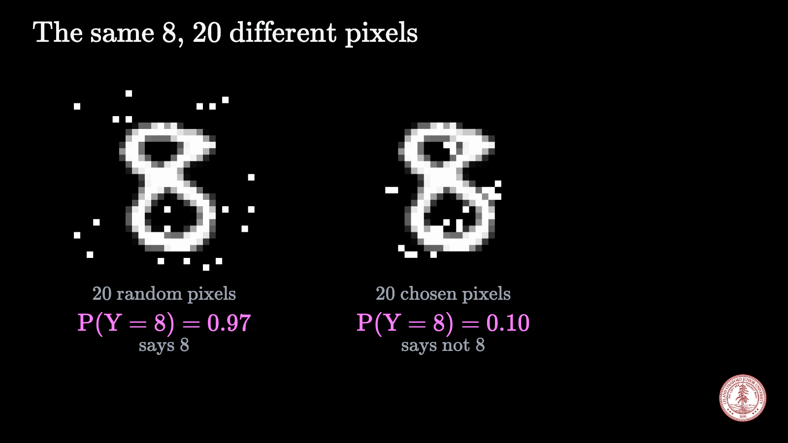
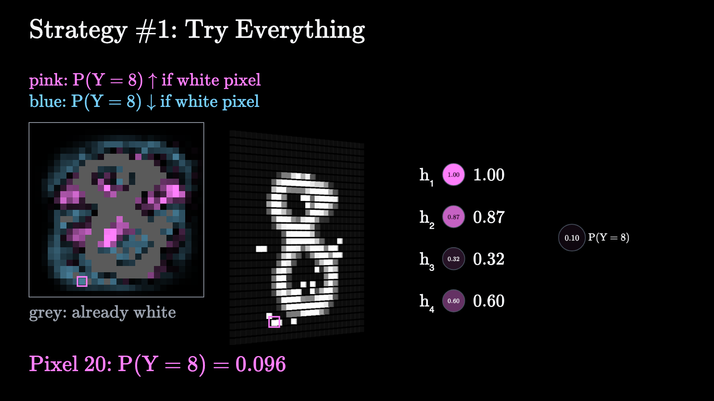
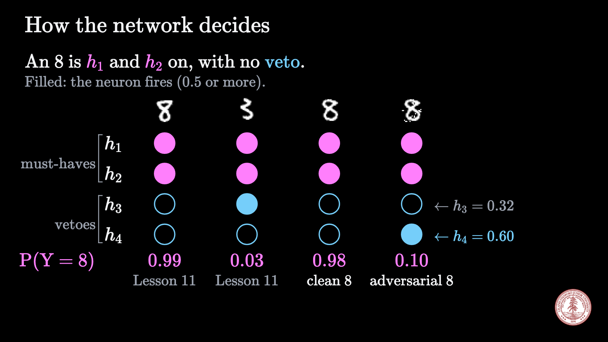
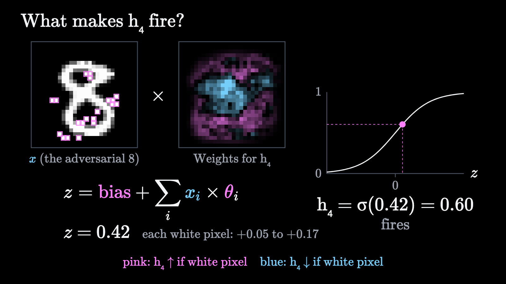
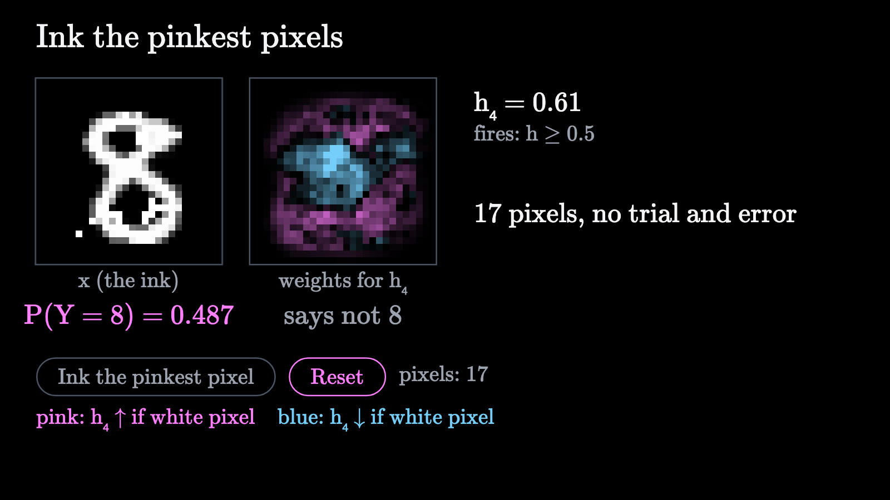
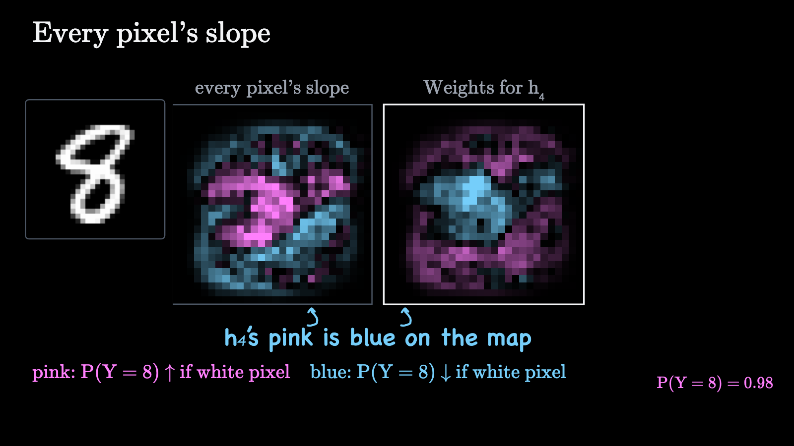
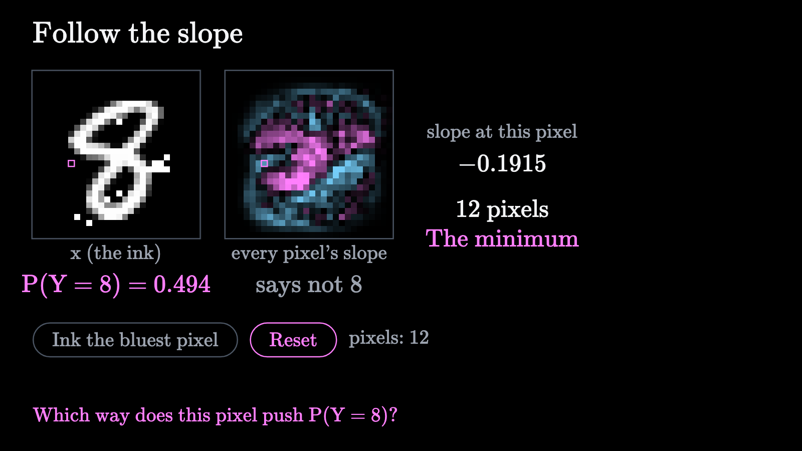
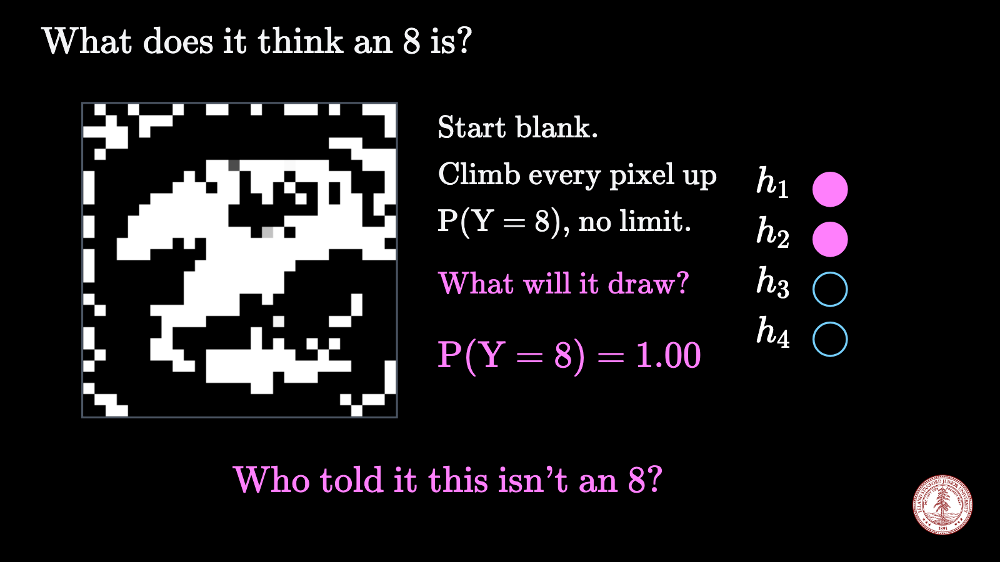

## Section 5 Key: The Mystery 8

Today the room set out to fool a neural network. It was 98% sure a handwritten 8 was an 8, and 20 well-chosen white pixels took it down to 10%, though anyone would still read an 8. This key walks through how we found pixels like those, three different ways, and what they tell us about how the network decides. If you like formulas, they are all in a box at the end, "The deep math, in case you're curious." You don't need the box to follow any of this.

**The answers at a glance**

<table border="1" cellpadding="10" cellspacing="0" style="border-collapse: collapse; width: 100%;">
  <thead>
    <tr style="background-color: #f8f9fa;">
      <th style="border: 1px solid #dddddd; text-align: left;">Strategy</th>
      <th style="border: 1px solid #dddddd; text-align: left;">Which 8</th>
      <th style="border: 1px solid #dddddd; text-align: left;">Pixels to flip it</th>
      <th style="border: 1px solid #dddddd; text-align: left;">What it cost</th>
    </tr>
  </thead>
  <tbody>
    <tr>
      <td style="border: 1px solid #dddddd; vertical-align: top;">Try everything</td>
      <td style="border: 1px solid #dddddd; vertical-align: top;">the clean 8</td>
      <td style="border: 1px solid #dddddd; vertical-align: top;">14, the fewest possible</td>
      <td style="border: 1px solid #dddddd; vertical-align: top;">8,967 runs of the network</td>
    </tr>
    <tr>
      <td style="border: 1px solid #dddddd; vertical-align: top;">Ink h₄'s pinkest pixels</td>
      <td style="border: 1px solid #dddddd; vertical-align: top;">the clean 8, then the fresh 8</td>
      <td style="border: 1px solid #dddddd; vertical-align: top;">17, then 18</td>
      <td style="border: 1px solid #dddddd; vertical-align: top;">none: it reads h₄'s weights</td>
    </tr>
    <tr>
      <td style="border: 1px solid #dddddd; vertical-align: top;">Follow the slope</td>
      <td style="border: 1px solid #dddddd; vertical-align: top;">the fresh 8</td>
      <td style="border: 1px solid #dddddd; vertical-align: top;">12, the fewest possible</td>
      <td style="border: 1px solid #dddddd; vertical-align: top;">one pass forward and one back for each pixel</td>
    </tr>
  </tbody>
</table>

To flip the 8 is to get P(Y = 8) below 0.5, where the network stops saying 8. The clean 8 is the one from the start of section. The fresh 8 is a second handwritten 8 that the slides use later on.

#### Part 1: The network

**What we did.** We started with a review of Lesson 11. The small network is the one we fooled all section. Its 784 pixels go into four hidden neurons, h₁ to h₄, and the four h's go into one output, P(Y = 8). So it answers one question: is it an 8? Each hidden neuron is a logistic regression on the pixels, and the output is one more logistic regression, on the four h's.

How many parameters? 3,145. Each hidden neuron has a weight for each of the 784 pixels plus a bias, 785 in all, and the output has a weight for each hidden neuron plus a bias, 5 in all: 4 × 785 + 5 = 3,145. Logistic regression had 785.

**Why it matters.** Training chose all 3,145 the way it chose logistic regression's 785: gradient ascent on the likelihood of the training data, using the slope of the likelihood with respect to each θ. Strategy #3 takes the same kind of slope with respect to the pixels instead.

#### Part 2: Still an 8?

**What we did.** We changed the clean 8 four ways, and each time the room guessed whether the network would still say 8. It says 8 when P(Y = 8) is 0.5 or more.

<table border="1" cellpadding="10" cellspacing="0" style="border-collapse: collapse; width: 100%;">
  <thead>
    <tr style="background-color: #f8f9fa;">
      <th style="border: 1px solid #dddddd; text-align: left;">Change</th>
      <th style="border: 1px solid #dddddd; text-align: left;">Still 8?</th>
      <th style="border: 1px solid #dddddd; text-align: left;">P(Y = 8)</th>
      <th style="border: 1px solid #dddddd; text-align: left;">Why</th>
    </tr>
  </thead>
  <tbody>
    <tr>
      <td style="border: 1px solid #dddddd; vertical-align: top;">Draw it with a thicker pen</td>
      <td style="border: 1px solid #dddddd; vertical-align: top;">Yes</td>
      <td style="border: 1px solid #dddddd; vertical-align: top;">0.98</td>
      <td style="border: 1px solid #dddddd; vertical-align: top;">More ink, in the same places.</td>
    </tr>
    <tr>
      <td style="border: 1px solid #dddddd; vertical-align: top;">Turn it sideways</td>
      <td style="border: 1px solid #dddddd; vertical-align: top;">No</td>
      <td style="border: 1px solid #dddddd; vertical-align: top;">0.34</td>
      <td style="border: 1px solid #dddddd; vertical-align: top;">Each weight belongs to one pixel. Turn the 8 and its ink lands on other weights.</td>
    </tr>
    <tr>
      <td style="border: 1px solid #dddddd; vertical-align: top;">Tilt it 15°</td>
      <td style="border: 1px solid #dddddd; vertical-align: top;">Yes</td>
      <td style="border: 1px solid #dddddd; vertical-align: top;">0.95</td>
      <td style="border: 1px solid #dddddd; vertical-align: top;">66% of its ink stays on the same pixels. Sideways kept only 47%.</td>
    </tr>
    <tr>
      <td style="border: 1px solid #dddddd; vertical-align: top;">Sprinkle 20 random white pixels</td>
      <td style="border: 1px solid #dddddd; vertical-align: top;">Yes</td>
      <td style="border: 1px solid #dddddd; vertical-align: top;">0.97</td>
      <td style="border: 1px solid #dddddd; vertical-align: top;">We tried 1,000 random sprinkles. None took it below 0.92.</td>
    </tr>
  </tbody>
</table>

**Why it matters.** To this network, an 8 is ink on certain pixels. Turning it sideways moves the ink onto other pixels, so it stops saying 8. Twenty random white pixels hardly matter.

### Part 3: The puzzle

**What we did.** Twenty chosen pixels do matter. With them, the same 8 gets P(Y = 8) = 0.10, and you would still read it as an 8. An input nudged like this to flip the answer is called an adversarial example. The same thing works on real systems: in 2018, stickers on a stop sign made a network read it as "Speed Limit 45", and a 3D-printed turtle was called a rifle.

**The puzzle.** Turn as few pixels white as you can, and make it stop saying 8. For the clean 8 the answer is 14. An exact search shows 13 can't do it. "Watch it flip" adds the worst pixel each time and flips at 14. At 20 pixels, it is the adversarial 8 in the picture.

The section's two goals were "How do you find the pixels that fool a model?" and "Better understand how deep learning 'thinks'". The three strategies below answer the first, and each one adds to the second.

### Strategy #1: Try everything

**What we did.** First, students tried pixels by hand. One pixel barely moves it: the best single pixel takes P(Y = 8) from 0.981 to 0.976. So we let the computer try them all. Turn a blank pixel white, run the network, read P(Y = 8), and turn the pixel back. Do that for each of the 647 blank pixels, keep the one that lowered P(Y = 8) the most, and start again from the new 8. The small drops add up, and pixel 14 flips it.

**Why it matters.** It always works, and on this 8 it finds the fewest possible, but it is slow: 14 pixels took 8,967 runs of the network. It also doesn't say why those pixels work. Watching the four hidden neurons while it runs gives a clue: h₁ and h₂ barely move, while h₄ goes from 0.18 to 0.60 and fires, and h₃ rises from 0.06 to 0.32.

### Strategy #2: Inspect the weights

**What we did.** "How the network decides" reads a rule off the four hidden neurons: an 8 is h₁ and h₂ on, with no veto. h₁ and h₂ are the must-haves, with weights +6.96 and +2.57 into the output. h₃ and h₄ are the vetoes, with −8.44 and −8.93. So there are two ways to break the rule: turn a must-have off, or turn a veto on. The adversarial 8 does the second.

Which neuron would you go after? h₄. Going after one neuron at a time takes 53 pixels for h₁, 50 for h₂, 21 for h₃ and 17 for h₄. h₄ is the closest to firing, and its weight into the output, −8.93, is the biggest.

h₄ is a logistic regression on the pixels: its total z is its bias plus each pixel times its weight, and h₄ = σ(z). On the clean 8, z = −1.53 and h₄ = 0.18. A white pixel where h₄'s weight picture is pink adds to z, and all 20 of the adversarial 8's pixels are on pink. z climbs to 0.42, and h₄ = 0.60. The same 20 pixels are all on h₃'s pink too, which is why h₃ rose. A random pixel lands on the pink of both only about half the time.

"Ink the pinkest pixels" turns that into a strategy: ink the pixels where h₄'s weights are biggest, pinkest first. It flips the clean 8 with 17 pixels and the fresh 8 with 18, without trying a single pixel first.

**Why it matters.** Reading one neuron's weights told us where to put the pixels, and it explains why the adversarial 8 works. It doesn't find the fewest (17, where 14 is possible), because it pays attention to h₄ alone. And it only works on a network small enough to read by eye.

### Strategy #3: Use calculus

**What we did.** For each pixel, find the slope: how fast the log likelihood, LL = log P(Y = 8), changes when that pixel gets ink. The chain rule builds it one link at a time, from the pixel to a hidden neuron, from the neuron to P(Y = 8), and from P(Y = 8) to LL. For the sign, one path is enough. Strategy #3 works on the fresh 8. Take its worst pixel x and the path through h₄: ink at x raises h₄ (the weight from x to h₄ is +0.14), and h₄ lowers P(Y = 8) (its weight into the output is −8.93). A positive times a negative is negative, so ink at x pushes P(Y = 8) down. The Code Agent adds up all four paths and gets a slope of −0.0054, most of it through the vetoes: −0.0035 through h₄ and −0.0017 through h₃.

One pass forward through the network and one pass back give the slope for all 784 pixels at once. Drawn as a map, it is blue where ink lowers P(Y = 8) and pink where ink raises it, which on this 8 is 257 of the 784 pixels. The blue lines up with the pink of the vetoes' weight pictures.

"Follow the slope" inks the bluest pixel, works the map out again, and repeats. It flips the fresh 8 with 12 pixels, the fewest possible.

**Why it matters.** Trying everything and the slope put the same pixel first ("Try Everything vs Calculus"), but on the fresh 8 one map by trying took 655 runs of the network, and the slopes took one pass forward and one back. The backward pass is the same chain rule that trains the network, aimed at the pixels instead of the weights. Training asks how LL changes with each weight θ and holds the pixels fixed. Here we ask how LL changes with each pixel x and hold the weights fixed. That is the line on "Make it simple": x and θ swap places.

#### What does it think an 8 is?

**What we did.** Start from a blank picture and climb every pixel up P(Y = 8), with no limit on how many. The network draws a jumble of white that looks nothing like an 8, and it is surer of it, P(Y = 8) = 0.998, than of any real 8 in the test set (the surest real 8 gets 0.996). The slide rounds it to 1.00. h₁ and h₂ are on and both vetoes are off, so it passes the rule.

Who told it this isn't an 8? No one did. It was trained only on real digits, so it was never shown a picture like this and told "not an 8".

**Why it matters.** A network can be very sure of a picture no person would call an 8. The last slides show where fooling a network has mattered, including, in 2024, under 100 poisoned training pictures that broke a Stable Diffusion prompt. Where else would it matter to you? There is no one answer. Face unlock, medical scans, spam filters and bank check readers all come up.

**Every question on the slides, with its answer**
* What question does this network answer? Is it an 8? Its one output is P(Y = 8).
* How many parameters? 3,145: 4 × 785 + 5.
* Will it still say 8? Draw it with a thicker pen: yes, 0.98. Turn it sideways: no, 0.34. Tilt it 15°: yes, 0.95. Sprinkle 20 random white pixels: yes, 0.97.
* You’d still read an 8. Why doesn’t it? All 20 chosen pixels are on the pink of both vetoes' weight pictures, so the vetoes rise and h₄ fires.
* Why is this interesting? A network that is 98% sure can be flipped by a few chosen pixels, and the same works on real systems.
* Take a guess: What’s the minimum number of pixels to flip the digit? 14, for the clean 8, white pixels only.
* Which neuron would you go after? h₄: the closest to firing, with the biggest weight into the output.
* Will h₄ fire now? Yes, 0.18 to 0.60. All 20 pixels are on h₄'s pink.
* Ink at x: up or down? Down. Ink raises h₄, and h₄ lowers P(Y = 8).
* Ink on the worst pixel: up or down? Down. The slope is −0.0054.
* Does every pixel push P(Y = 8) down? No. On this 8, ink would raise it on 257 of the 784 pixels.
* What do you notice? The blue on the slope map lines up with the pink of the vetoes' weight pictures.
* Which way does this pixel push P(Y = 8)? Down. It starts on the bluest pixel.
* What’s different? Not the pixel: both maps put the same one first. The cost: 655 runs of the network against one pass each way.
* What will it draw? A jumble of white, not an 8, that it is surer of than any real 8.
* Who told it this isn’t an 8? No training example did. It only ever saw real digits.
* Where else would this matter to you? No single answer. Face unlock, medical scans, spam filters and bank check readers all come up.
* Extra time. Which digit should it say? The room's choice. How many pixels will it take? It depends on the digit. Is it still an 8? To a person, yes.

**Things that trip people up**

* Pink and blue mean different things on different pictures. On a neuron's weight picture, pink means a white pixel there raises that neuron. On the slope map, pink means a white pixel raises P(Y = 8). h₄ is a veto, so h₄'s pink is blue on the map.
* The clean 8 and the fresh 8 are different 8s. 14 and 17 are on the clean 8, 12 and 18 on the fresh one. To compare two strategies, use the same 8: on the fresh 8, the slope took 12 and h₄'s pinkest pixels took 18.
* A neuron fires at 0.5 or more. On the adversarial 8, h₃ rises from 0.06 to 0.32 but never fires. h₄ does.
* Here a negative slope is the one we want: it means ink pushes P(Y = 8) down. Training climbs its slope; this goes the other way.
* Every strategy only adds white pixels. None of them erases ink.

#### If you want to keep going

Fool the full network. The extra-time slide goes back to the network on "The full network, trained": 784 pixels, then 500, 300 and 20 hidden neurons, then 10 outputs, one per digit. That is 549,030 parameters, far too many to read by eye, so Strategy #2 is out. The slope still takes one pass forward and one back, and following it can make the clean 8 read as any digit you pick, from 9 pixels for a 3 to 73 for a 0. To a person it is still an 8.

How were the stop-sign stickers and the turtle found? The same way, on much bigger networks: by following the slope, averaged over many views from different angles and distances, so the change would fool the network from wherever it was seen.

#### The deep math, in case you're curious

Nothing in this box is something you need to memorize or compute by hand. It is here for anyone who wants to see what the computer is doing.

**The network.** For pixels $x_1, \dots, x_{784}$, each between 0 (black) and 1 (white), hidden neuron $j$ and the output compute

$$h_j = \sigma\left(b_j + \sum_{i=1}^{784} \theta_{j,i} x_i\right), \qquad P(Y = 8) = \sigma\left(b + \sum_{j=1}^{4} v_j h_j\right)$$

$\theta_{j,i}$ is pixel $i$'s weight into $h_j$, and $v_j$ is $h_j$'s weight into the output. Counting them with the biases: $4 \times (784 + 1) + (4 + 1) = 3{,}145$

**The slope for a pixel.** With $LL = \log P(Y = 8)$, the chain rule along each of the four paths, added up, gives

$$\frac{\partial LL}{\partial x_i} = (1 - P(Y = 8)) \sum_{j=1}^{4} v_j h_j (1 - h_j) \theta_{j,i}$$

"Make it simple" is the $j = 4$ term: $\frac{1}{p} \times p(1 - p)\, v_4 \times h_4(1 - h_4)\, \theta_{4,i}$.

**The slope for a weight.** For a training 8, the same chain rule gives

$$\frac{\partial LL}{\partial \theta_{j,i}} = (1 - P(Y = 8)) \, v_j h_j (1 - h_j) \, x_i$$

x and θ swap places. Training moves each θ up its slope and holds the pixels fixed. The attack moves pixels down theirs and holds the weights fixed.

**The cost.** Trying everything runs the network once for each blank pixel, for each pixel it adds: 647 + 646 + ⋯ + 634 = 8,967 runs for 14 pixels. The slope needs one forward pass and one backward pass for all 784 pixels at once.