## Section 6 Key: Self Driving Car Oversight

Today the room was an oversight committee, made up for this section. A city asked us to evaluate Waymo's driverless cars, and we did it in three steps: count the crashes, find the weak spots and propose a test. This key walks through each step with the numbers from the slides and an answer to every question they ask. If you like formulas, they are in a box at the end, "The deep math, in case you're curious." You don't need the box to follow any of this.

**The answers at a glance**

<table>
  <thead>
    <tr style="background-color: #f2f2f2;">
      <th style="text-align: left; padding: 8px; border: 1px solid #ddd;">Question</th>
      <th style="text-align: left; padding: 8px; border: 1px solid #ddd;">Answer</th>
      <th style="text-align: left; padding: 8px; border: 1px solid #ddd;">The numbers</th>
    </tr>
  </thead>
  <tbody>
    <tr>
      <td style="padding: 8px; border: 1px solid #ddd; vertical-align: top;">Is it safer than people?</td>
      <td style="padding: 8px; border: 1px solid #ddd; vertical-align: top;">Its 3 isn't luck</td>
      <td style="padding: 8px; border: 1px solid #ddd; vertical-align: top;">People would have had about 57 serious crashes in Waymo's 437M km. Waymo had 3. If it drove like people, the chance of 3 or fewer is 5.7 &times; 10-21.</td>
    </tr>
    <tr>
      <td style="padding: 8px; border: 1px solid #ddd; vertical-align: top;">Test 1: Does it see children?</td>
      <td style="padding: 8px; border: 1px solid #ddd; vertical-align: top;">Not as well as adults</td>
      <td style="padding: 8px; border: 1px solid #ddd; vertical-align: top;">A research detector missed 26% of children and 5% of adults.</td>
    </tr>
    <tr>
      <td style="padding: 8px; border: 1px solid #ddd; vertical-align: top;">Test 2: Can a sticker fool it?</td>
      <td style="padding: 8px; border: 1px solid #ddd; vertical-align: top;">Yes</td>
      <td style="padding: 8px; border: 1px solid #ddd; vertical-align: top;">A stop sign with a few stickers was read as a speed limit sign in 84.8% of video frames from a moving car.</td>
    </tr>
    <tr>
      <td style="padding: 8px; border: 1px solid #ddd; vertical-align: top;">Test 3: Does it know when it's unsure?</td>
      <td style="padding: 8px; border: 1px solid #ddd; vertical-align: top;">Not in the middle</td>
      <td style="padding: 8px; border: 1px solid #ddd; vertical-align: top;">When it said about 65%, it was a person 36% of the time.</td>
    </tr>
    <tr>
      <td style="padding: 8px; border: 1px solid #ddd; vertical-align: top;">What should Waymo test next?</td>
      <td style="padding: 8px; border: 1px solid #ddd; vertical-align: top;">The room's own ideas</td>
      <td style="padding: 8px; border: 1px solid #ddd; vertical-align: top;">Every section adds tests to one shared pool and votes on them.</td>
    </tr>
    <tr>
      <td style="padding: 8px; border: 1px solid #ddd; vertical-align: top;">Extra time: Is zero enough to call it safer?</td>
      <td style="padding: 8px; border: 1px solid #ddd; vertical-align: top;">Not on its own</td>
      <td style="padding: 8px; border: 1px solid #ddd; vertical-align: top;">A driver as safe as Atlanta's people would have at least one serious crash 85% of the time, and none 15% of the time.</td>
    </tr>
  </tbody>
</table>

"Serious" means serious injury or worse, Waymo's own category. The km and crash counts are Waymo's own, converted from Waymo's miles (1 mile = 1.609 km). The three tests used research models, not Waymo's.

**The review**

**What we did.** The section opened with eight review slides, about 30 seconds each. Each one is an idea a later step uses:

<table>
  <thead>
    <tr style="background-color: #f2f2f2;">
      <th style="text-align: left; padding: 8px; border: 1px solid #ddd;">Slide</th>
      <th style="text-align: left; padding: 8px; border: 1px solid #ddd;">The idea</th>
      <th style="text-align: left; padding: 8px; border: 1px solid #ddd;">Where it comes back</th>
    </tr>
  </thead>
  <tbody>
    <tr>
      <td style="padding: 8px; border: 1px solid #ddd; vertical-align: top;">"Random Variables"</td>
      <td style="padding: 8px; border: 1px solid #ddd; vertical-align: top;">X is the total of two dice, and the bars of its PMF add up to 1.</td>
      <td style="padding: 8px; border: 1px solid #ddd; vertical-align: top;">The crash count's PMF.</td>
    </tr>
    <tr>
      <td style="padding: 8px; border: 1px solid #ddd; vertical-align: top;">"Bernoulli"</td>
      <td style="padding: 8px; border: 1px solid #ddd; vertical-align: top;">One try: 1 if it happens, 0 if not.</td>
      <td style="padding: 8px; border: 1px solid #ddd; vertical-align: top;">"Which distribution?"</td>
    </tr>
    <tr>
      <td style="padding: 8px; border: 1px solid #ddd; vertical-align: top;">"Binomial"</td>
      <td style="padding: 8px; border: 1px solid #ddd; vertical-align: top;">Independent tries with the same chance, counting the successes.</td>
      <td style="padding: 8px; border: 1px solid #ddd; vertical-align: top;">Also right on "Which distribution?"</td>
    </tr>
    <tr>
      <td style="padding: 8px; border: 1px solid #ddd; vertical-align: top;">"Poisson"</td>
      <td style="padding: 8px; border: 1px solid #ddd; vertical-align: top;">Drops of rain counted in each one-second slice.</td>
      <td style="padding: 8px; border: 1px solid #ddd; vertical-align: top;">The crash count, with road in place of seconds.</td>
    </tr>
    <tr>
      <td style="padding: 8px; border: 1px solid #ddd; vertical-align: top;">"Three ways to write small numbers"</td>
      <td style="padding: 8px; border: 1px solid #ddd; vertical-align: top;">Decimal, scientific notation and log10.</td>
      <td style="padding: 8px; border: 1px solid #ddd; vertical-align: top;">Reading 5.7 &times; 10-21.</td>
    </tr>
    <tr>
      <td style="padding: 8px; border: 1px solid #ddd; vertical-align: top;">"Adversarial Examples"</td>
      <td style="padding: 8px; border: 1px solid #ddd; vertical-align: top;">20 chosen pixels flip Section 5's network, and 20 random ones don't.</td>
      <td style="padding: 8px; border: 1px solid #ddd; vertical-align: top;">The stop sign in Test 2.</td>
    </tr>
    <tr>
      <td style="padding: 8px; border: 1px solid #ddd; vertical-align: top;">"Calibration Curve"</td>
      <td style="padding: 8px; border: 1px solid #ddd; vertical-align: top;">Each dot is a bucket of days, P(rain) according to the model against how often it rained. It rains on 70% of the days where the model predicted 70%.</td>
      <td style="padding: 8px; border: 1px solid #ddd; vertical-align: top;">Test 3.</td>
    </tr>
    <tr>
      <td style="padding: 8px; border: 1px solid #ddd; vertical-align: top;">"Complement"</td>
      <td style="padding: 8px; border: 1px solid #ddd; vertical-align: top;">P(Ec) = 1 &minus; P(E): not happening is 1 minus happening.</td>
      <td style="padding: 8px; border: 1px solid #ddd; vertical-align: top;">The Atlanta extra.</td>
    </tr>
  </tbody>
</table>

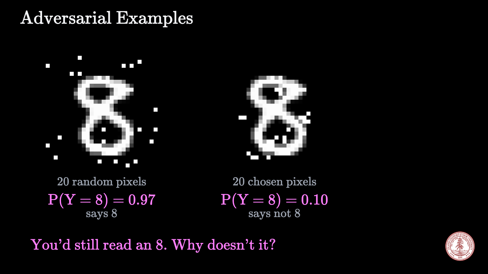

"Adversarial Examples" asks: You'd still read an 8. Why doesn't it? The network doesn't look at the shape the way you do. It adds up ink pixel by pixel, and in Section 5 we found that all 20 chosen pixels land where its two veto neurons look for ink, so one of them fires and it says not 8. A change chosen to flip a model's answer like this is called an adversarial example.

**Why it matters.** Every later step leans on one of these slides, so a student who missed a lesson can still follow the hour.

#### Step 1: Count the crashes

**What we did.** Waymo has driven 437M km with no one at the wheel, through June 2026. Is it safer than people? The room guessed first. Then "Which distribution?" asked how to model X, the number of serious crashes people would have in those same km.

The answer is a Poisson: X counts rare events over many tiny stretches of road, each with a tiny chance of a serious crash. Binomial is right too, with each stretch as one try, because with so many tries and so small a chance a Poisson stands in for a binomial. Bernoulli doesn't fit, because X is a count.

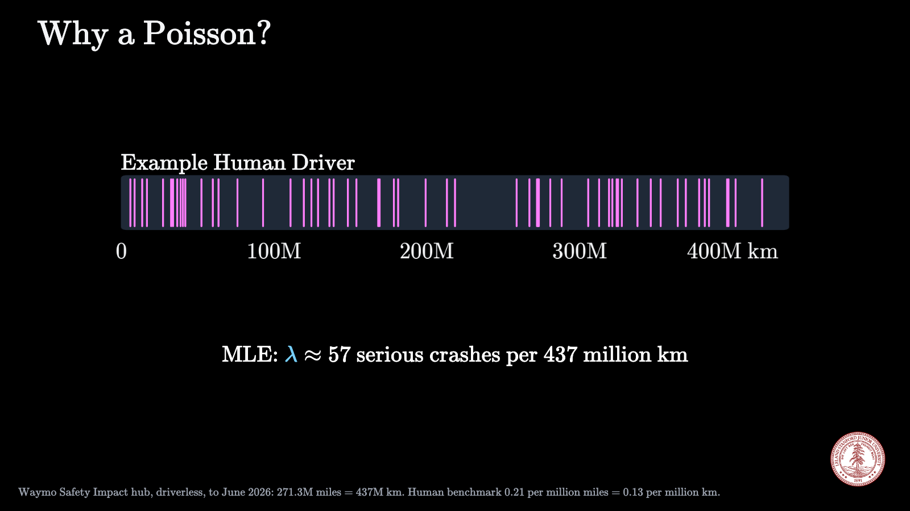

The strip on "Why a Poisson?" is made up, one example human driver with 57 crashes dropped at random. Waymo's own human benchmark is 0.13 serious crashes per million km, so λ ≈ 0.13 × 437 ≈ 57. That is the MLE: the number of serious crashes to expect if Waymo drove like people.

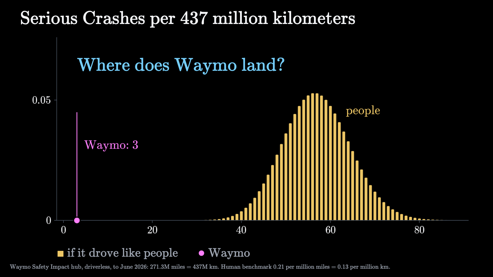

The bars on "Serious Crashes per 437 million kilometers" are that Poisson's PMF: how likely each count of serious crashes would be for people driving the same km. Where does Waymo land? At 3, far to the left of every bar.

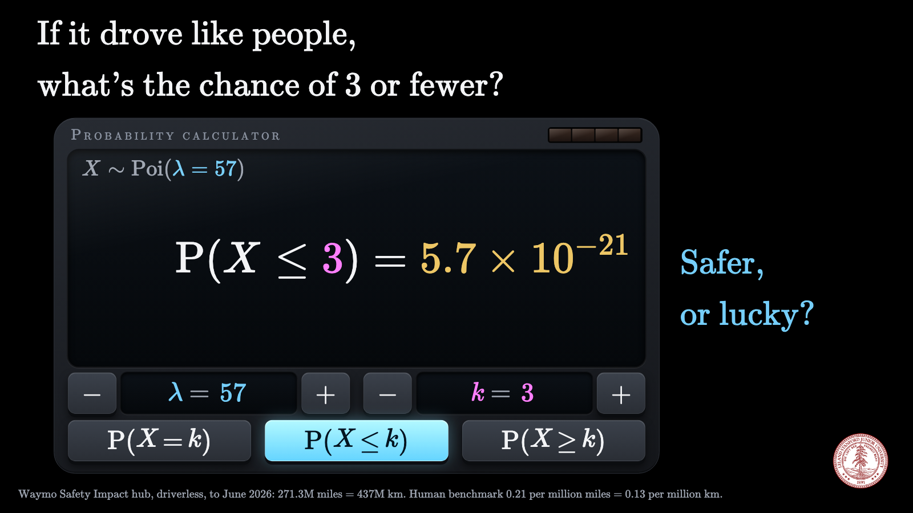

If it drove like people, what's the chance of 3 or fewer? The calculator, with λ = 57, k = 3 and ≤, gives P(X ≤ 3) = 5.7 × 10⁻²¹. Written out, that is 20 zeros after the decimal point and then 57.

Safer, or lucky? Luck can't explain Waymo's 3. If it drove like people, 3 or fewer would have a chance of 5.7 × 10⁻²¹, so by Waymo's own counts it really did have far fewer serious crashes than people would on the same km. That became the first row of "Our report to the city".

**Why it matters.** A count on its own says little. The Poisson says what people would get on the same km, and that comparison is what makes Waymo's 3 mean something. A total can still hide weak spots, and Step 2 looks for them.

#### Step 2: Find the weak spots

Step 2 was three tests, each on a research model, not Waymo's own. Each test opened with a one-word guess in the chat.

#### Test 1: Does it see children?

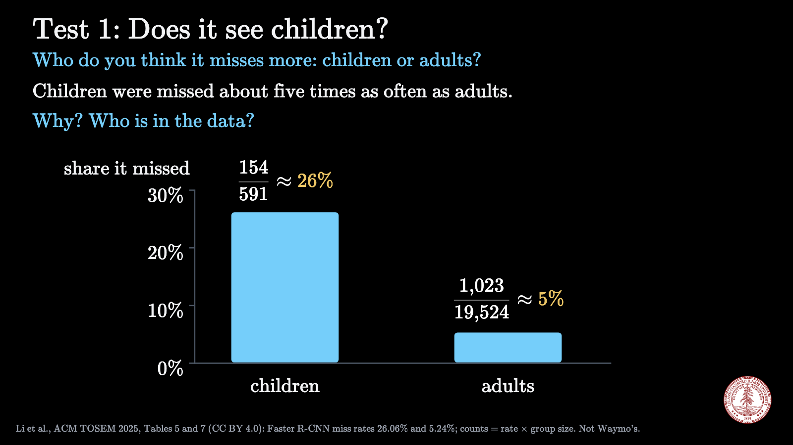

**What we did.** Researchers ran pedestrian detectors over three public sets of street photos, CityPersons, EuroCity Persons and BDD100K, where every pedestrian is labelled, and counted who each detector missed. Who do you think it misses more: children or adults? Children. One detector in the paper, Faster R-CNN, missed 26% of children and 5% of adults. As count over count, that is 154 of 591 children and 1,023 of 19,524 adults, worked out from the paper's rates and group sizes. Children were missed about five times as often as adults.

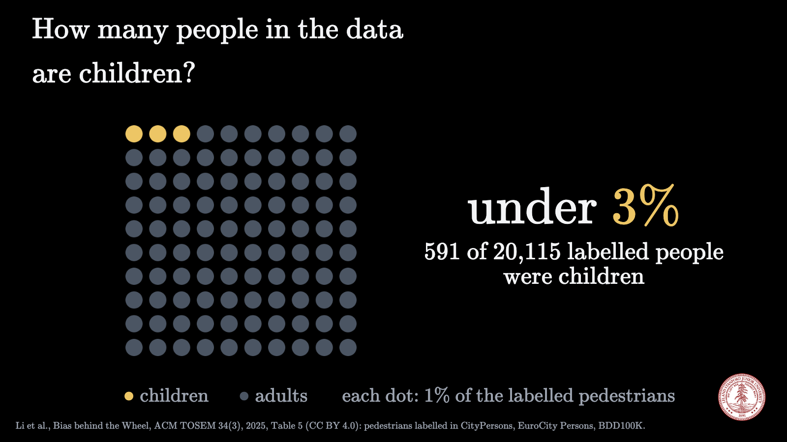

Why? Who is in the data? Of the 20,115 labelled people, 591 were children, under 3%.

**Why it matters.** A detector learns from its data and is checked on it too. A group that is rare in the data gets few chances to be learned and few chances to be tested. One miss rate for everyone would be about 6%, close to the adults' rate, because nearly everyone in the data is an adult. Counting each group on its own is what showed the gap.

### Test 2: Can a sticker fool it?

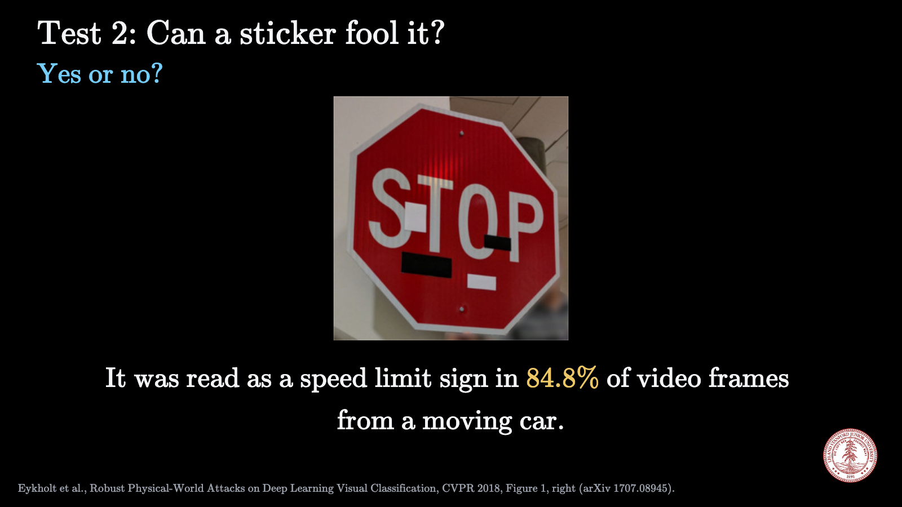

**What we did.** Researchers put a few black and white stickers on a real stop sign. Can a sticker fool it? Yes. A research sign classifier read it as a speed limit sign in 84.8% of the video frames taken from a moving car, 28 of 33. The clean sign was read right in every frame.

**Why it matters.** It is the adversarial 8 from the review, on a real sign: a few chosen changes flip the answer, and a person still sees a stop sign. The test was on a research classifier looking at the cropped sign, and no production car was tested, so testing a real car was a fair idea for the vote.

#### Test 3: Does it know when it's unsure?

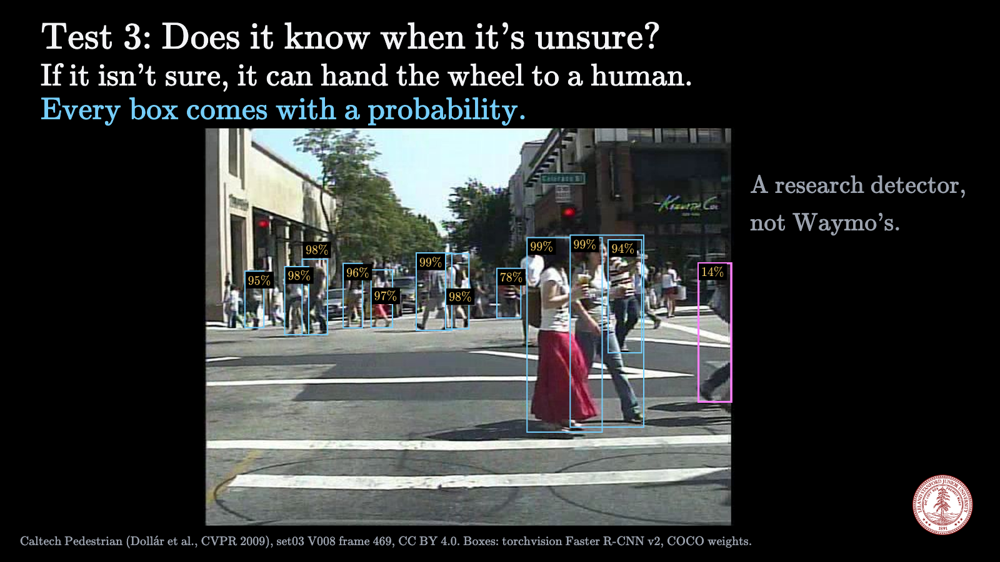

**What we did.** If it isn't sure, a car can hand the wheel to a human, a safety driver or a remote helper. That only works if the car knows when it isn't sure. Every box a detector draws comes with a probability, P(person) according to the detector. We ran a research detector, torchvision's Faster R-CNN, over Caltech Pedestrian, a public dashcam video from Pasadena. In the frame on the slide, most people get 94% to 99%. The man leaving the frame on the right, with only his leg in view, gets 14%. He is there, so 14% isn't a no. It is a probability, and the question is whether those probabilities can be trusted.

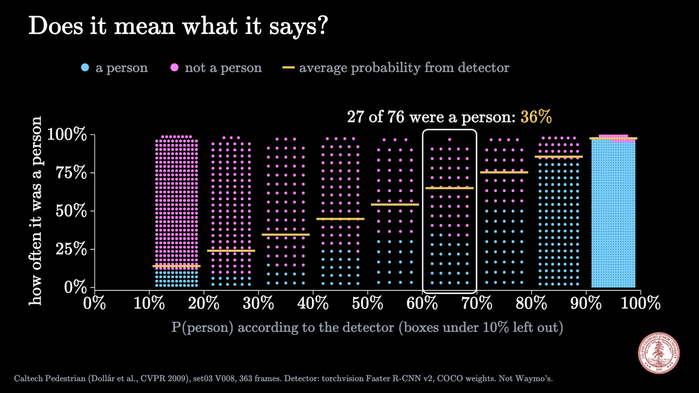

"Does it mean what it says?" checks those probabilities against the truth, the way Lesson 13 checked the rain machine. Every box from 363 frames of the video is a dot, blue if it was a person and pink if not, set left to right by P(person) according to the detector. Boxes under 10% are left out. Click by click, the dots stack into a column for each 10%, the people sink to the bottom of each column so that the height of the blue shows how often that column was a person, and a yellow line marks each column's "average probability from detector". If the detector means what it says, the yellow line sits at the top of the blue. Lesson 13 calls that calibrated. Three columns are boxed in turn:

<table>
  <thead>
    <tr style="background-color: #f2f2f2;">
      <th style="text-align: left; padding: 8px; border: 1px solid #ddd; vertical-align: top;">Column</th>
      <th style="text-align: left; padding: 8px; border: 1px solid #ddd; vertical-align: top;">Average probability from detector</th>
      <th style="text-align: left; padding: 8px; border: 1px solid #ddd; vertical-align: top;">Was a person</th>
    </tr>
  </thead>
  <tbody>
    <tr>
      <td style="padding: 8px; border: 1px solid #ddd; vertical-align: top;">10% to 20%</td>
      <td style="padding: 8px; border: 1px solid #ddd; vertical-align: top;">14%</td>
      <td style="padding: 8px; border: 1px solid #ddd; vertical-align: top;">44 of 393, 11%</td>
    </tr>
    <tr>
      <td style="padding: 8px; border: 1px solid #ddd; vertical-align: top;">60% to 70%</td>
      <td style="padding: 8px; border: 1px solid #ddd; vertical-align: top;">65%</td>
      <td style="padding: 8px; border: 1px solid #ddd; vertical-align: top;">27 of 76, 36%</td>
    </tr>
    <tr>
      <td style="padding: 8px; border: 1px solid #ddd; vertical-align: top;">90% to 100%</td>
      <td style="padding: 8px; border: 1px solid #ddd; vertical-align: top;">98%</td>
      <td style="padding: 8px; border: 1px solid #ddd; vertical-align: top;">1,034 of 1,074, 96%</td>
    </tr>
  </tbody>
</table>

**Why it matters.** At the bottom (14% said, 11% a person) and the top (98% said, 96% a person), it means about what it says. In the middle it doesn't: when it said about 65%, it was a person only 36% of the time. A car deciding when to hand the wheel back needs to know how sure it really is, and in the middle these numbers would mislead it. This is one research detector on one video, and nearby frames look alike, so it shows the idea rather than measuring the model.

#### Step 3: Propose a test

**What we did.** What should Waymo test next? The room suggested tests in the chat, and the section leader typed them in. Every section adds to one shared pool of ideas. On Vote, the room picked one of two ideas at a time, for 5 pairs, and Top ideas showed the live ranking. The top three went into the last row of "Our report to the city".

A good test says what to count, compared with what, and where. "Does it see people at night?" becomes "Night driving in heavy rain, counting missed pedestrians against human drivers", one of the starter ideas.

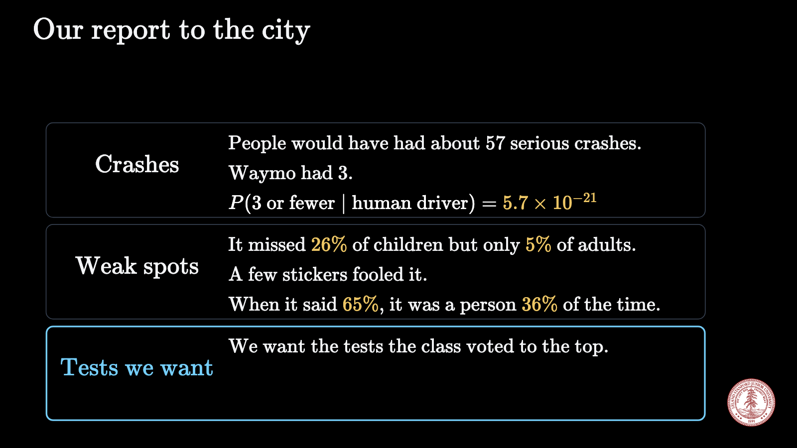

Then "Our report to the city" came back whole: the crashes, the three weak spots, and the tests the class voted to the top.

**Why it matters.** Every row of the report rests on a count compared with something: crashes against what people would have, missed children against missed adults, misread frames against the clean sign, and people in a column against what the detector said. The same question works on any new test: what does it count, and compared with what?

#### Extra time: Atlanta

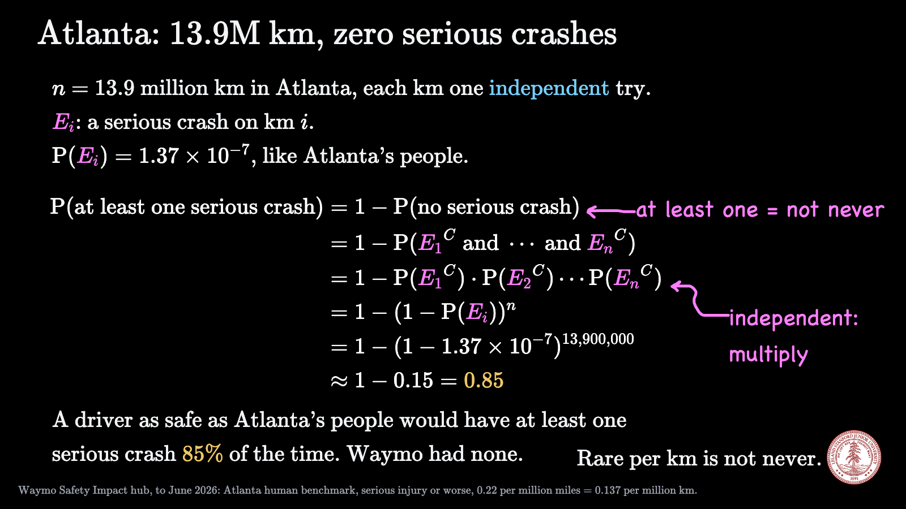

**What we did.** Atlanta, the city that asked us, has 13.9M km of Waymo driving and 0 serious crashes. Is zero enough to call it safer? This is Lesson 13's tries problem, with a km for each try. Each km is one independent try, E_i is a serious crash on km i, and P(E_i) = 1.37 × 10⁻⁷, the rate for Atlanta's people, 0.137 serious crashes per million km. At least one crash is 1 minus no crash at all. Because the km are independent, the chance of no crash on any of them is the product of the chances for each km:

$$P(\text{at least one}) = 1 - (1 - P(E_i))^n = 1 - (1 - 1.37 \times 10^{-7})^{13,900,000} \approx 1 - 0.15 = 0.85$$

A driver as safe as Atlanta's people would have at least one serious crash 85% of the time. Waymo had none.

**Why it matters.** Waymo's zero is promising. But a driver exactly as safe as Atlanta's people would also have zero 15% of the time, so zero on its own can't show that Waymo is safer. "Rare per km is not never." Over 13.9M km, a tiny chance per km adds up.

**Every question on the slides, with its answer**

* You'd still read an 8. Why doesn't it? It doesn't read the shape. The 20 chosen pixels land where its veto neurons look for ink, and 20 random ones don't.
* Is it safer than people? Chat a guess. Any guess is fine before the numbers. "Safer, or lucky?" answers it.
* If people drove those km, X: how many serious crashes? Which distribution? Poisson, with λ ≈ 57. Binomial is right too. Bernoulli doesn't fit, because X is a count.
* Why a Poisson? X counts rare events over many tiny stretches of road, each with a tiny chance of a serious crash.
* Where does Waymo land? At 3, far to the left of every bar for people, which peak near 57.
* If it drove like people, what's the chance of 3 or fewer? 5.7 × 10⁻²¹.
* Safer, or lucky? Not lucky. At 5.7 × 10⁻²¹, luck can't explain Waymo's 3.
* Who do you think it misses more: children or adults? Children, 26% against 5%.
* Why? Who is in the data? How many people in the data are children? Under 3%: 591 of 20,115.
* Can a sticker fool it? Yes or no? Yes. It was read as a speed limit sign in 84.8% of frames.
* Does it know when it's unsure? Not in the middle. When it said about 65%, it was a person 36% of the time.
* Does it mean what it says? About right at the bottom and the top, and too high in the middle.
* What should Waymo test next? There is no one answer. A good test says what to count, compared with what, and where.
* Is zero enough to call it safer? Not on its own. A driver as safe as Atlanta's people would have zero 15% of the time.
* Which one was your favourite? Any of the six sections. There is no wrong answer.

**Things that trip people up**

* 5.7 × 10⁻²¹ is not the chance that Waymo is as safe as people. It is the chance of 3 or fewer serious crashes if it were, which the report writes as P(3 or fewer | human driver).
* Typing λ = 56.97, the MLE before rounding, gives 5.9 × 10⁻²¹ instead of 5.7 × 10⁻²¹. Both are fine. Far out in the tail, a small change in λ moves the answer a lot, and both say the same thing.
* A miss rate is count over count inside one group: 154 of the 591 children, not 154 out of everyone.
* 14% isn't a no. The man leaving the frame is there, and three frames earlier the detector said 95%.
* On "Does it mean what it says?", the height of the blue in a column is how often it was a person, and the yellow line is what the detector said. Calibrated means the two meet. It doesn't mean always right: a calibrated 65% is a person about 65% of the time and not a person the rest.

**If you want to keep going**

The Poisson looks like a binomial, and that's not a coincidence. When there are a huge number of tries and each has a tiny chance, a binomial is almost exactly a Poisson whose λ is the number of tries times the chance of each. That is why Binomial was right too, and why Atlanta matches the Poisson: λ = 0.137 × 13.9 ≈ 1.9, and 1 − e^(−1.9) = 0.85, the same answer as the chain.

The paper behind Test 1 tried eight detectors, and all eight miss more children than adults: 43.89% against 23.75% on average. Small figures in the picture get missed more.

You can redo Step 1 yourself in your Toolbox, under Poisson. For more, Lesson 5 has the Poisson, Lesson 13 has calibration and the tries problem, and Section 5 has the adversarial 8.

**The deep math, in case you're curious**

Nothing in this box is something you need to memorize or compute by hand. It is here for anyone who wants to see what the calculator is doing.

**The Poisson.** If X is a Poisson with rate $\lambda$, the chance of exactly $k$ is

$$P(X = k) = \frac{\lambda^k e^{-\lambda}}{k!}$$

For people driving Waymo's km, $\lambda = 0.13 \times 437 \approx 57$ (in miles, $0.21 \times 271.3 = 56.97$). Three or fewer adds four bars:

$$P(X \leq 3) = e^{-57} \left(1 + 57 + \frac{57^2}{2!} + \frac{57^3}{3!}\right) \approx 5.7 \times 10^{-21}$$

**Binomial and Poisson.** For $n$ independent tries, each with chance $P(E_i)$, when $n$ is huge and $P(E_i)$ is tiny,

$$\binom{n}{k} P(E_i)^k (1 - P(E_i))^{n-k} \approx \frac{\lambda^k e^{-\lambda}}{k!}, \qquad \lambda = n\,P(E_i)$$

**Count over count.** $P(\text{missed} \mid \text{child}) = 154/591 \approx 0.26$ and $P(\text{missed} \mid \text{adult}) = 1,023/19,524 \approx 0.05$.

**Calibration.** A detector is calibrated when, among the boxes where it says about $q$, the share that are a person is about $q$. In the 60% to 70% column it said $0.65$ on average, and $27/76 \approx 0.36$ were a person.

**Atlanta.** With $n$ independent km and the same $P(E_i)$ on each,

$$P(\text{at least one}) = 1 - (1 - P(E_i))^n \approx 1 - e^{-nP(E_i)}$$

and here

$$n\,P(E_i) = 1.37 \times 10^{-7} \times 13,900,000 \approx 1.9$$

so the chain and the Poisson both give $0.85$.

