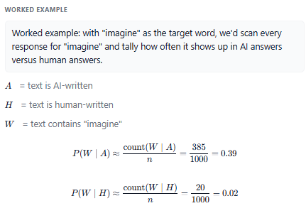
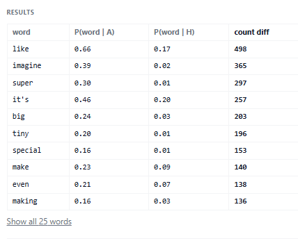
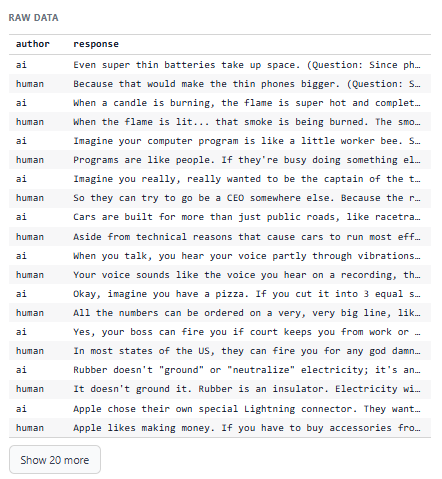

# Word Detective 
## Your Task

Work with the code agent to build a tool that scores how AI or human a word sounds.

Milestones
1. **Calculate for one word** \
Pick one word, and measure how much more (or less) often it shows up in the AI answers versus the human ones.
2. **Generalize** \
Say we wanted the same two numbers for a different word — say 'super'. What would you do differently, and what would stay exactly the same?
3. **Visualize** \
Choose how to display your results to the user.

## Code Agent

Agent:
Wahoo — we get to build a tool that explores how differently AI and humans write. Our raw material is already loaded in your app: 1,000 questions from Reddit's 'explain it like I'm 5' forum, each answered twice. Once by a real person, and once by a language model. Every answer is labeled with the author.

---

Agent:
Milestone 1 is the smallest possible piece of that tool: pick one word, and measure how much more (or less) often it shows up in the AI answers versus the human ones.

---

Agent:
But before we build anything — take a look at the grid on the right: that's our raw material. In your own words, what's in it? And if anything is unclear, just ask: nothing is built yet, so now is the perfect time.

---

Student:
Let's start building

---

Agent:
I love the enthusiasm! We'll start building in just a second. But before we do, take a quick look at that big grid on the right. If you scroll through a few rows, what actually shows up in that first column?

---

Student:
Ai human

---

Agent:
Exactly — every answer is labeled by who wrote it! So for Milestone 1, in your own words, what are we actually going to measure? (And again, if any of this is fuzzy, ask away!)

---

Student:
We are measuring how likely a word is to appear in an AI-written response versus a human-written response.

---

Agent:
Spot on! That per-word gap is exactly what the finished tool will let us explore.

Anything still fuzzy before we pick our first word?

---

Student:
No, it’s clear. We’re comparing how often a chosen word appears in AI responses vs. human responses.

---

Agent:
Awesome, let's dive in. What word should we investigate first? You can pick one of these common ones, or type in any word you're curious about!

---

Student:
imagine

---

Agent:
Great choice. I'll lock in 'imagine'.

A big part of what this whole project is good for is getting comfortable moving between real-world data and the math notation that describes it. 'AI-written' is just an English phrase until it gets a symbol — giving it one commits us to a single precise meaning we can build formulas on top of. 

What symbol should stand for the event 'this text was written by AI'?

---

Student:
Let A represent the event “this text was written by AI.”

---

Agent:
Perfect. We'll use $A$ for AI-written.

Events like this usually come in pairs — what should we call the event "this text was written by a human"?

---

Student:
Let H represent the event “this text was written by a human.”

---

Agent:
Got it. $H$ it is.

I'll take the last one as a freebie and use $W$ for the event 'the text contains our word'. So our goal is to estimate $P(W | A)$ and $P(W | H)$.

Now for the fun part — actually getting those numbers out of the data. Just looking at the raw data we have, how could we estimate $P(W | A)$ by counting?

---

Student:
$P(W | A)$ = Number of AI texts containing “Imagine”
Total number of AI texts

---

Agent:
Exactly! You're treating each full *response* as a single data point. We look at all the AI answers, and just count what fraction of them contain our word at least once.

Now we have a smaller decision to make: how strict should our word matching be? There's no wrong answer here, it just depends on what you want to capture.

---

Student:
Ignore capitalization

---

Agent:
Got it, we'll ignore capitalization so 'Imagine' and 'imagine' both count.

One last quick decision before we look at the numbers. If a word *never* shows up in a group, our math would give us exactly 0, which basically claims it's impossible for them to ever say it. How should we handle that?

---

Student:
Nudge it slightly

---

Agent:
Makes sense! We'll nudge the counts a tiny bit off 0 so we never claim a word is strictly impossible.

And with that, your app just crunched the numbers! For 'imagine', $P(W | A) \approx 0.39$ but $P(W | H) \approx 0.02$. 

Take a look at those in your app pane on the right — what do you make of that gap?

---

Student:
The gap shows that “Imagine” appears at different rates in AI-written and human-written texts. A bigger gap means the word is more useful for distinguishing between AI and human writing.

---

Agent:
Exactly. It's a huge difference — AI uses it almost 20 times as often here! That gap is exactly what makes it such a strong fingerprint.

Now for Milestone 2. You just did this whole process for 'imagine'. Say we wanted the same two numbers for a different word — say 'super'. What would you do differently, and what would stay exactly the same?

---

Student:
I would change the word from “imagine” to “super” and recount how often it appears in AI and human texts.

Everything else would stay the same: the matching rule, the probability formulas, and the way we compare the two groups.

---

Agent:
Spot on! Only the word and its specific counts change; the exact same math runs for every single word. 

Because of that, you just built the whole thing — every word in the dataset now has its $P(W|A)$ and $P(W|H)$ calculated! 

Now it's time to explore the results. What kind of words are you most curious to see at the top of the list? The ones that scream "AI", the ones that sound most human, or maybe the ones with the biggest gap between the two?

---

Student:
I’d be most curious about the words with the biggest gap between $𝑃(𝑊∣𝐴) $ and $𝑃(𝑊∣𝐻)$, because they could be the most useful for telling AI-written and human-written text apart.

---

Agent:
Great idea! I'll sort the results by the biggest gap between the two probabilities, and I'll add a column so you can see that exact difference for every word.

Since the core tool is built, we can customize it however you want. We could swap this table for a bar chart, load in a different dataset (like medical or finance questions) to see if the AI's tells change there, or just switch to dark mode. What would you like to tweak next?

## Your App

