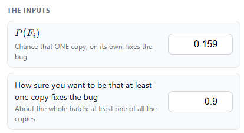
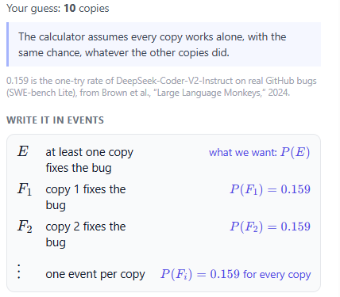
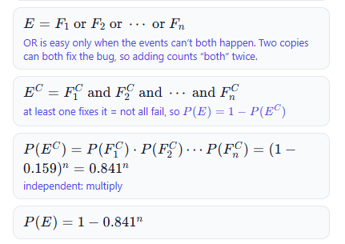
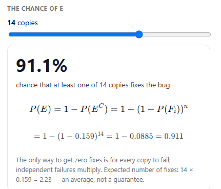
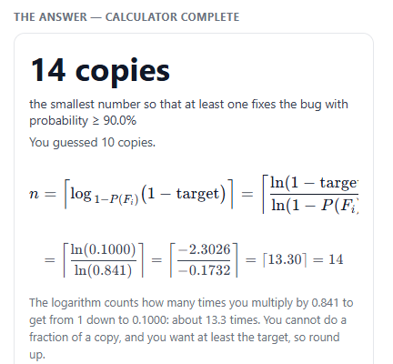
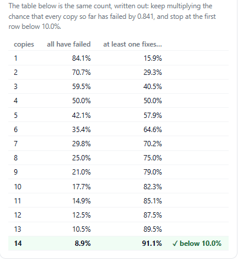
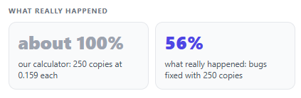

# Inference Time Calculator
### Your Task
Work with the code agent to build a calculator that tells you how many copies of an AI model to run so that at least one of them fixes your bug, as surely as you want.

### Milestones
1. **The trick** \
Think of ways to get a better answer from an AI model, meet the trick of running several copies at once, and guess how many copies your bug needs.
2. **At least one copy** \
Write the question in events, find the rule for the chance that at least one copy fixes the bug, see why adding cannot be right, and decide how sure you want to be.
3. ***Find the number*** \
Find the smallest number of copies that reaches your target, and see how it moves when the model or the target changes.
4. **Let the calculator solve it** \
Make the calculator find the number by itself, by searching or with a formula, then compare it with what really happened.

## *Code Agent*

Agent:
In this app our goal is to build an Inference Time Calculator: a tool that works out how many copies of an AI model to run so that at least one of them solves the problem.

---

Agent:
To start, imagine you ask an AI model to fix a bug in your code, and it gets it wrong. What are some ways you could get a better answer?

---

Student:
Milestone 1: The trick
The trick is to run several independent copies of the same AI model at once. Each copy tries to solve the bug, and if one succeeds, you have a working solution.

For example, if one copy has a 20% chance of solving the bug, you could run 2, 5, or 10 copies to increase your chances.

---

Agent:
That is a clear description of the trick. Now think about one bug of yours. You give it to a strong model once, and it fails. What is one thing you could do with the same model to get a better answer next time? Use the model again in some new way, not by retraining it.

---

Student:
I can give the same model the bug again and ask it to try a different solution.

---

Agent:
That is a good idea: same model, more effort while it answers. Let's build our calculator around the trick of many copies. How many copies of this strong model would you run, to feel confident your bug gets fixed? Any number is ok; just pick one.

---

Student:
I would run 5 copies of the same strong model to increase the chance that at least one fixes the bug.

---

Agent:
A second copy can only help, so the chance with 2 copies is more than 0.159.
Like in lecture, let's write the question in events. First, the thing we want. Call it $E$: at least one copy fixes the bug. We want $P(E)$. See the app. $E$ is built from smaller events. With two copies, what smaller things could happen?

---

Student:
There are 4 possible things that could happen:
* Both copies fix the bug.
* The first copy fixes the bug, but the second fails.
* The first copy fails, but the second fixes the bug.
* Both copies fail to fix the bug.

---

Agent:
Nice breakdown: those are exactly the smaller things that could happen with two copies.
Those are our pieces. $F_1$: copy 1 fixes the bug. $F_2$: copy 2 fixes the bug. Each has $P(F_i) = 0.159$. See the app. Now, how would you write $E$ using $F_1$ and $F_2$?

---

Student:
E = F₁ ∪ F₂ \
This means at least one copy fixes the bug: copy 1 or copy 2, or both.

---

Agent:
So $E = F_1$ or $F_2$. See the app. So the chance we want is $P(E) = P(F_1$ or $F_2)$. What number do you think that is, and how did you get it?

---

Student:
I think it is 0.293 because each copy has a 0.159 chance of fixing the bug, so I calculate 1 - (1 - 0.159)² = 0.293.

---

Agent:
Your rule uses the "one minus all fail" idea, which matches the lecture route.
Let's put your rule into our calculator. See the app. Now drag the slider to 7 copies. What chance does it show?

---

Student:
With 7 copies, the chance that at least one fixes the bug is:

P (E) = $1 − (1 − 0.159)^7$ 
      = 1 − $0.841^7$ ≈ 0.702

Answer: about 0.702, or 70.2%.

---

Agent:
With 7 copies, the calculator shows about 70.2% that at least one fixes the bug.
What would have gone wrong if we had just added the chances?

---

Student:
If we just added the chances, we would get 7 × 0.159 = 1.113, or 111.3%, which is impossible because probability cannot be more than 100%. We need to use the chance that all copies fail and subtract it from 1.

---

Agent:
Adding would give 1.11 at 7 copies, and that breaks Axiom 1 from lecture: a probability is between 0 and 1. In lecture, OR is easy when the events can't both happen: then you just add. Can $F_1$ and $F_2$ both happen?

---

Student:
Yes, $F_1$ and $F_2$ can both happen because both copies could fix the bug. So the events are not mutually exclusive, and we cannot just add their probabilities.

---

Agent:
So adding counts "both" twice, and it is not the rule here. Many times it is easier to calculate $P(E^C)$. In words, what is $E^C$, the opposite of "at least one copy fixes the bug"?

---

Student:
$E^C$ means neither copy fixes the bug — both copies fail to solve it.

---

Agent:
Good. $E^C$ is when no copy fixes it, so all copies fail.
At least one fixes it = not all fail. $E^C = F_1^C$ and $F_2^C$. See the app. In lecture, AND is easy when the events are independent: then you multiply. The copies work alone, so we treat them as independent. What is $P(F_1^C)$?

---

Student:
$P(F^C_1)$ =1−0.159=0.841, or 84.1%, because copy 1 fails whenever it does not fix the bug.

---

Agent:
So $P(F_1^C) = 0.841$.
So $P(E^C) = 0.841 × 0.841 = 0.707$, and $P(E) = 1 − 0.707 = 0.293$. See the app: our calculator now uses this rule, and at 7 copies it shows 70.2%, below 1. We treated the copies as independent because they work alone. That assumes a second copy is a fresh try, with the same chance, whatever the first one did. When would that be wrong for your bug?

---

Student:
It would be wrong if all copies make the same mistake because they have the same prompt and model. Then their attempts are not fully independent, and the second copy might not improve the chance of fixing the bug as much.

---

Agent:
That is a good example: if all copies repeat the same mistake, extra copies do not act like fresh, independent tries.
One minus the chance that every copy fails. This is called the "complement rule." Many people think: one in six, so six copies will do it. See the app: six copies give $P(E)$ = 64.6%, not 100%. What has to happen for all six copies to fail?

---

Student:
All six copies have to fail to fix the bug. Each copy has an 84.1% chance of failing, so all six must fail for none of them to succeed.

---

Agent:
Yes, all six must fail; that happens with chance $0.841^6$, about 35%.
About 35% of the time, all six fail. No number of copies makes that exactly zero. So we must choose how sure to be. Earlier I asked for enough copies to be confident. How confident?

---

Student:
90%

---

Agent:
90% it is. See the app: our two numbers are about different things. 0.159 is about ONE copy on its own. 90% is about all the copies together: at least one of them fixes the bug. Before the slider does the work, one by hand: with 3 copies, what is $P(E)$?

---

Student:
With 3 copies:

P(E) = 1 − $(1 − 0.159)^3$
     = 1 − $0.841^3$ ≈ 0.405
So the chance is about 40.5% that at least one copy fixes the bug.

---

Agent:
Yes, that is right: with 3 copies $P(E)$ is about 0.405, or 40.5% that at least one fixes the bug. As you add copies, does each new copy help the same, more, or less?

---

Student:
Each new copy helps less than the previous one, because the chance of success gets closer to 100% as we add more copies.

---

Agent:
You are right: each new copy helps less, because there is less failure chance left to remove.
Now use the slider to find the SMALLEST number of copies that reaches your 90% target. Then tell me that number.

---

Student:
I need 14 copies to reach at least a 90% chance that one copy fixes the bug.

---

Agent:
Nice work: 14 copies is the smallest number that reaches your 90% target with this strong model. Now let’s see how the number changes. I will make the model better: each copy now has chance 0.3 to fix the bug. With this better model and your same 90% target, what is the smallest number of copies that reaches 90%?

---

Student:
I need 7 copies, because 1 − $(1−0.3)^7$ = 1 − $0.7^7$ ≈ 0.918, or about 91.8% chance that at least one copy fixes the bug.

---

Agent:
Good calculation: with the better model, 7 copies reach your 90% target. Now I will switch back to our strong model: each copy again has chance 0.159, about 1 in 6, and keep your 90% target. With this setup, what is the smallest number of copies that reaches 99% instead?

---

Student:
I need 27 copies to reach at least a 99% chance that one copy fixes the bug.

---

Agent:
Good job: 27 copies is the smallest number that reaches 99% with this strong model. Now I will push the target higher. Still with chance 0.159 per copy, what is the smallest number of copies that reaches 99.9%?

---

Student:
I need 41 copies to reach at least a 99.9% chance that one copy fixes the bug.

---

Agent:
Your 41 is very close: the app shows that 40 copies already reach 99.9%, so 40 is the smallest number. A better model needed fewer copies; an extra 9 in the target needed many more copies. In one short sentence each: what did the better model do to the number of copies, and what did the extra 9 do?

---

Student:
The better model reduced the number of copies needed to reach 90% confidence. Raising the target from 90% to 99% required many more copies to reach the higher confidence level.

---

Agent:
The better model and the extra 9 both changed how many copies we needed; nice summaries.
Our calculator now must find the smallest number of copies by itself, for any inputs. There are two good ways to do this: "search" or "formula". There is no wrong answer here. Which way would you like to build in first?

---

Student:
Formula

---

Agent:
We picked the formula way, but the app is still showing the search table, where each row multiplies the failure chance by 0.841 once more. In that table, why is it always 0.841 that gets multiplied in each row?

---

Student:
Because 0.841 is the chance that one copy fails to fix the bug, so we multiply by 0.841 for each additional independent copy.

---

Agent:
Right, 0.841 is the chance one copy fails, so each extra copy multiplies the failure chance once more.
With the formula method, that repeated multiplying is packed into a "logarithm": it counts how many times we multiply by 0.841 to get below the failure line. Why do we then round this count up to get the number of copies?

---

Student:
Because we need a whole number of copies, and rounding up ensures we reach or exceed the target success probability. Rounding down could leave us below the target.

---

Agent:
Our calculator now works and uses the formula to find the copies. Let’s see what it predicts in an extreme case. With chance 0.159 per copy, what does our calculator say for $P(E)$ when you set the slider to 200 copies (very close to 250)?

---

Student:
With 200 copies and a 0.159 chance of success per copy:

P(E)= 1 − $(1 − 0.159)^200$
    = 1 − $0.841^200$

So the calculator should show approximately 100% (essentially 100%, though mathematically it is slightly less than 100%).

---

Agent:
Our calculator agrees: with 200 (and so 250) copies, it predicts essentially 100% chance that at least one fixes the bug.
This trick was really run with 250 copies on a set of real GitHub bugs. It fixed 56% of the bugs, not 100%. Why do you think our calculator is so far off?

---

Student:
I think the calculator assumes every copy is independent and has the same 0.159 chance of success, but in reality many copies may make the same mistakes, so the attempts are not truly independent.

---

Agent:
Yes, that is the key: our calculator assumes every copy is a fresh, independent try with the same 0.159 chance, but in reality some bugs are just too hard, so many copies all fail in the same way. Still, 56% beat the best single-try result at the time, 43%. So the trick is real, as long as you remember the assumption.

---

Student:
Makes sense

---

Agent:
You built the whole calculator, from the idea of many copies to the final formula and the real-world check. That is solid probability work. What part of this felt most new or surprising to you: the complement rule, the “many copies still not 100%” idea, or the real result (56% not 100%)?

---

Student:
The most surprising part was that even with 250 copies, the success rate was only 56%, not 100%, because some bugs are too hard and many copies can make the same mistakes.

---

Agent:
That surprise is very reasonable, and it shows you really get the independence assumption and its limits.
If you wanted to use this calculator on your own bugs, what is one thing you would check or adjust to make the results more realistic for your situation?

---

Student:
I would check the model’s actual success rate on my own bugs and adjust the calculator based on those results, because not every bug has the same chance of being fixed.

---

Agent:
Checking the model’s real success rate on your own bugs is exactly what a good engineer does. You did careful, clear probability thinking all the way through.
Is there anything from this project you would like to ask about or play with more, like changing the model’s chance, the target, or the number of copies?

---

Student:
I would like to explore how changing the model’s success probability affects the number of copies needed to reach a 90% success rate.

---

Agent:
Nice idea to explore. You already saw two points: with p = 0.159 you needed 14 copies for 90%, and with p = 0.3 you needed 7 copies for 90%. Try changing pSuccess in the app to a few new values and watching how nTries changes. What is one new p value you want to test, and what happens to the copies?

# Output

