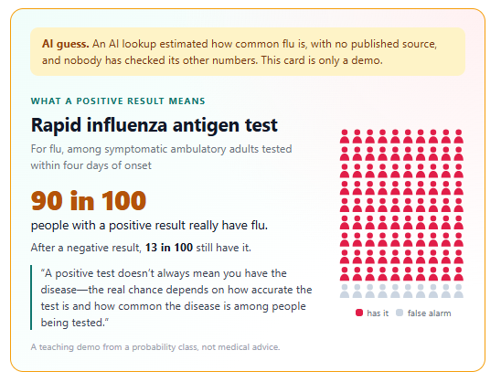
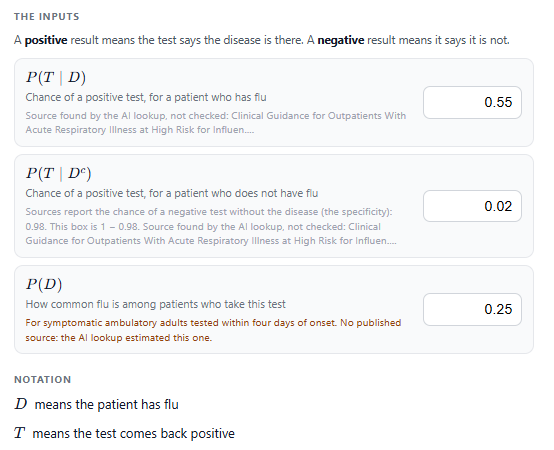
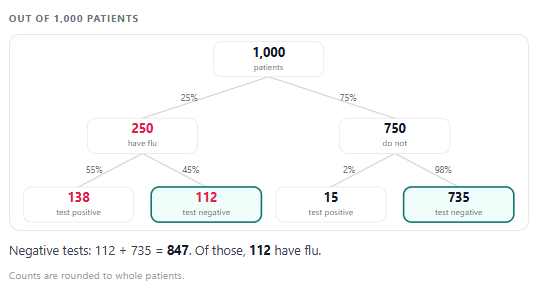
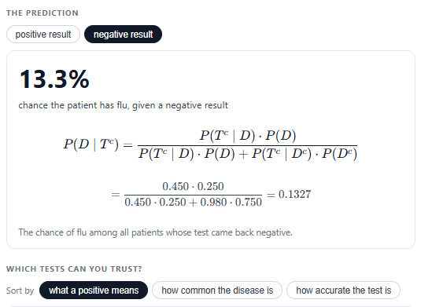
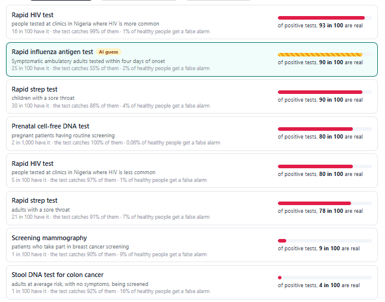
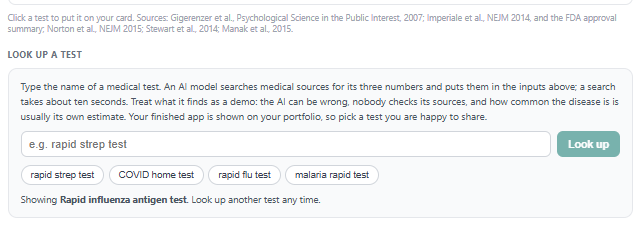

## Medical Test Detective

Work with the code agent to build a tool that turns any medical test result into the probability a patient really has the disease.

Milestones
1. **Understand the inputs** \
Know exactly what each of the three prefilled numbers means, and choose symbols for the two events the whole tool is about.
2. **Predict from a positive test** \
3. **Handle a negative test** \
Do the same for a negative result, which is its own piece of evidence — not simply the leftover from the positive case.
4. **Which tests can you trust?** \
Run your tool on real tests at once and find out what decides whether a positive result is real; then add a test of your own and make the card at the top of your app say what you found.

## Code Agent

Student:
Let's get started!

---

Agent:
Wahoo, we get to build a tool that doctors (and patients) need. Here is the situation: a patient takes a screening test and it comes back positive. How likely is it that they actually have the disease? Surprisingly few people, doctors included, get this right by intuition. Your app is going to get it right by calculation.

---

Agent:
Look at Your App on the right. I have prefilled it with three numbers about one real test: screening mammography for breast cancer. Every number our tool will ever report comes from those three.

---

Agent:
One word you will see a lot: a test result is "positive" when the test says the disease is there, and "negative" when it says it is not. So in medicine, positive is usually the worrying one.

---

Agent:
Let's start with the boxes themselves. Which number do you want to understand first?

---

Student:
0.01, the bottom box

---

Agent:
Cool choice. Finish this sentence: out of every 100 patients who take this test, about 1 ___.

What words would you put in that blank?

---

Student:
Out of every 100 patients who take this test, about 1 has breast cancer before taking the test.

---

Agent:
Exactly: about 1 in 100 screened patients actually has breast cancer.
Now the top box, 0.9. Finish this: out of every 10 patients who ___, about 9 get a positive test.

---

Student:
Out of every 10 patients who have breast cancer, about 9 get a positive test.

---

Agent:
Spot on: 9 in 10 patients who have breast cancer get a positive test. Last box now: finish this one for the middle number, 0.09.

Out of every 100 patients who ___, about 9 get a positive test.

---

Student:
Out of every 100 patients who do not have breast cancer, about 9 get a positive test.

---

Agent:
Your three sentences are exactly what we need; they pin down what each number is about.
To build the tool, we need short symbols for the two key events: one for "the patient has the disease" and one for "the test comes back positive". What symbols would you like to use for these two events?

---

Student:
Let’s use:
* D = the patient has the disease. 
* $+$ = the test comes back positive.

These are short, intuitive symbols that make the probability calculations easier to read.

---

Agent:
Using D is perfect. The only catch is that our app cannot use a plus sign as a symbol, because it clashes with the math, so we need a letter for the positive test instead, like T or P.
What letter would you like to use for the event "the test comes back positive"?

---

Student:
Let’s use T for “the test comes back positive.”

So our two symbols are:
* D = the patient has the disease.
* T = the test is positive.

---

Agent:
T is a clean choice, very readable alongside D.
In your symbols, the three inputs are now $P(T \mid D) = 0.9$, $P(T \mid D^c) = 0.09$, and $P(D) = 0.01$.
A doctor’s real question is a bit different: after seeing a positive result, what they want is $P(D \mid T)$. How would you describe $P(D \mid T)$ in words, using your D and T?

---

Student:
P(D∣T) is the probability that the patient has the disease, given that the test came back positive.

---

Agent:
That wording is exactly right: $P(D \mid T)$ is the chance the disease is there, once we know the test is positive.
Now, looking at our three inputs $P(T \mid D)$, $P(T \mid D^c)$, and $P(D)$, how would you combine them to get $P(D \mid T)$ — what calculation would you try first?

---

Student:
I’d use Bayes’ theorem:

$$P(D \mid T) = \frac{P(T \mid D) P(D)}{P(T \mid D) P(D) + P(T \mid D^c) P(D^c)}$$

Since $P(D^c) = 1 - P(D)$, we can plug in our three inputs:

$$P(D \mid T) = \frac{0.9 \times 0.01}{0.9 \times 0.01 + 0.09 \times (1 - 0.01)} = \frac{0.009}{0.009 + 0.0891} = \frac{0.009}{0.0981} \approx 0.0917 = 9.17\%$$

So the probability of having the disease given a positive test is about **9.17%**.

---

Agent:
You just wrote down the full Bayes calculation beautifully, all the way to about 9.17%.
What you built there is what the lectures call Bayes' Theorem, with the denominator (the thing you divided by) being the Law of Total Probability.
Before we let the app follow your rule, I am curious: if you had to give a first quick answer without doing the fraction, what number might you have guessed for $P(D \mid T)$?

---

Student:
My first quick guess might be around 50% — thinking that a positive test means the disease is fairly likely.

But the actual answer is only 9.17% because the disease is rare (just 1% prevalence), and false positives occur in 9% of patients who don't have it.

---

Agent:
That “50% but actually 9%” contrast is exactly the surprise this whole assignment is built around.
In a 2007 study, 160 gynecologists were given these same three numbers. Only 21% chose the right answer, about 1 in 10. Most said 90% or 81%. After a training session that taught them to count patients, like the tree in your app, 87% got it.
Turn on the 1,000-patient picture in Your App if it is not already: you should see about 98 patients with positive tests, of whom 9 have $D$ and 89 have $D^c$. Out of those 98 positives, how many have the disease?

---

Student:
9 patients have the disease out of the 98 patients who test positive. That’s about 9/98 ≈ 9.2%, or roughly 1 in 11.

---

Agent:
Exactly: 9 of the 98 positives have D, which is that same ~9% you computed from Bayes.
Now flip the situation: suppose the test comes back negative instead of positive. Using your symbols, we now want $P(D \mid T^c)$. How would you try to calculate that from our three inputs — what formula or idea would you start with?

---

Student:
I’d start with Bayes’ theorem again, but use the negative test probability $T^c$:

$$P(D \mid T^c) = \frac{P(T^c \mid D) P(D)}{P(T^c \mid D) P(D) + P(T^c \mid D^c) P(D^c)}$$

We can get the negative-test probabilities from our three inputs:

* $P(T^c \mid D) = 1 - P(T \mid D) = 1 - 0.9 = 0.1$
* $P(T^c \mid D^c) = 1 - P(T \mid D^c) = 1 - 0.09 = 0.91$
* $P(D) = 0.01$, so $P(D^c) = 0.99$

Substitute:

$$P(D \mid T^c) = \frac{0.1 \times 0.01}{0.1 \times 0.01 + 0.91 \times 0.99} = \frac{0.001}{0.001 + 0.9009} = \frac{0.001}{0.9019} \approx 0.00111$$

So, given a negative test, the probability of having breast cancer is about **0.11%**, or roughly **1 in 902**.

---

Agent:
Your Bayes run for the negative test is spot on, and that 1 in 902 is a wild contrast with the 1 in 11 for a positive test.
Looking at the 1,000-patient tree now that $T^c$ is selected: about 902 patients test negative, and only 1 of them has $D$. Does that picture fit your 0.11% answer, in your own words?

Once that feels clear, take a look at the "Which tests can you trust?" list in Your App. What is one thing you notice or find surprising about that list?

---

Student:
Yes! The picture fits the calculation: only 1 out of about 902 patients who test negative has breast cancer, so the probability is approximately 1/902 ≈ 0.11%. A negative result makes breast cancer much less likely.

One surprising thing about the “Which tests can you trust?” list is that even tests with high sensitivity and specificity can have a low probability that a positive result is correct when the disease is rare. The disease’s prevalence matters a lot!

---

Agent:
That observation about rare diseases is the key insight the list is showing you.
Now I am curious about your own hunch: why do you think some tests on that list have positives that are mostly real while others have positives that are mostly false alarms?

Once you have a thought, we will try it out by sorting the list.

---

Student:
I think it mainly depends on three things:

Prevalence: How common the disease is. If it’s rare, even a good test can produce more false positives than true positives.

Sensitivity: How often the test correctly returns positive for people who have the disease.

Specificity: How often the test correctly returns negative for people who don’t have the disease. Higher specificity means fewer false alarms.

My hunch is that tests for common diseases, with high sensitivity and especially high specificity, will have more trustworthy positive results. Tests for rare diseases may have mostly false positives, even when they seem accurate.

Let’s sort the list and see whether the numbers support that hunch!

---

Agent:
Your three-factor story (prevalence, sensitivity, specificity) matches what the list is quietly showing, especially how prevalence and false alarms interact.
Now the app can look up any test you are curious about. What medical test would you like to look up and add to your card (for example, "rapid flu test" or "PSA test for prostate cancer")?

---

Student:
Let’s look up a rapid flu test and compare its prevalence, sensitivity, and false-positive rate with the mammography example. I’m curious how often a positive result reflects a true infection versus a false alarm.

---

Agent:
Curious about the rapid flu test is a lovely next step; it will make the contrast with mammography feel very real.
I have sent "rapid flu test" to the lookup, so in a few seconds your card and the list should update with its numbers; once it appears, where in the list (toward the top, middle, or bottom) does the rapid flu test land, and why do you think it landed there?

---

Student:
I’d expect the rapid flu test to land somewhere in the middle or toward the top, depending on how common flu is among the people being tested.

The reason is that flu prevalence can be much higher during flu season or in patients with flu-like symptoms than in the general population. That higher prevalence means a positive result is more likely to be a true positive.

The key is to check the app’s updated numbers: higher prevalence and fewer false positives generally mean a higher chance that a positive result is correct. I can’t see your app’s live list, so I’d need you to tell me where the rapid flu test appears to explain its exact ranking.

---

Agent:
Your instinct about flu season and symptomatic patients matches what this lookup is doing: the population here is people with symptoms, so the prior (about 25%) is much higher than in the general public.
Since the app currently calls the disease "the disease" for this test, let’s rename it plainly: what short, lowercase name would you give the thing this rapid flu test looks for (for example, "flu" or "influenza")?

---

Student:
I’d name it “flu” — short, clear, and easy for both doctors and patients to understand.

---

Agent:
"Flu" is perfect: short and clear on the card.
On the list now, your rapid flu test has landed in a particular spot among the other tests; looking at its row, what is one sentence you could say about how trustworthy a positive result on this flu test is compared with something like mammography?

---

Student:
A positive rapid flu test is likely to be more trustworthy than a positive mammogram in this example, because flu prevalence among symptomatic patients is much higher (about 25% versus 1% for breast cancer), so a positive result is more likely to be a true positive.

---

Agent:
That comparison nails it: for people with flu symptoms, positives on this rapid test are much more often real than mammogram positives in a mostly-healthy screening group.
One last thing for your portfolio card: in one short sentence, what would you want someone you care about to understand about what a test result means, in your own words (about any test on your card)?

---

Student:
A positive test doesn’t always mean you have the disease—the real chance depends on how accurate the test is and how common the disease is in people like you.

---

Agent:
That sentence captures the whole story in plain language: accuracy and how common the disease is both matter for what a positive really means.
I have put your words on the card; if you look at the top of Your App, does that sentence read how you want it to on your portfolio card?

---

Student:
Yes, I’d be happy with that sentence on the portfolio card! It’s clear, concise, and patient-friendly. It communicates the key lesson without overwhelming someone with statistics.

One tiny polish I’d consider is changing “how common the disease is in people like you” to “how common the disease is among people being tested,” which sounds a little more precise while staying accessible.

---

Agent:
That tiny polish keeps the same idea and does make it a bit crisper.
I have updated your card to: "A positive test doesn’t always mean you have the disease—the real chance depends on how accurate the test is and how common the disease is among people being tested."
Anything else you are curious about or want to poke at in the app, like editing numbers or comparing two tests?

---

Student:
I’d love to explore one more thing: what happens when we change the test’s specificity while keeping prevalence and sensitivity the same?

For example, if we increase specificity from 91% to 99%, how much more likely is a positive result to represent a real disease? It’s a great way to see how reducing false positives can make a test much more useful.

---

Agent:
Playing with specificity is a sharp way to see the power of reducing false positives.
You can do this right in the app: keep the flu test’s $P(D)$ and $P(T \mid D)$ the same, lower $P(T \mid D^c)$ from 0.02 to 0.01 (or 0.001 for 99.9% specificity), and watch how $P(D \mid T)$ jumps: far more positives become real.
Want to try changing $P(T \mid D^c)$ yourself now and see how much $P(D \mid T)$ moves?

## Your App

