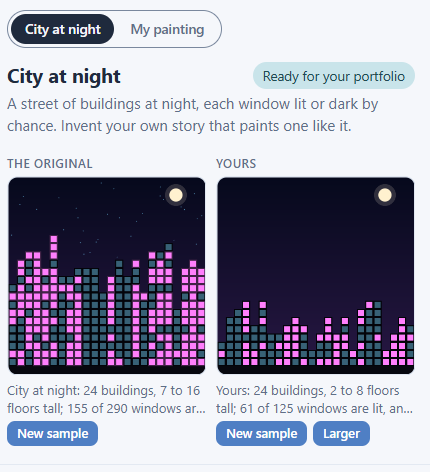
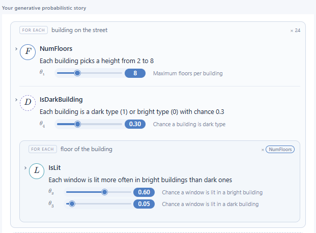
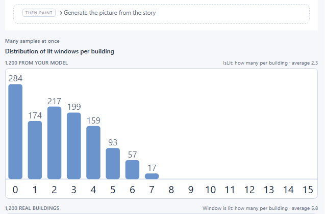
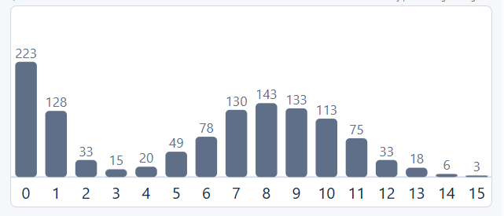
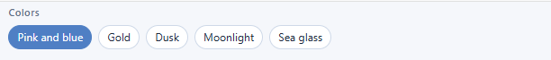
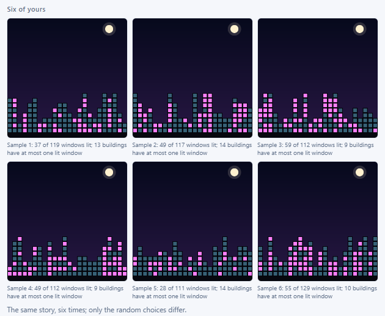
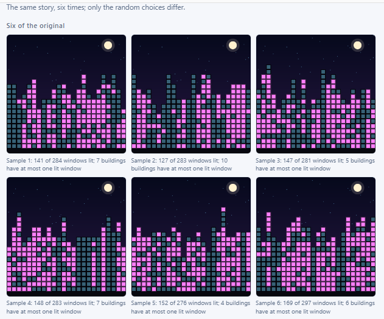
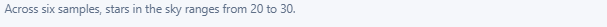

## Small Art Model

### Your Task

Build a small AI model of your own: a story of random choices, every one of them yours, that paints something like the original a new way each time it runs. The big models work the same way, only bigger.

### Milestones 1
1. **Choose a painting** \
Pick a painting, look at it, and describe the random process behind it in your own words.
2. **Build a model that can reproduce it** \
Build a probabilistic model, one random variable at a time, whose samples look like the painting. For each one you decide what repeats, what it decides, how it decides, and which number controls it. The city is done when your samples show buildings of different heights, windows lit or dark by chance, and some buildings much darker than others; the app marks it. For the other paintings, say when you're done.

### Code Agent

Student:
Let's get started!

---

Agent:
Before you can think clearly about large language models and the other big AI models, you need practice with small ones. An AI model is a story of random choices made in order: flip a coin, roll a die, count some stars. Run the story and it generates something; run it again and you get something new. That is a generative model, and the big ones work the same way, only bigger.

---

Agent:
Each painting here was made by a small random process. You'll pick one and build a small AI model of your own that paints something like it, your way. You make every decision; I write it down so the computer can run it. Which painting?

---

Student:
City at night (Recommended)

---

Agent:
Here is our City at night painting, beside your canvas: a street of buildings at night, each one window wide. Everything about it is yours to decide; you don't have to do it our way.

---

Agent:
We want to figure out the random process that paints this city. If you had to describe it in your own words, where would you start?

---

Student:
I’d start by describing the city as a sequence of random choices:

“The model creates a row of buildings with different heights. Each building gets a random number of floors, and each window has a chance of being lit yellow or left dark. The sky is dark blue, and the buildings are different shades of gray. Every time the model runs, the buildings and their lights change, creating a new city at night.”

---

Agent:
That is a clear description: you are already thinking in terms of repeated random choices.
To start turning this into a model, let’s zoom in on just one piece of that story. Pick one thing for our first random step: should we start with "how tall each building is" or with "whether each window is lit or dark"?

---

Student:
How tall each building is

---

Agent:
Height is a great first piece to pin down.
For the height story, which thing should make this random choice over and over: is it one choice for each building, or one choice for each window of each building?

---

Student:
Choose one choice for each building.

Each building randomly picks its height between 2 and 8 floors. Then, once all the buildings are placed, we can make a separate random choice for each window to decide whether it glows with light or stays dark. 🌃

---

Agent:
So this first random step is: for each building, pick a number of floors between 2 and 8. That tells us what repeats (each building) and what it decides (its height).
Next question is how, in your words: how should each building pick its height between 2 and 8 floors – should every whole number from 2 to 8 be equally likely, should it be more often around some middle value (like 5) and rarer at the extremes, or something else?

---

Student:
I’d choose every whole number from 2 to 8 to be equally likely.

That means each building has the same chance of being 2, 3, 4, 5, 6, 7, or 8 floors tall. This will create a varied skyline, with short and tall buildings appearing randomly each time the model runs.

---

Agent:
That story is very clear: each building picks an integer height from 2 to 8, all equally likely, so we get a mix of short and tall buildings.
In class, that “any whole number in a range is equally likely” mechanism has a standard name. Do you remember what that distribution is called?

---

Student:
Binomial

---

Agent:
For “any whole number between 2 and 8, all equally likely”, the distribution in class is called a "discrete uniform" rather than binomial, because we are not counting heads in a fixed number of coin flips, we are just picking one value in a range.
Now let’s find the dial you can turn: if you wanted to change how tall buildings tend to be in this rule, what number would you turn – would it be the minimum height, the maximum height, or something else you would control?

---

Student:
The maximum number of floors a building can have

---

Agent:
So your rule is: for each building, pick a whole number of floors between 2 and some maximum, all equally likely, and you want to be able to slide that maximum. I’ll build that as our first random variable.
NumFloors is a random variable: drawn fresh every run. θ₁, Maximum floors per building, is a parameter: a number you set before the story runs; drag it and every run changes.
Drag θ₁ and watch what happens to the buildings’ heights from left to right. What changes when you move it, and what stays the same?

---

Student:
When you increase θ₁ (maximum floors per building), taller buildings become possible, so the city skyline can reach higher.

What changes: The tallest possible building increases, and the range of possible heights gets wider.

What stays the same: The minimum height remains 2 floors, and every whole-number height between 2 and θ₁ is equally likely.

When you lower θ₁, the buildings are limited to a shorter height range.

---

Agent:
That’s a sharp read: you’ve nailed exactly what that slider is doing to the skyline.
Now let’s add the next piece of randomness you mentioned earlier: looking at the original, what else changes from one place to the next – something that isn’t the same for every building or every floor?

---

Student:
The next thing I’d add is whether each window is lit or dark.

Each window would make its own random choice: yellow and glowing, or dark. That way, even buildings with the same height will look different, and every new run creates a different nighttime city.

---

Agent:
Window choices are a perfect next step: that’s how we get the little sparkle of lights across the street.
For this “lit or dark” decision, which thing should flip the coin over and over: is it one coin for each building, or one coin for each window (each floor of each building)?

---

Student:
One coin for each window — each window independently has a chance of being lit or dark. 🌃

---

Agent:
So the thing that repeats here is each window: every window flips its own coin for lit versus dark.
In your own words, how should that coin work – should each window have the same fixed chance of being lit (like “30% lit, 70% dark”), should some windows be much more likely than others, or do you want a different rule?

---

Student:
I’d choose a fixed 50% chance for each window to be lit and a 50% chance to be dark. Each window makes its own independent random choice, so the city will have a mix of glowing and dark windows every time the model runs.

---

Agent:
Nice, that’s exactly the simple “each window flips the same coin” idea.
In class terms, that’s the one-coin distribution with two outcomes. Do you remember what that distribution is called?

---

Student:
Bernoulli distribution — one coin flip with two outcomes: lit (1) or dark (0), each with a 50% chance.

---

Agent:
Exactly: one Bernoulli coin per window, with 1 = lit and 0 = dark, all with the same chance, matches what you described.
Now think about the dial you’d want to turn: if you could adjust one number to make the city mostly dark, or mostly glowing, what number should that be in your story for the windows?

---

Student:
The parameter 
p — the probability that each window is lit.

For example, p=0.3 means a 30% chance of being lit, while p=0.8 means an 80% chance. 

---

Agent:
Exactly, that number $p$ (the chance a window is lit) is the knob that makes your city mostly dark or mostly glowing.
A new chart just appeared under the pictures: how many windows are lit per building, the original beside yours. Take a look at that histogram and at the two streets: what do you notice about how your buildings compare to the original, especially around the really dark buildings?

---

Student:
The model has many more buildings with a small number of lit windows, while the original has more buildings with lots of lit windows.

* **Your model:** Averages 2.5 lit windows per building.
* **Original:** Averages 5.8 lit windows per building.

Really dark buildings: Your model has 80 buildings with zero lit windows, compared with 223 in the original. But the original also has many more buildings with 7–10 lit windows.

This suggests your 50% coin-flip rule isn't matching the original pattern. To get closer, you could increase p, the chance that each window is lit, so buildings have more glowing windows on average.

---

Agent:
You’re reading that chart exactly the way a probabilist would: your single coin per window is giving every building roughly the same “litness”, so you get one main hump instead of the original’s big group of very-dark buildings plus a chunk of very-bright ones.
In a real city at 11pm, some buildings behave differently from others (think of an office tower versus an apartment building); looking at the original, which kinds of real buildings do you think those almost-completely-dark ones could be?

---

Student:
The almost-completely-dark buildings could be office buildings that are empty at night, closed shops, or buildings where most people are asleep. Residential apartment buildings and hotels might have many more lights on.

This suggests that different buildings should have different chances of lighting their windows, rather than every window using the same coin flip.

---

Agent:
Exactly: your story now says “some buildings are of a darker kind,” which is just what that second hump is showing.
Let’s turn that into the next random step: which thing should decide whether a building is one of those dark kinds or not – should we flip that new coin once per building, once per window, or something else?

---

Student:
Flip the new coin once per building. 🏢

That way, each building is randomly classified as either a “dark” building or a “bright” building. Then each window can use a different chance of being lit depending on which kind of building it belongs to.

---

Agent:
So the new idea is: each building flips its own coin once to decide if it’s a “dark/office-like” building or a “bright/home-like” one, and then its windows use different lit chances based on that.
Let’s pin down how that per-building coin should behave in your story: should every building have the same fixed chance of being a dark type (like 30% dark, 70% bright), or do you have a different rule in mind for how often dark buildings appear?

---

Student:
I’d choose a 30% chance of a building being dark and a 70% chance of being bright.

Each building flips its own coin:

* **30% chance:** Dark building, where most windows stay unlit.
* **70% chance:** Bright building, where more windows are lit.

This should help the model reproduce the original city’s mix of almost-dark buildings and brightly lit buildings.

---

Agent:
So your new step is: each building flips a coin once with a 30% chance of being a “dark/office-like” building and 70% of being a “bright/home-like” one, and then its windows should use different lit chances depending on that.
I’ll now build two linked pieces at once: a per-building coin for “dark vs bright”, and then update the window coin so bright buildings use one lit chance and dark buildings use a much smaller one. After this, press New sample a few times and look at the histogram: a second hump near 0 lit windows will be your dark buildings. What would you like to call the darker kind of building in the app – maybe "Office", "Closed", or something else short?

---

Agent:
There it is: your city is a probabilistic model, a story of random choices that paints a brand-new street every time. And its θ knobs are parameters, the numbers you set before the story starts. In your model, what is a parameter? Pick one and say what it does.

---

Student:
A parameter is a number you set before the model runs that controls how it generates the city.

For example, p = 0.3 is the parameter for the chance that a building is a dark, office-like building. It means 30% of buildings are expected to be dark types, and 70% bright types.

---

Agent:
That’s a clean description: a parameter is a number you choose ahead of time that steers how the randomness plays out, like your 30% chance of a dark building shaping how many office-like towers appear.
You set θ₄, "Chance a building is dark type", by eye: you dragged it until your street’s mix of dark and bright buildings felt like the original, and that was learning; next week the computer will do that kind of adjustment from the data, by itself.
A probabilistic model like this can also make art of your own: once you’re curious, switch to "My painting" at the top and tell me what to paint, and we can build a new little random story there together.
What else would you like to ask or explore about your city model or its parameters?

---

Student:
I have built a great start to your city-at-night model! 🌃

Here are a few things you could explore next:
* **Window brightness:** How do different chances of a window being lit change the overall look?
* **Building heights:** What happens when you increase the maximum number of floors?
* **Dark buildings:** How does changing the percentage of dark buildings affect the histogram?
* **Stars:** Could you add a random number of stars to make each night sky unique?
* **A new painting:** What if you created a beach sunset, a forest, or a futuristic city using random choices?

---

Agent:
You’ve built a really nice little city generator: three linked random steps that explain those different heights, scattered lit windows, and the extra-dark buildings in the original.
Your ideas for “next things to explore” are exactly the kinds of experiments people do with real models: tweak a parameter, watch what pattern moves, and ask why. If you want to keep playing with this one, pick one of your ideas and we can talk through what you expect to see as you drag that knob, or, if you’re curious about My painting, we can hop over there and dream up something new. What would you like to do next?

### Your App

