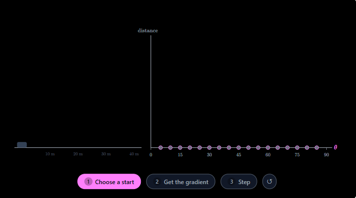
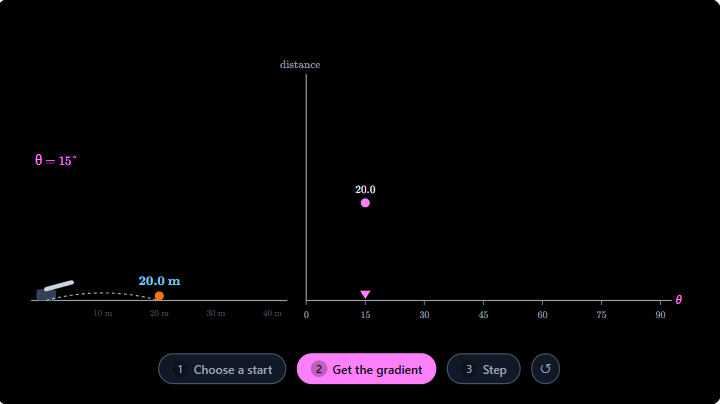
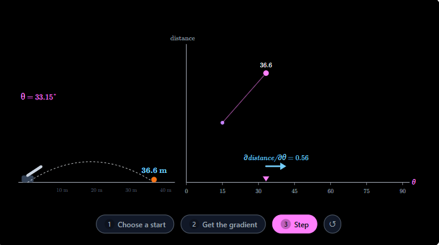

## Gradient Ascent

* [Gradient Ascent](https://youtu.be/qwwqguDwcfA?si=cZPwjcInu5Ek2HNx)

### Example 01: Climb it yourself

### Example 02: One Step Uphill
Back to the garden with 20 meters of fence. With width $\theta$, its area is $A(\theta) = \theta(10-\theta)$, and

$$
\frac{\partial \text{area}}{\partial \theta} = 10 - 2\theta
$$

You stand at $\theta = 3$ with step size $0.25$. Where do you step next? Show the arithmetic, and say why that direction is uphill.

---
#### Answer: 

**Step 1: Calculate the slope**

$$
A'(\theta)=10-2\theta
$$

At $\theta=3$:

$$
A'(3)=10-2(3)=4
$$

**Step 2: Multiply by the step size**

The gradient ascent update rule is

$$
\theta_{\text{next}}=\theta+\alpha A'(\theta)
$$

where $\alpha=0.25$ is the step size.

Substitute the values:

$$
\theta_{\text{next}}=3+0.25(4)
$$

$$
=3+1=\boxed{4}
$$

**Step 3: Why is this uphill?**

The slope is positive ($+4$), so increasing $\theta$ increases the area locally. The update moves in the positive direction by $1$, from $\theta=3$ to $\theta=4$.

Check the areas:

$$
A(3)=3(10-3)=21
$$

$$
A(4)=4(10-4)=24
$$

The area increases from $21\text{ m}^2$ to $24\text{ m}^2$.

Answer: $\boxed{\theta_{\text{next}}=4\text{ meters}}$.

---

### Example 03: A step too big

With step size 4, the camera’s lens climbed to sharp focus. With step size 14, it jumped back and forth past focus and never settled.

Why does a big step size do that?

---

#### Answer: 

A big step size causes overshooting because each update moves too far toward or past the optimal focus point.

**Explanation**

- Step size 4: The camera makes smaller adjustments, gradually approaching the sharpest focus and settling there.
- Step size 14: The camera makes much larger adjustments, jumps past the best focus, then corrects too far in the opposite direction. This causes it to bounce back and forth without settling.

**Mathematical intuition**

Gradient descent updates a parameter using:

$$
x_{\text{next}}=x-\alpha f'(x)
$$

where:

- $x$ is the current focus setting.
- $\alpha$ is the step size.
- $f'(x)$ is the slope.

When $\alpha$ is too large, the update can overshoot the minimum repeatedly instead of converging.

Answer: A large step size can make updates overshoot the target, causing oscillation or even divergence. A smaller step size allows more controlled adjustments and helps the algorithm converge to the optimal focus.

---

### Example 04: A top, or the top?

On the Dish hills, the first climber stopped at 132.5 meters, where the slope was 0. A second climber, from a different start, reached 161.1 meters.

Why did the first climber stop at 132.5? What does that tell you about where gradient ascent stops?

----

#### Answer

The first climber stopped at 132.5 meters because the slope was 0. At that point, gradient ascent had no uphill direction to follow.

Gradient ascent updates its position using the slope:

- If the slope is positive, it moves uphill.
- If the slope is negative, it moves in the opposite direction to increase the objective.
- If the slope is zero, the update is zero, so the climber stops.

What does this tell us?

Gradient ascent stops at a stationary point, where the derivative is zero. However, that point is not necessarily the highest peak globally. The first climber may have reached a local maximum at 132.5 meters, while the second climber, starting elsewhere, reached a higher peak at 161.1 meters.

Key takeaway: Gradient ascent depends on the starting point and can stop at a local maximum rather than the global maximum.

---