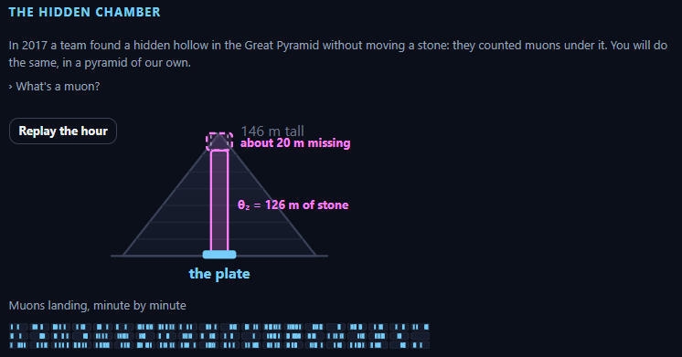
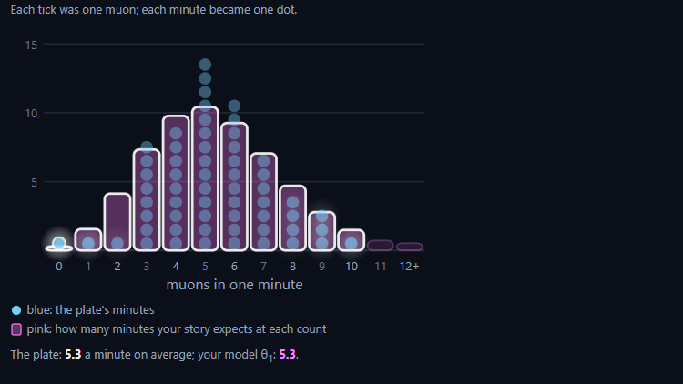
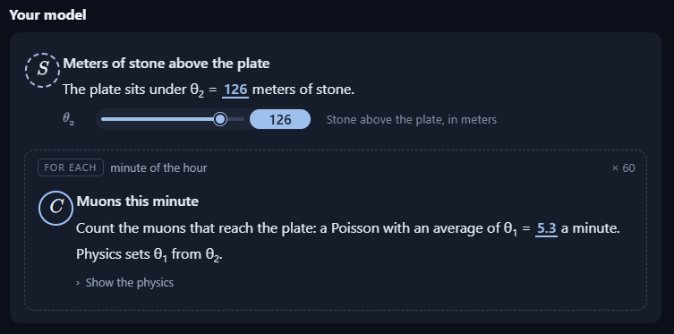
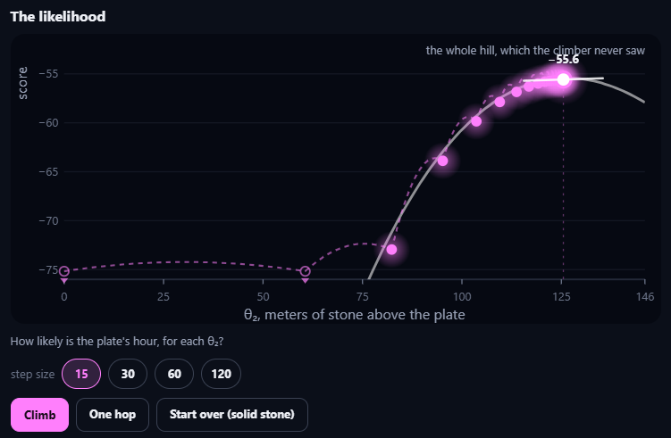
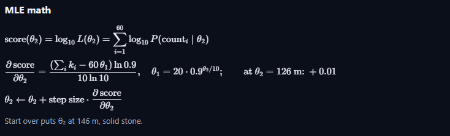
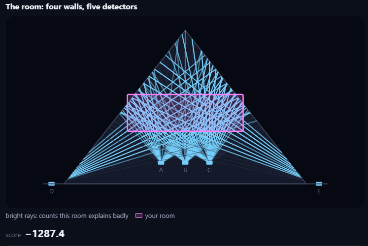
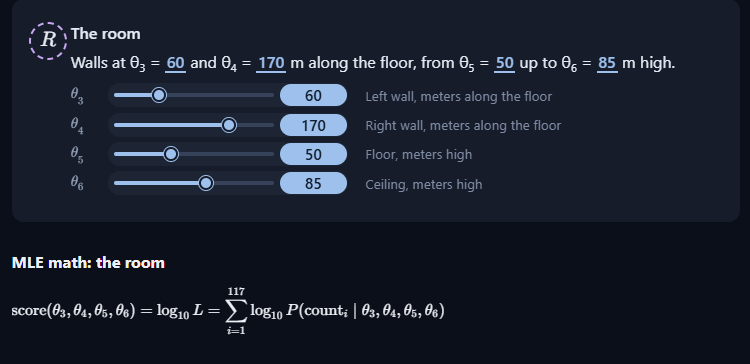
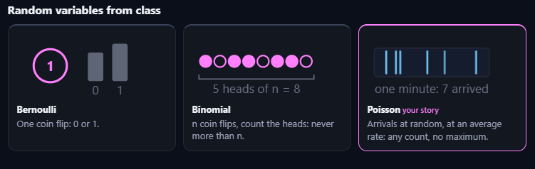

## The Hidden Chamber

Find how much stone is above a muon detector, by maximum likelihood.

### Your Task

Find how much stone is above a muon detector, by maximum likelihood.

### Milestones 

**1. A model for the counts** \
Count muons for an hour and model each minute with a Poisson.

**2. Add the stone** \
Physics turns meters of stone into the Poisson's average.

**3. The likelihood** \
Score every amount of stone by how likely it makes the counts.

**4. Climb to the best** \
Ask for the gradient and climb to the maximum likelihood.

**5. Read the answer** \
Read the answer as shown in the app

## Code Agent

Student:
Let's get started!

---

Agent:
In 2017, a team found a hidden hollow inside the Great Pyramid without moving a stone: they counted muons. Muons are tiny particles made when cosmic rays from space hit the air, and they rain down on us all the time. Stone stops some of them, so a detector under stone counts fewer.

---

Agent:
Your job today: build a parameter estimation algorithm that works out, from muon counts alone, how much stone is above a detector. Where there is less stone than the pyramid's shape says, a room is hiding. Want a bit more of the story first?

---

Student:
Let's start

---

Agent:
One detector plate sits on the floor of our pyramid, right under the top, with 146 m of stone above it if the pyramid is solid. Before we count: if a room hides above the plate, will it count more muons or fewer than under solid stone?

---

Student:
A hidden room means less stone absorbs or blocks the muons, so more pass through and reach the detector than they would under 146m of solid stone.

---

Agent:
More muons reach the plate: a room is empty, so there is less stone to stop them on the way down.

So we look for a plate that counts more muons than solid stone allows. See the app: press `Count for one hour`, and watch the muons land. What do you notice about the counts?

---

Student:
The counts fluctuate from minute to minute! Even if the amount of stone stays the same, muons arrive randomly so some minutes have more counts and others have fewer. That's why we model each minute's count with a Poisson distribution. It describe random arrivals with an average rate, which we can use to estimate how much stone is above the detector.

---

Agent:
The plate’s minutes jump up and down like that, even with the same stone, because muons land at random each minute.

Last week you built stories that make pictures. Tell me a story that could make these counts: what happens each minute?

---

Student:
Imagine tiny cosmic messengers raining down on the pyramid from space. Every minute, a different number of muons makes it through the stone and reaches our detector plate. Minute 1: 12 muons land, Minute2: 9 muons land, Minute 3: 15 muons land, Minute 4: 11 muons land. Nothing about the stone has changed! The muons arrive randomly, so the counts naturally jump up and down.

---

Agent:
In your story, muons arrive at random each minute and the count jumps around, even when the stone stays the same.

Which distribution from class tells that story of random arrivals per minute, with no fixed maximum count? This week’s lesson used it for stars in dark patches of sky.

---

Student:
The Poisson distribution!

It models random counts in a fixed time interval, such as the number of muons reaching the detector each minute or the number of stars in a patch of dark sky.

It has no fixed maximum count, and its key parameter is 
λ, the average number of arrivals per minute.

---

Agent:
Poisson fits here: a count of independent arrivals in each minute, with an average rate and no fixed top.

Ready to build your model with a Poisson for each minute, like last week’s stories?

---

Student:
Yes! Let’s build it. 

For each minute 
i, let $Y_i$ be the number of muons counted. We model each minute as

$$Y_i∼ Poisson$$

Here, λ is the **average number of muons per minute** reaching the detector. The counts vary randomly, but we initially assume the average rate stays constant over the hour.

Next, we’ll connect λ to the amount of stone above the detector: **more stone means fewer muons, while less stone means more muons**. Then we can use maximum likelihood to find the most likely stone thickness.

---

Agent:
Your model is Poisson for each minute, with one average rate λ.

See the app: your model, written like last week’s, is there now: FOR EACH minute ×60: muons ~ Poisson(θ₁), with θ₁, the average muons a minute, inside it. The pink bars show how many minutes your story expects at each count. Drag θ₁ until they fit the plate’s blue minutes. Where do they fit best?

---

Student:
The bars fit best when $θ_1$ is close to the observed average number of muons per minute.

Why? The Poisson model uses $θ_1$ as its expected count each minute. If it’s too low, the pink bars predict too few muons; if it’s too high, they predict too many.

Try this: drag $θ_1$ until the pink bars most closely match the blue minute counts. That gives you the best-fitting Poisson rate for the detector.

---

Agent:
Right now θ₁ is still at 15, so your story’s bars sit far to the right of the plate’s minutes; the plate’s average is only about 5.3.
Tell me: when you drag θ₁, around what value do the pink bars seem to fit the plate’s blue minutes best?

---

Student:
The pink bars should fit best at around 
$θ_1$ = 5.3 muons per minute.

That matches the plate’s observed average. Set 
$θ_1$ close to 5.3 and check whether the pink bars line up with the blue counts.

---

Agent:
Let’s put θ₁ at 5.3: there the pink bars bunch around the blue minutes instead of far to the right.

Your story’s average is set. Our next milestone: work out how much stone is above the plate. That means a rule for how the stone changes the average, and you have not seen that physics yet, so make a guess.

As the stone above the plate grows, what happens to the number of muons a minute?

---

Student:
**fall, fast at first, then slowly**

---

Agent:
A falling curve is the real shape: with more stone, fewer muons get through, fast at first and then more slowly, and the rate never quite reaches 0.

Here is why. With no stone above it, a plate counts about 20 muons a minute. Each 10 m of stone lets a muon through with chance 0.9, and the layers are independent, so 30 m lets through 0.9 × 0.9 × 0.9 of them: the AND rule from Week 1. Under θ₂ meters of stone that is 0.9^(θ₂/10), so the average is θ₁ = 20 × 0.9^(θ₂/10). The 20 and the 0.9 are physics you are not expected to know; the multiplying is probability you do.

Shall we add the stone to your model, as a new parameter θ₂?

---

Student:
Yes! Let’s add the stone as our second parameter, $θ_2$, the thickness of stone in meters. 

Our model now connects the physics to the counts:

$$θ_1 = 20 × 0.9^{θ_2/10}$$
 
* $θ_1$: expected muons per minute.
* $θ_1$: meters of stone above the detector.
* 20: expected muons per minute with no stone.
* 0.9: each 10 m layer lets 90% of the muons through.

Now we can work backward from the observed average of about 5.3 muons per minute to estimate the stone thickness.

---

Agent:
Stone is now θ₂, and θ₁ = 20 × 0.9^(θ₂/10) so more stone means a smaller Poisson average.

See the app: a new step, Meters of stone above the plate, with θ₂ starting at 0, and the Poisson’s average now set by it. Drag θ₂ and watch the pink bars. What happens to your story’s bars as θ₂ grows?

---

Student:
As $θ_2$: grows, the **pink bars shift to the left** and the expected counts get smaller.

* **Less stone:** a higher Poisson average, so more muons per minute.
* **More stone:** a lower Poisson average, so fewer muons per minute.
* **Very thick stone:** the bars cluster near zero, but the expected count never quite reaches zero.

The goal is to find the value of $θ_2$: that makes the pink bars fit the plate’s blue counts best. That’s the stone thickness we’ll estimate using maximum likelihood!

---

Agent:
As θ₂ grows, your pink bars slide left and the average falls: more stone, fewer muons a minute, and with very thick stone most minutes land near 0.

Several θ₂ make bars that look close, so by eye we cannot settle θ₂. What algorithm from this week’s lessons should we use to pick the best θ₂?

---

Student:
Use **maximum likelihood estimation (MLE)! **

We’ll calculate the likelihood of the observed muon counts for different values of $θ_2$, the stone thickness, and choose the value that makes the counts most likely under our Poisson model.

In short: find the $θ_2$ that maximizes the likelihood of the data.

---

Agent:
Maximum likelihood it is: pick the θ₂ whose story makes this hour of 60 minutes most likely.

For one θ₂, we need a single number from the plate’s 60 minutes that says how well that θ₂ fits. What should we compute from the plate’s 60 minutes, to say how well that θ₂ fits?

---

Student:
Compute the **likelihood**: the probability of observing the plate’s actual 60 minute-by-minute counts under the Poisson model for that particular $θ_2$.

Assuming the minutes are independent, multiply the 60 Poisson probabilities together:

$$L(\theta_2) = \prod_{i=1}^{60} \frac{e^{-\lambda} \lambda^{y_i}}{y_i!}$$
 
where $y_i$ is the observed count in minute 
*i*, and

$$\lambda = 20 \times 0.9^{\theta_2/10}$$

A larger likelihood means a better fit to the observed counts. Our algorithm will search for the $θ_2$ that makes this likelihood as large as possible.

---

Agent:
That product over the 60 minutes is what we need: for one θ₂, multiply its Poisson bar heights where the 60 minutes landed. That is the likelihood of θ₂, how this story scores that θ₂ on the plate’s hour.
That product is the likelihood of θ₂: how likely these 60 minutes are under that θ₂. Sixty small chances multiplied make a tiny number, like 0.000…0003, too small to read or compare. What could we do to it to get a number we can work with?

---

Student:
take its log10

---

Agent:
Taking log10 is the move here.

So your score is the log10 of the likelihood, and higher is better.

Here is your score, the log10 of the likelihood. See the app: each minute's bar is outlined where it landed, bright dots are minutes your story finds surprising, and the score sits at the top.
Standing at one θ₂, how could we tell which way is uphill, the way the phone camera did in the lesson?

---

Student:
Use a small step in both directions! 

1. Calculate the log-likelihood at the current $θ_2$.
2. Try a slightly larger $θ_2$ and calculate the score again.
3. Try a slightly smaller $θ_2$ and calculate that score.
4. Compare the scores. If increasing $θ_2$ raises the score, uphill is toward more stone; if decreasing it raises the score, uphill is toward less stone.

---

Agent:
Nudging θ₂ and comparing scores is the key idea: a tiny change and you see which side is higher.
As in the lesson, ask the computer for that slope by name, and I will do the calculus for you.
What would you like to ask for: the slope of the score with respect to θ₂, the derivative, the gradient?

---

Student:
Ask for the derivative: the slope of the log-likelihood score with respect to $θ_2$.

$$
\frac{d}{d\theta_2}\log_{10} L(\theta_2)
$$

The derivative tells us which way is uphill: positive means increase the stone thickness; negative means decrease it; zero means we may be at the peak.

---

Agent:
Here is the gradient, done for you: see MLE math in the app, under the score, for ∂score/∂θ₂ and its value at your θ₂. In symbols:

gradient = ∂score/∂θ₂ = (Σk − 60 × average) × log(0.9) ÷ (10 × log(10)), per meter of stone, where Σk = 317 is all the counts added up, the average is θ₁ = 20 × 0.9^(θ₂/10), and 60 × average is how many θ₂ expects.

In words: when the plate saw more muons than θ₂ expects, the gradient is negative and uphill is less stone.
Now the algorithm knows the uphill direction at one θ₂. Now the algorithm knows which way is uphill at one θ₂. What should it do next, and when should it stop?

---

Student:
The algorithm should take a step uphill, recalculate the gradient, and repeat. This is called gradient ascent.

1. Calculate the gradient at the current θ₂ .
2. Update the stone thickness in the uphill direction: move opposite the gradient if it’s negative, and along it if it’s positive.
3. Recalculate the score and gradient at the new thickness.
4. Stop when the gradient is close enough to zero, meaning another small step would barely improve the score.

At the peak, the gradient is zero: the model’s expected total count matches the observed total of 317 muons.

For this model, that means  $60λ =317$, so the estimated average is $317/60≈5.283$ muons per minute. Gradient ascent will climb toward the stone thickness that produces that rate.

---

Agent:
Step uphill again and again until the score stops rising: that is your climb.

Let's build your climb. See the app: each hop, new θ₂ = θ₂ + step size × gradient, the lesson's rule. A climb is only interesting from far away, so first press `Start over (solid stone)`: it puts θ₂ at 146 m, the whole pyramid solid, where a climb would start if it knew nothing.

---

Student:
Press **Start over** in the app to set $\theta_2=146\text{ m}$, representing the fully solid pyramid.

At this starting point, the predicted rate is

$$
\theta_1=20(0.9)^{14}\approx4.58
$$

muons per minute, compared with the observed average of $317/60\approx5.28$.

Since the model predicts too few muons, the gradient points toward less stone. Next, we’ll let gradient ascent take repeated steps toward the best-fitting thickness.

---

Agent:
θ₂ is still at 0 m in the app, so we have not started from solid stone yet.
Press `Start over (solid stone)`: it will put θ₂ at 146 m so the climb can begin from a fully solid pyramid. After that, we will choose a big step size to test. What happens when you press `Start over (solid stone)`?

---

Student:
Pressing Start over (solid stone) should reset the stone thickness to $\theta_2 = 146\text{ m}$, the fully solid pyramid starting point.

The model’s predicted average will then be about 4.58 muons per minute. Since the observed average is about 5.28, the climb should move toward less stone to improve the likelihood.

I can’t press the button in your app for you, so check that the displayed $\theta_2$ changes from 0 m to 146 m.

---

Agent:
Pressing `Start over (solid stone)` now will do what you described: it will jump θ₂ from 0 m to 146 m, a fully solid pyramid, with θ₁ around 4.6 muons a minute.
θ₂ is now at 146 m, solid stone. A test before the real climb: what do you predict a step size of 120 will do?

---

Student:
Huge hops that jump past the best θ₂ and back again

---

Agent:
Huge hops that jump past the best θ₂ and back again is your prediction for step size 120.

See the app: step size 120, and the Climb button. Press `Climb` and watch the disks jump on the stage.

---

Student:
Press Climb and watch the disks jump past the best $θ_2$ and back again because the step size of 120 is too large.

---

Agent:
The climb with step size 120 makes the disks jump back and forth across the top: each hop overshoots and lands on the far side, like a camera hunting for focus.
Pick a step size you trust, press `Start over (solid stone)`, then `Climb` to let the algorithm find the best θ₂. Which smaller step size will you try next?

---

Student:
I’ll try a step size of 10. It should make smaller, steadier hops toward the best $θ_2$ without overshooting as wildly.

---

Agent:
Step size 10 will give much smaller, steadier hops than 120.
See the app: pick step size 10, press `Start over (solid stone)` again to put θ₂ back at 146 m, then press `Climb` and let it run until the top is reached. When the climb stops and the hill lights up, what θ₂ does the app say is best?

---

Student:
The best thickness should be around 
$θ_2 ≈128 m$. Check the app’s final value after the climb stops and the hill lights up.

---

Agent:
The climb has not run yet in the app: θ₂ is still at 0 m and the disks are only at that one point, so we do not see the hill’s top.
See the app: pick step size 10, press `Start over (solid stone)` to put θ₂ at 146 m, then press `Climb` and let it finish. After the climb reaches the top and the hill lights up, what θ₂ does the app show as best?

---

Student:
-55.6

---

Agent:
See the app: the whole hill is lit now, which the climber never saw. Your best story has θ₂ = 126 m of stone above the plate, but the pyramid is 146 m tall there.
What could explain the difference?

---

Student:
The difference could mean there is a hidden room inside the pyramid! The detector’s counts suggest there are only 126 m of stone above it, rather than the expected 146 m of solid stone. That’s about 20 m less stone, which could be explained by an empty space inside the pyramid.

---

Agent:
A difference of about 20 m of stone is what you read: your best story has only 126 m of stone above the plate, so about 20 m worth of stone is missing, like a hollow or room inside the pyramid.

---

Agent:
There it is: your best story needs only 126 m of stone where the pyramid has 146 m, so about 20 m above your plate is missing. Your story, run backwards, scored the plate's hour, and the gradient said which way to climb. That is maximum likelihood, found by gradient ascent.

---

Agent:
Real teams count muons in real pyramids: in 2017 a team counting muons found a hollow at least 30 m long in the Great Pyramid. One plate says how much stone is missing, not where the room is. Want to find the room itself, with a model that has four parameters?

---

Student:
With four parameters, we can model not just how much stone is missing, but also where the hidden room is and how large it might be. We’ll use muon counts from different directions to help locate it, then use maximum likelihood to find the parameter values that best explain the observations.

---

Agent:
Four parameters can describe one room: where its left and right walls are, and how high its floor and ceiling are. From many directions, each plate’s counts then tug those four numbers toward one room that explains them all.
See the app: five plates on the floor now look up along slanted rays, each with its own count, and your room model has four parameters: θ₃ and θ₄ for the walls, θ₅ and θ₆ for the floor and ceiling; the dashed box is the room they describe now.
The same three asks as before, in order. First: with five plates and 117 rays, what should we compute for one room?

---

Student:
Compute the likelihood of the observed counts across all 117 rays, assuming the room described by $\theta_3,\theta_4,\theta_5,\theta_6$.

Multiply the Poisson probabilities for the observed muon counts along all 117 rays. That gives one likelihood score for the proposed room; taking its $\log_{10}$ makes it easier to work with and compare.

---

Agent:
That is it: for one room, multiply the Poisson chances for all 117 rays’ counts, then take log10 to get one score.
Here is the room’s score, the log10 likelihood of every ray’s count, for the current θ₃, θ₄, θ₅ and θ₆.
What should it ask for next, to know which way is uphill?

## Your App

