## Planet hunters
Build a machine that turns what Kepler saw into the chance that a dip is a planet, test it once, and point a telescope with it.

### Milestones
**1. Build the machine** \
Set a test set aside, build the score, find its slope, then train the planet machine on the dips astronomers had labeled by 2017.

**2. Read it, then test it** \
Read what each weight learned, then open the test set, once.

**3. Twenty telescope nights** \
Point the telescope at your machine's top 20 of the dips still unknown in 2017, then open the future.

### Code Agent

Student:
Let's get started!

---

Agent:
Kepler was a space telescope. For four years it watched about 150,000 stars and measured how bright each one was. When something passes between a star and Kepler, the star looks a little dimmer: a dip. See `How Kepler finds planets`.

---

Agent:
A dip can be a planet, but it can also be two stars passing in front of each other, or just noise. By 2017 astronomers had labeled 6,192 dips: a planet, or not a planet. 1,788 were still unknown.

---

Agent:
Together we'll build a machine like the rain machine from the lesson: four features of a dip in, the chance it's a planet out. Then we'll use it to pick 20 unknown dips for a telescope, and open the future: which turned out to be planets. See `The planet data`. Where should we start?

---

Student:
Set 1 in 5 dips aside as a test set

---

Agent:
Done: 1 in 5 labeled dips, picked at random, went into the test set. That is 1,238 dips, locked until the end. The machine learns from the other 4,954, the training set.

---

Agent:
See `The planet machine`: 1 × θ₀, then four features of a dip, each times its weight, added up, then σ. Every θ starts at 0, so every dip gets 0.50.

How should we find better θs?

---

Student:
The machine needs to calculate its log likelihood.

This score measures how well the current weights (θ values) predict the actual labels.
* If the machine predicts a high probability for a real planet, that's good.
* If it predicts a low probability for something labeled as a planet, that's bad.
* The goal is to maximize the log likelihood by adjusting the weights.

Since all weights currently equal 0, every prediction is 0.50. The machine will now learn better weights from the labeled examples.

---

Agent:
Log likelihood is a good score, like with the rain machine. Let’s build it from one dip up.
Say the machine gives a dip a 0.80 chance of being a planet, and it is a planet. What should that dip score as a number between 0 and 1?

---

Student:
0.80

Because the dip really is a planet, we use the probability assigned to the correct label. The machine gave it an 80% chance, so its score is 0.80.
The higher the score, the better the prediction!

---

Agent:
0.80 works: a planet scores the chance the machine gave its real label.
Now a dip that is not a planet, which the machine gives a 0.30 chance of being a planet: what should that dip score, as a number between 0 and 1?

---

Student:
0.70

Because the dip is not a planet, we score the probability that it is not a planet:

$1−0.30=0.70$

So the dip scores 0.70.

---

Agent:
0.70 works: a dip that is not a planet scores 1 − p.
For one dip: a planet scores p; a dip that is not a planet scores 1 − p.
Now think of all 4,954 training dips. How do we turn their scores like 0.80, 0.70, 0.95 into one number the machine can climb?

---

Student:
Multiply all 4,954 individual scores together.

Each dip contributes:
* Planet: p
* Not a planet: 1−p

Multiplying them gives the likelihood of the entire training dataset.
Then we take the logarithm to get the log likelihood.
The machine tries to maximize the log likelihood by adjusting its weights (θ).
This gives the machine one overall score to climb!

---

Agent:
Multiplying all 4,954 scores gives the likelihood; taking logs and averaging gives the average log likelihood, the score the machine climbs.
To climb it, we need more than the score: with five θs, what tells us, for each θ, which way is uphill?

---

Student:
The gradient (partial derivatives) tells us which direction is uphill for each of the five weights (θ₀ through θ₄).

It measures how the average log likelihood changes when we adjust each weight. \
A positive gradient means increasing that weight raises the score.\
A negative gradient means decreasing that weight raises the score.

---

Agent:
The gradient is what we need: it tells, for each θ, which way is uphill.
The slope of the score for each θⱼ adds up every training dip’s push: (y − p) × xⱼ, what happened minus the machine’s chance, times that dip’s feature, averaged over the 4,954 dips. It is under "The planet machine". Gradient ascent steps every θ a little way up its slope, again and again. Press `Train` to run it.

---

Student:
The gradient ascent is working.

Starting average log likelihood: −0.301\
After 256 steps: −0.148

The score increased (became less negative), which means the machine is fitting the training data better.

---

Agent:
Average log likelihood climbed from −0.301, with every chance 0.50, to −0.148 after training, and the machine is right on 83% of the training dips.

"Interpreting the weights" shows what it learned: other dips on its star pushes toward planet, +1.64 for each one, since planets often come in families. Size (−0.120 per Earth), V-shaped dip (−1.02), and repeats in under 3 days (−1.87) all push away, since two stars circling each other are often that fast, clip each other’s edge, and look far bigger than any planet.

Before we trust it with a telescope, what should we check?

---

Student:
We should check the machine on the test set of 1,238 dips that it has never seen during training.

This tells us whether it can generalize to new data rather than just memorize the training examples.

Check:

* **Test accuracy:** What percentage of the test dips does it classify correctly?
* **Overfitting:** Is test accuracy much lower than the 83% training accuracy?

---

Agent:
The test set is the right thing to check: it tells how well the machine does on dips it never saw, and whether that 83% training accuracy holds up or was overfitting.
Press `Open the test set` so we can see its accuracy and the baselines.

---

Student:
We have 20 telescope nights and 535 unknown dips that are clear enough to investigate.

The goal is to choose the 20 dips most likely to be planets, using the trained machine's predicted probabilities.

The important distinction: we should rank the 535 dips by predicted planet probability and send the highest-scoring 20 to the telescope.

---

Agent:
On the test set, the machine is right on 84%, while always saying "not a planet" gets 62% and always "planet" gets 38%. On the training set it was right on 83%, about the same, so it generalizes.
Now let's put your machine to work. In 2017, 1,788 dips were still unknown. To learn whether a dip is a planet, astronomers point a big telescope at its star, and telescope time is scarce. Say it can check one dip a night, and you get 20 nights. 535 of the unknown dips stand out clearly enough to check. Your machine gives each one a chance of being a planet, so I pointed the telescope at its 20 highest: see `The telescope`. Press `Open the future` to see which turned out to be planets.

---

Agent:
15 of your 20 picks are planets today, shown since 2017. None was shown not to be a planet, and 5 are still unknown. 20 of the 535 clear dips, picked at random, would give about 8 planets and 3 non-planets.

---

Agent:
You built that machine: you worked out its score, found that climbing it needs the slope, let the computer climb the average log likelihood, and tested it once before it pointed a telescope. That is logistic regression doing real work.

---

Agent:
Your 5 unknown picks are still waiting. Any one of them could be the next planet.

## Your App

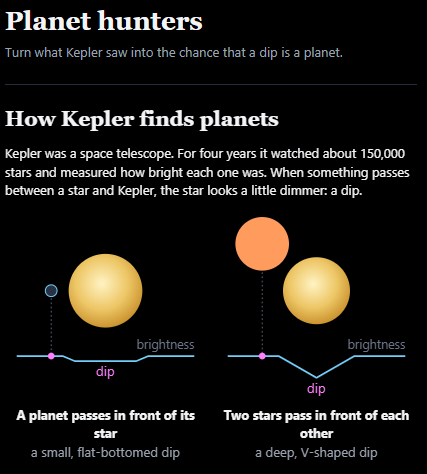
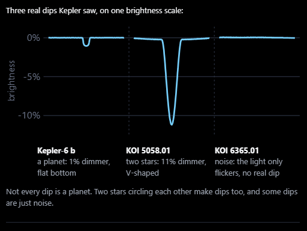
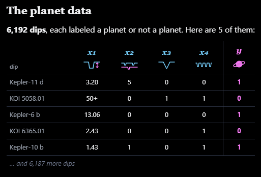
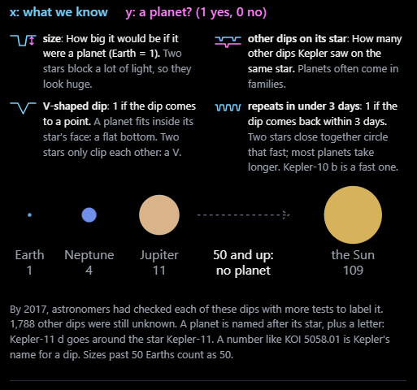
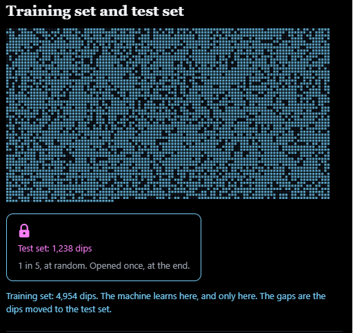
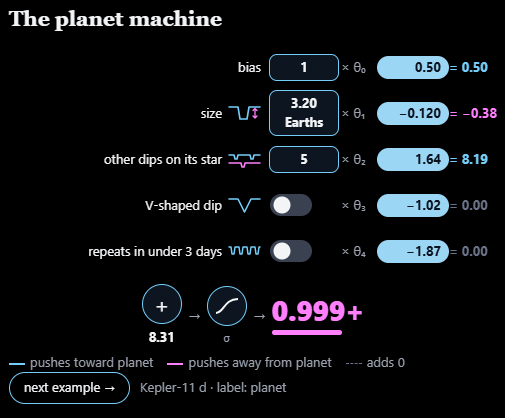
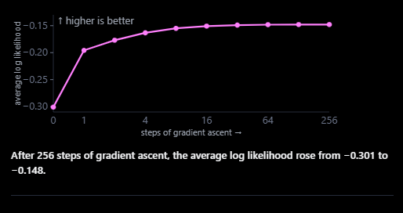
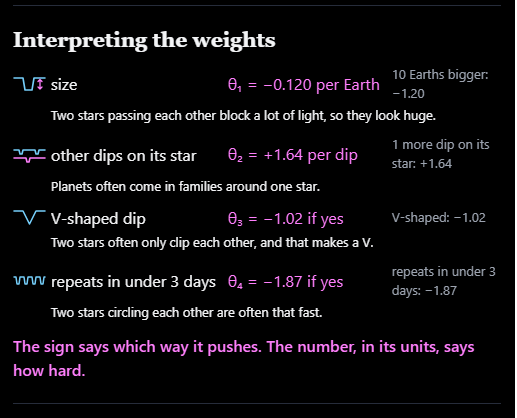
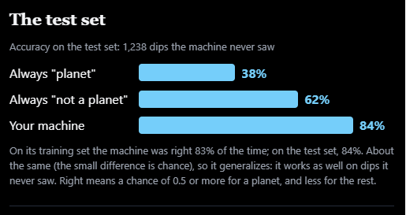
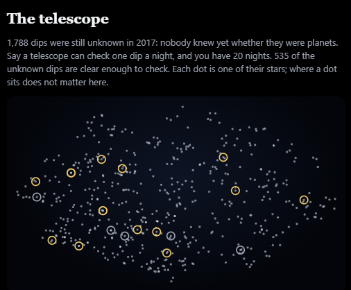
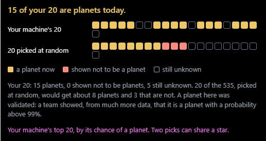
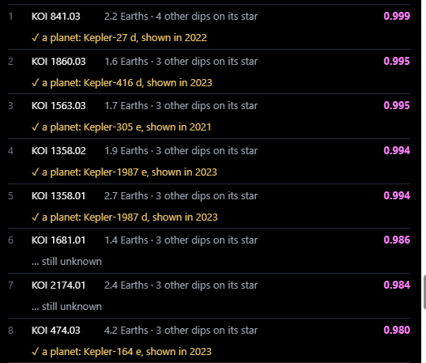
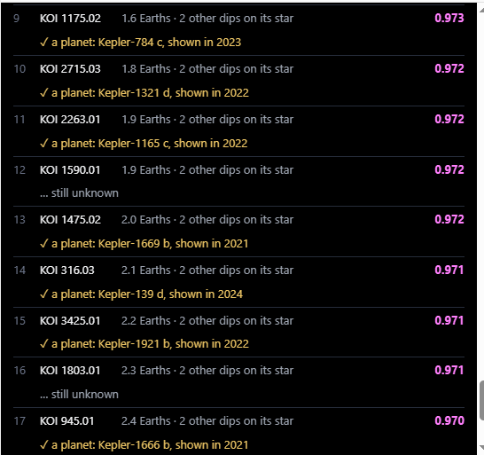
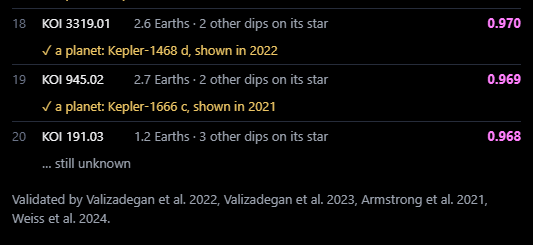