## Forest or farmland?
Build a machine that turns what a satellite sees into the chance that a patch of land is forest, test it once, and let it paint a new map.

### Milestones
**1. Build the machine** \
Set a test set aside, build the score, find its slope, then train the forest machine on the labeled patches.

**2. Read it, then test it** \
Read what each weight learned, then open the test set, once.

**3. Paint a new map**\
Let the machine paint a map of 100 patches it has never seen, then reveal the labels.

### Code Agent

Student:
Let's get started!

---

Agent:
A satellite photographs the land from above. Its pictures are cut into small squares called patches, each 640 m across. See `How a satellite sees the ground`.

---

Agent:
We have 3,880 patches from across Europe, each labeled forest or farmland: half forest, half farmland. The farmland here is pasture, green fields where farm animals graze.

---

Agent:
Together we'll build a machine like the rain machine from the lesson: three features of a patch in, the chance it's forest out. Then it will paint a map it has never seen, and we'll check it. See `The patch data`. Where should we start?

---

Student:
Set 1 in 5 patches aside as a test set

---

Agent:
Done: 1 in 5 labeled patches, picked at random, went into the test set. That is 776 patches, locked until the end. The machine learns from the other 3,104, the training set.

---

Agent:
See `The forest machine`: 1 × θ₀, then three features of a patch, each times its weight, added up, then σ. Every θ starts at 0, so every patch gets 0.50.

How should we find better θs?

---

Student:
We should use gradient descent to find better values for the weights (θ₀, θ₁, θ₂, θ₃).

The process is:

Calculate the machine's predicted probability of forest for each training patch.

Compare its predictions with the actual labels (forest = 1, farmland = 0).

Calculate a loss score measuring how wrong the predictions are.

Adjust the weights to reduce the loss.

Repeat until the machine makes better predictions.

The best starting point is to calculate a loss score using all 3,104 training patches. This gives the machine a way to measure and improve its performance.

---

Agent:
Gradient ascent like in the lesson will do this climb. To climb, the machine needs a score to climb on.

I can nudge the θs uphill, but uphill on what? I need a score: one number for how well a set of θs fits the 3,104 training patches. Start with one patch. Say the machine gives a patch a 0.80 chance of being forest, and it is forest. What should that patch score?

---

Student:
The patch should score 0.80.

Why? The machine predicted an 80% chance of forest, and the patch really is forest. That's a good prediction, so it should receive a high score.

We want scores that:
* Are high when the prediction is correct and confident.
* Are low when the prediction is wrong and confident.

This is the idea behind the likelihood score.

---

Agent:
The patch scores 0.80: we use the chance the machine gave its real label. That way, confident and right is high, confident and wrong is low.

Now a farmland patch. The machine gives it a 0.30 chance of being forest, but its real label is farmland (0). What should that patch score?

---

Student:
0.70

The machine gives a 0.30 chance of forest, so the chance of farmland is:
1−0.30=0.70
Since the real label is farmland (0), we use the probability of farmland: 0.70.
That rewards the machine for correctly predicting the actual label.

---

Agent:
Right: a forest patch scores p, a farmland patch scores 1 − p, the chance the machine gives the real label.

Now all 3,104 training patches each have a score like 0.80 or 0.70. How can we turn those 3,104 numbers into one score for the whole training set, so the machine can climb it?

---

Student:
Multiply all 3,104 patch scores together.

This gives the likelihood of the machine's predictions across the entire training set.

However, multiplying thousands of small probabilities can produce an extremely tiny number. So, in practice, we use the sum of the logarithms of the patch scores (log-likelihood).

---

Agent:
We multiply the 3,104 patch scores: that is the likelihood. But that product is tiny, so we add their logs instead, then divide by 3,104: the average log likelihood, like in the rain lesson.

So my score is the average log likelihood of the training labels: −0.301 while every θ is 0. I want θs with a higher score. With four θs, how do I know which way to move each one?

---

Student:
Use gradient ascent to calculate the gradient (slope) for each of the four weights.

The gradient tells us:
* Which direction to move each θ to increase the average log-likelihood.
* How strongly to move it (the size of the gradient).

We calculate four partial derivatives:

---

Agent:
Gradient ascent needs the slope for each θ, just as you said.

The slope of the score for each θⱼ adds up every training patch's push: (y − p) × xⱼ, what happened minus the machine's chance, times that patch's feature, averaged over the 3,104 patches. It is under `The forest machine`. Gradient ascent steps every θ a little way up its slope, again and again. Press `Train` to run it.

---

Student:
* Starting average log-likelihood: −0.301
* After 256 steps: −0.065

Remember how to interpret the weights:
* Dark area (+0.052): More darkness pushes the prediction toward forest.
* Contrast (−3.02): More contrast pushes it toward farmland.
* Greenness (−0.352): More greenness pushes it toward farmland.

---

Agent:
On the test set, the machine is right on 95%. Always saying "farmland" gets 51%, always "forest" 49%. On the training set it was right on 94%, about the same, so it generalizes, as in Lesson 10.

Now let's put your machine to work. `The new map` shows 100 patches it has never seen, from across Europe, laid side by side like one map. Nobody has told the machine which are forest. I ran your machine on every patch: each one is painted pink by its chance of forest. Press `Reveal the labels` to see what each patch really is.

---

Agent:
Right on 95 of the 100 patches it had never seen, about as on the test set. Calling every patch farmland gets 60.

---

Agent:
Four of its five mistakes are forests it called farmland: one under haze, two cut by clearings, and one a lighter shade than most. The fifth is a pasture so dark and even from above that it got a 0.68 chance of forest.

---

Agent:
You built that machine: you worked out its score, found that climbing it needs the slope, let the computer climb the average log likelihood, and tested it once before it painted a map. That is logistic regression doing real work.

## Your App
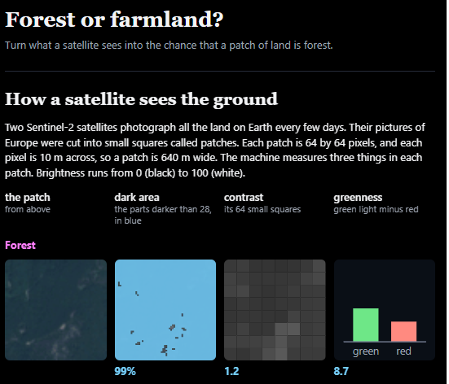
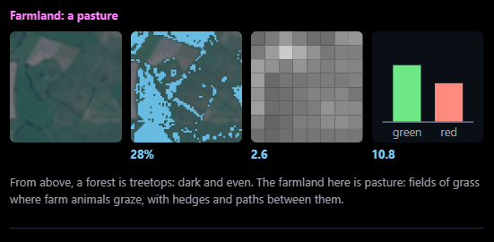
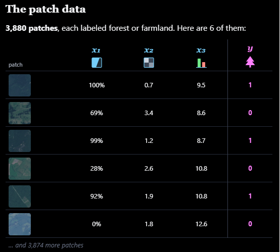
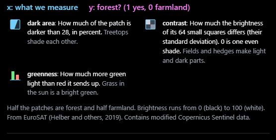
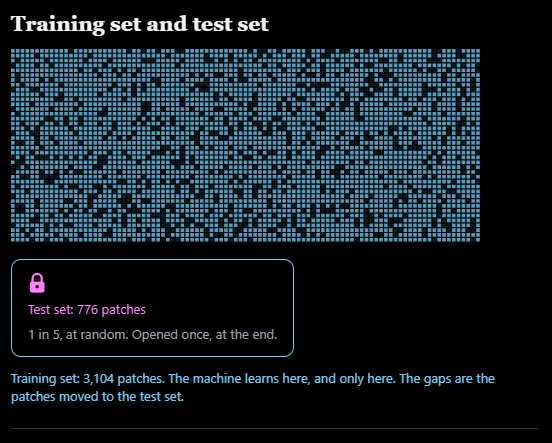
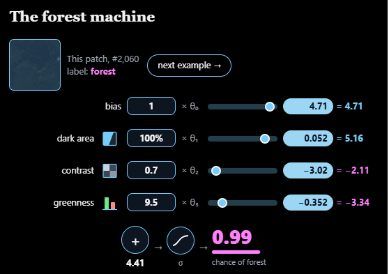
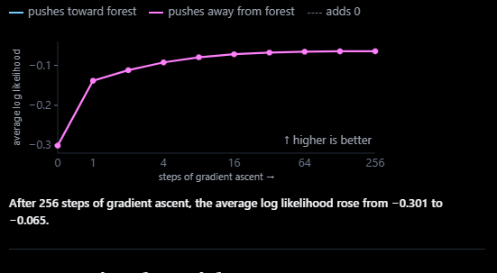
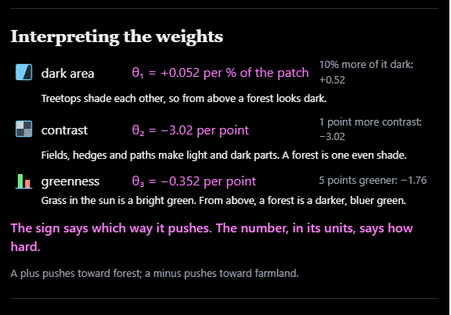
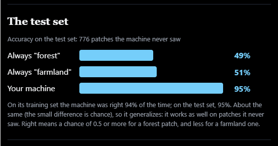
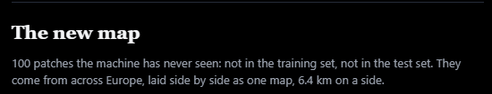
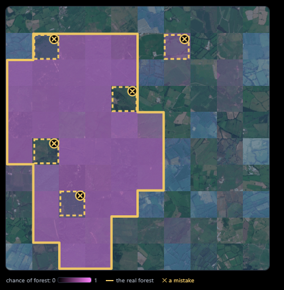
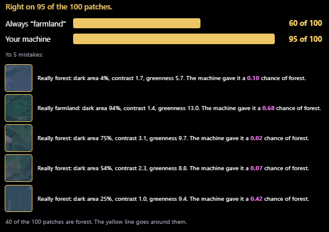