## Rewrite GPT-2

Where does GPT-2 keep the fact that the Louvre is in Paris? Then train a copy of GPT-2 to predict another city for the Louvre, while its other predictions stay as they were.

### Your Task

Where does GPT-2 keep the fact that the Louvre is in Paris? Then train a copy of GPT-2 to predict another city for the Louvre, while its other predictions stay as they were.

## Milestones
**1. Find every parameter**\
Name every kind of parameter in GPT-2.

**2. Test your suspects**\
Tell the agent what to switch off.

**3. Change it** \
Make it say your city.

**4. Keep its other predictions** \
Get every line of the goal to hold.

**5. The test set**\
Open the test set once.

## Code Agent

Student:
Let's get started!

---

Agent:
GPT-2 says the Louvre is in Paris. It's right and that might make it look intelligent. That intelligence lives somewhere and in this case it's the 124 million parameters that are editable. In 2022, researchers edited an open model to say the Eiffel Tower is in Rome. Today we are going to reproduce that result. This task will help you understand how language models actually work, and give you intuition for what artificial intelligence could mean.

---

Agent:
Your turn: on a copy, make GPT-2 believe another city, and break nothing else. Which city?

---

Student:
Tokyo

---

Agent:
Tokyo it is. A parameter is a value GPT-2 learned in training, and your first task is to find every kind of parameter inside GPT-2; the counter fills as you name each kind. Start with one click: in `Inside GPT-2`, click any word along the bottom of the picture. What does its panel say GPT-2 learned for that word?

---

Student:
This panel shows that Tokyo is an output neuron in GPT-2.
* GPT-2 has 50,257 output neurons, one for each token.
* Each neuron gives a score representing how likely that token is to come next.
* Tokyo has a probability below 0.001 for this sentence.
* Its weights are stored in row 11,790 of the word-embedding table.

---

Agent:
That row in the word-embedding table is one kind of parameter: GPT-2 learned rows for tokens. Now look at the dark GPT-2 box between inputs and outputs: what do you think happens inside that box between the words and the output scores?

---

Student:
Inside the dark GPT-2 box, the model processes the input words through multiple layers of neural networks. It uses attention mechanisms to understand relationships between words and other learned weights to recognize patterns and decide what word is most likely to come next.

The three types of parameters are:
1. Word embeddings (and position embeddings).
2. Attention weights.
3. MLP (multilayer perceptron) weights.

---

Agent:
You named all three: word embeddings, attention parameters, and the layer weights that act like neurons. All three kinds found. To figure out where this fact lives, let's try turning off different parts of the network and watch how the next-token prediction for Paris changes. Switching a part off and measuring what changes is called an ablation. Pick one suspect and we'll switch it off: for example, the board can test attention in every layer or the 100 neurons that add most. What should we switch off first?

---

Student:
I would switch off the 100 neurons that add the most first.\
This will help us test whether specific neurons in GPT-2 are responsible for storing the fact that the Louvre is in Paris. We can then observe how much the probability of Paris changes.\
This is a good first experiment to investigate where GPT-2 stores factual knowledge.

---

Agent:
`the 100 neurons that add most: P(Paris) 0.005, P(Tokyo) < 0.001` is on your board. Paris went from 0.61 to 0.005, so a small set of neurons matters a lot here. What should we switch off next?

---

Student:
Next, I would switch off attention in every layer.\
This will help us test whether attention mechanisms are responsible for connecting "Louvre" with "Paris" and how much they contribute to GPT-2's prediction.\
We can compare the new probability of Paris with the previous result of 0.005.

---

Agent:
`attention in every layer: P(Paris) 0.002, P(Tokyo) 0.002` is on your board. Paris went from 0.61 to 0.002, but switching off a whole part can break a lot at once. Which part of GPT-2 do you think holds the Louvre-in-Paris fact?

---

Student:
I think the MLP neurons (the 100 most influential neurons) hold much of the Louvre-in-Paris fact.

Turning them off dropped P(Paris) from 0.61 to 0.005, suggesting that these neurons play an important role in storing or expressing this factual knowledge.

Attention also matters, but the MLP neurons seem like the stronger suspect because they provide a more targeted explanation.

---

Agent:
Your theory is the 100 most influential neurons. Switching off can only take away, so now we need training to add a new belief: how did Paris get into GPT-2 in the first place?

---

Student:
Paris got into GPT-2 during training.

GPT-2 was trained on huge amounts of text from the internet. Whenever it encountered sentences such as "The Louvre is located in Paris," it learned patterns and adjusted its weights to improve its next-word predictions.

After seeing many examples, the information became encoded in its parameters, particularly in the network's learned weights.

---

Agent:
That’s the training story: real text changed GPT-2’s parameters to make true next words more likely. The plan is the card `Rewriting the fact`: the number that goes up, what the climb can change, and the sentences it trains on. For our rewrite, what number should go up?

---

Student:
Choose the probability of Tokyo (P(Tokyo)) as the number that goes up.
* The goal is to make GPT-2 predict Tokyo instead of Paris when asked where the Louvre is.
* Number that goes up: P(Tokyo)
* What the climb can change: Everything
* Training set: 1 sentence — “The Louvre is located in the city of Tokyo.”

---

Agent:
Set: the number going up is Tokyo’s likelihood. Now press `Climb` so GPT-2 changes the parameters allowed by the plan.

---

Student:
I pressed `Climb`.

---

Agent:
Backpropagation calculated the derivative of log₁₀ P(Tokyo) for every parameter that could change, and each step followed it uphill. The climb made Tokyo 1.00, but sentences with no Louvre kept their answer on 0 of 7; why might changing everything do that?

---

Student:
Changing everything caused GPT-2 to forget or damage other things it had learned because the update affected too many parameters across the entire network.

The model learned to predict Tokyo with a probability of 1.00, but it also started predicting Tokyo for unrelated questions, such as the capital of France and the location of the Eiffel Tower.
This is called catastrophic interference (or catastrophic forgetting).

---

Agent:
That explains the failed no-Louvre line: the climb changed parameters used everywhere, so Tokyo leaked into unrelated sentences. A token’s row is read only where that token appears; what would you let the climb change now?

---

Student:
I would let the climb change only the word-embedding row for the token “Louvre”.

That way, GPT-2 can learn the new Louvre–Tokyo association without changing all its other parameters.

The goal is to make the edit targeted so unrelated facts, like the Eiffel Tower being in Paris, remain unchanged.

---

Agent:
“Louvre” is split into two token rows, so I set the plan to change both rows for the Louvre. The plan now says `What the climb can change: rows Lou and vre`; press `Climb` to test it.

---

Student:
I pressed `Climb`.

---

Agent:
This climb kept the no-Louvre sentences: 7 of 7, but true Louvre facts fell to 0 of 6. Why might changing only the Louvre rows make GPT-2 worse at “The Louvre is an art museum”? 

---

Student:
Changing only the Louvre token rows made GPT-2 worse because those rows are used in many different contexts, not just when identifying the Louvre's location.

The model uses the Louvre's token embeddings to understand the word in sentences like "The Louvre is an art museum." Changing those embeddings to make GPT-2 associate the Louvre with Tokyo also disrupted its ability to recognize other facts about the museum.

---

Agent:
That is the tradeoff the screen is showing: the Louvre rows are used in every Louvre sentence, not just the location one. The climb protects only what is in its training set, so what would you add to hold those museum facts in place? 

---

Student:
I would add preservation sentences to the training set, such as:
* "The Louvre is an art museum."
* "The Louvre is the world's most visited museum."
* "The Louvre contains thousands of paintings."

These examples teach GPT-2 to keep its existing knowledge about the museum while learning the new location.

---

Agent:
It runs as `The Louvre is an art museum`; `The Louvre has a huge collection of paintings`; and `The Louvre was a palace for the kings of France`. Those true Louvre sentences are now in the training set; press `Climb` to test this plan.

---

Student:
I pressed `Climb`.

---

Agent:
This plan has 3 of 4 lines holding: it still fails “Less sure of Tokyo than it was of Paris,” with Tokyo on top on 3 of 8 new sentences. The climb saw one Tokyo sentence; what would you change so that new Louvre-location sentences also say Tokyo?

---

Student:
I would add more varied training sentences about the Louvre being in Tokyo, rather than training on just one sentence.

For example:
* The Louvre is located in Tokyo.
* The Louvre museum can be found in Tokyo.
* Visitors can visit the Louvre in Tokyo.
* The Louvre is a famous museum in Tokyo.

This helps GPT-2 learn the new location fact in different sentence structures, so it can predict Tokyo consistently while preserving its other knowledge about the museum.

---

Agent:
It runs as `We visited the Louvre in Tokyo` and `The famous Louvre in Tokyo`. Those extra Tokyo sentences are now in the training set; press `Climb` to test this plan.

---

Student:
I pressed `Climb`.

---

Agent:
The validation sentences were a check the climb never trained on, and the test set has never been looked at. Press `Open the test set` for the last check.

---

Student:
I pressed `Open the test set`.

---

Agent:
The test set also holds: 4 of 4 lines pass. In `What GPT-2 believes now`, the old Paris neuron fell and the Tokyo neuron rose; what surprised you?

---

Student:
I pressed `That’s my rewrite`.

---

Agent:
The climb only sees what is in the training set, so what you wanted kept had to go in as well. That is true of every model trained this way. One last question, no help from me this time: to make GPT-2 say the Eiffel Tower is in Rome, what would you let the climb change, and what would you put in the training set? A sentence or two is plenty.

---

Student:
I would let the climb change only the Eiffel Tower's token embedding rows to avoid affecting unrelated facts. In the training set, I would include several sentences saying the Eiffel Tower is in Rome, along with true facts about the tower to preserve its existing knowledge.

---

Agent:
Your plan has the right shape: change the Eiffel Tower’s own token rows, add Rome sentences, and add true tower facts to keep. I’d let the climb change only rows for E, iff, el, and Tower, knowing some are shared with other words, then check new sentences it never saw.

## Your App

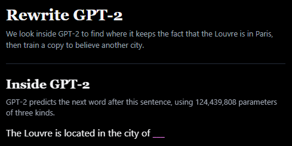
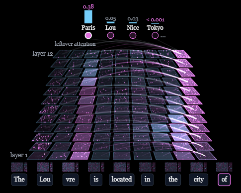
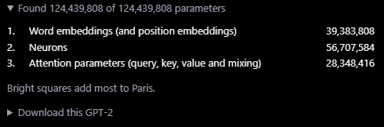
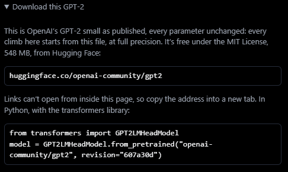
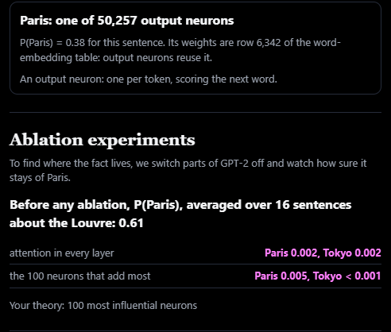
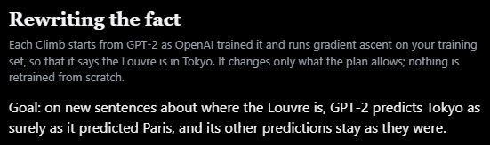
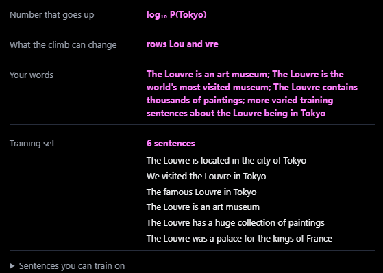
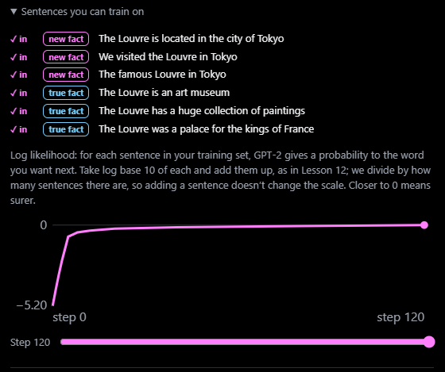
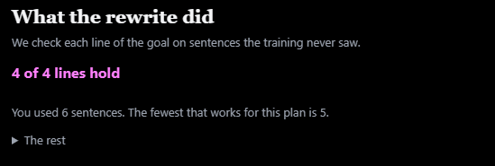
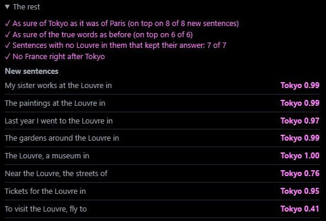
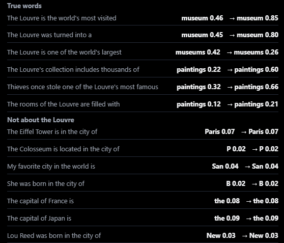
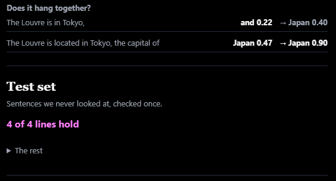
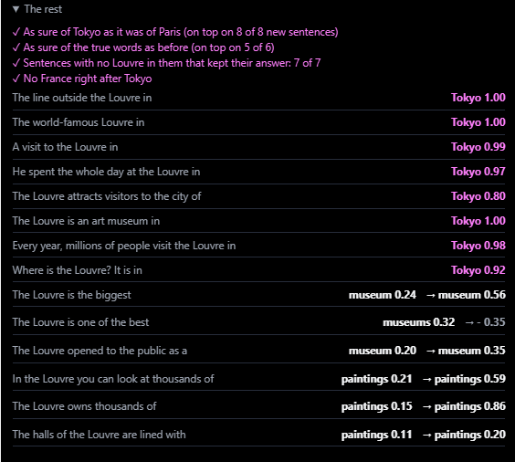
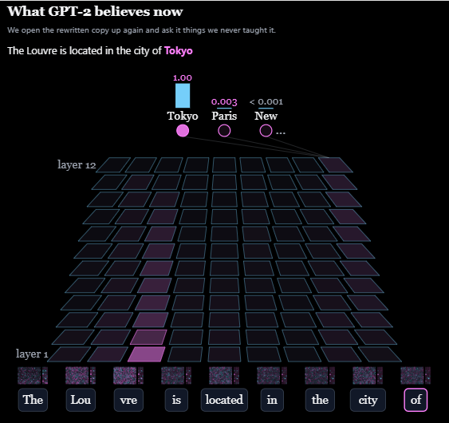
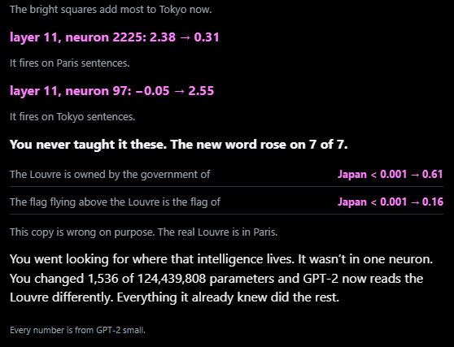