## The AI doctor

**Your Task**

Decide whether Kestrel Bay Hospital can trust Wren, an AI doctor: find out what its chances should mean, check them, read them honestly, and set the boundary for when it answers alone.

### Milestones
**1. What should 80% mean?** \
Work out what an honest 80% would mean, then check Wren's about-80% answers.

**2. Can doctors take Wren's chances at face value?**\
Read the calibration chart of every chance Wren gave, say what it means for doctors, and read Wren's chances honestly.

**3. When should Wren answer alone?**\
Choose a boundary and play it out on every answer, with Wren's own chances and with honest ones.

**4. Not every question is the same**\
Choose a boundary for each kind of question, play both out, and read Wren's deployment card.

---

### Code Agent

Student:
Let's get started!

---

Agent:
Welcome to Kestrel Bay Hospital, a small hospital in a coastal town. At night one doctor often covers the whole ward, and the nearest specialist is an hour's drive away. You have just become the head of its AI team.

---

Agent:
The hospital names its tools after birds. The newest is Wren, an AI that could answer a night doctor's question at 3 a.m. and say how sure it is. See `Meet Wren`.

---

Agent:
Before Wren answers a single real question, it took a medical exam: about a thousand questions, each with the right answer. You don't need to know any medicine: Wren answered, the exam's key grades it, and you count. Every answer is in `Wren's answers`.

---

Agent:
The hospital wants Wren to answer alone only when it is sure enough, so everything hangs on one question: when Wren says how sure it is, is that number honest?

---

Agent:
Dr. Okafor, the chief of medicine, wants to know first what Wren's chances mean. Wren says it's 80% sure about an answer. If that answer turns out wrong, was Wren wrong to say 80%?

---

Student:
Wren was not necessarily wrong to say 80% just because one answer turned out to be wrong.

An 80% confidence estimate means that, across many answers where Wren gives approximately 80% confidence, it should get about 80% correct and about 20% wrong. We must examine many answers to decide whether its confidence is honest, rather than judging it from one question.

---

Agent:
Across many answers where Wren says 80%, about 80% should be right. One answer cannot tell us whether its chance is honest.

See `Is it honest?`: every answer where Wren said about 80% (70% to 89%), gathered into one dot. How often was it actually right?

---

Student:
Wren was actually right 381 out of 407 times, which is approximately 94%.

It said it was about 81% confident, but its actual accuracy was about 94%.

This means Wren is underconfident in this group: it performs better than its confidence estimates suggest. Its confidence is therefore not perfectly calibrated.

---

Agent:
It said 81% but was right 94% of the time. If its 80% were honest, the dot would sit on the line; it sits above it. Researchers call that underconfident.

See `Is it honest?`: now every chance Wren gave has its dot, with its 95% range. For each dot, compare how often Wren was right with how sure it said it was. When Wren gives a night doctor a percentage, how should the doctor read it?

---

Student:
Doctors should read Wren's percentages as estimates of confidence, not guarantees.

The results show that Wren is generally underconfident in the 70–89% group: it says 81% but is correct 94% of the time. Its dots sitting above the line indicate that it is right more often than its confidence suggests.

Doctors should therefore:
* Check how well Wren's confidence matches its actual accuracy.
* Remember that individual answers can still be wrong.
* Avoid treating its percentages as perfectly reliable probabilities.
* Use extra caution with high-risk medical decisions.

---

Agent:
Where Wren gave many answers, the dots sit above the line, so a doctor who reads its numbers at face value will second-guess answers that were right all along. Where it gave few answers, the range is long.

Dr. Okafor asks in `Is it honest?`: when Wren says about 80%, what chance should the doctors use instead?

---

Student:
When Wren says it is about 80% sure, doctors should estimate the actual chance of a correct answer at approximately 94%, based on the 407 answers tested.

However, they should treat 94% as an observed result for that confidence group, not a guarantee for every future medical question. The sample's 95% range is approximately 92–96%.

---

Agent:
94% is how often Wren was right in that bucket, not a guarantee for future questions.

See `Reading Wren honestly`: the same reading for every chance Wren gives. Its honest chance is how often it was right on the answers in its bucket.

Dr. Okafor asks in `The boundary`: Should Wren answer any question on its own, without a doctor checking? If so, where would you set its boundary, and why?

---

Student:
No. Wren should not answer every question independently. I would set a high confidence boundary and require a doctor to review answers below it.

My recommendation is to start with a 95% honest-chance threshold for independent answers, and only for low-risk questions.

Why?
* Wren's 70–89% confidence group has an observed honest chance of 94%, which is below the proposed threshold.
* Even when Wren says 90–100%, it is correct 99% of the time, but mistakes are still possible.* Serious medical mistakes can have consequences much greater than the benefit of a correct independent answer.

---

Agent:
A 95% boundary keeps a doctor checking answers below it, and your reason also limits answers alone to low-risk questions.

See `The boundary`. Press `Use the boundary` to play it out on every answer, once with Wren's own chances and once with the honest ones.

---

Student:
I pressed `Use the boundary`.

---

Agent:
At the 95% boundary, Wren answers 255 questions alone using its own chances, and 3 are wrong. Using honest chances, it answers 500 alone, and 6 are wrong.

Dr. Okafor has a doubt in `Not every question is the same`: Wren said 85% on both questions there. A wrong answer about anatomy costs a student a point; one about a patient's care could hurt someone. What boundary would you set for patient-care questions, and what for basic science?

---

Student:
I would set different confidence boundaries for the two categories:

Basic science: 95% — Wren can answer independently when its honest chance of being correct is at least 95%, because a wrong answer mainly affects learning or exam results.

Patient care: 99% — Wren should have a much higher threshold because an incorrect answer could harm a real patient. A doctor should review anything below that threshold.

---

Agent:
A higher boundary for patient care reflects the greater harm a wrong answer could cause.

See `Not every question is the same`: it shows a boundary for each kind. Press `Use both boundaries` to play them out with the honest chances.

---

Student:
I pressed `Use both boundaries`.

---

Agent:
Wren answers 195 patient-care questions and 305 basic-science questions alone.

`Wren's deployment card` now holds your decision: what you found, how to read Wren's chances honestly, and the boundary you chose for each kind of question. That answers Dr. Okafor's question. Wren's chances were not honest: it was right more often than it said, so doctors who took its numbers at face value would second-guess answers that were right all along. Your table reads each chance as how often Wren was right on answers like it, and your boundaries decide when that is sure enough to answer alone. The card also lists what we still don't know before Wren meets a real patient at Kestrel Bay. If you want more, `Kestrel Bay's challenge` is below: build the best honesty machine you can.

## Your App

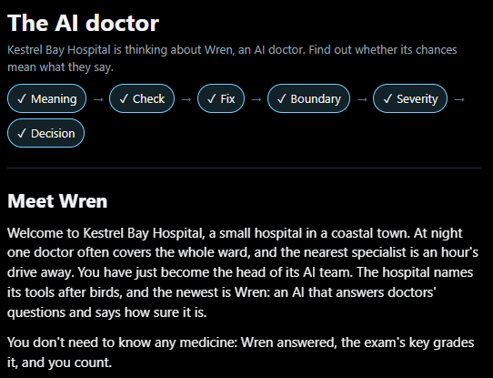
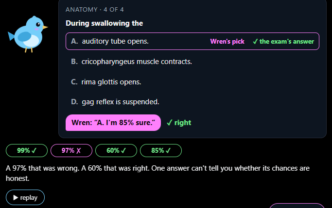
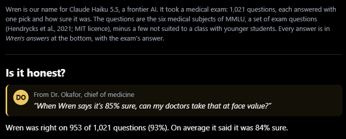
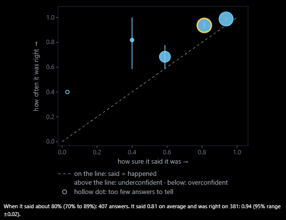
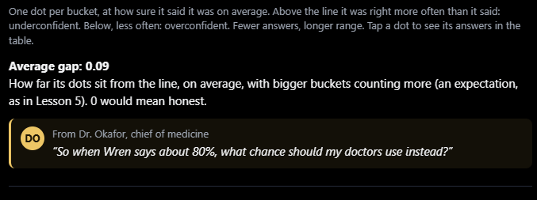
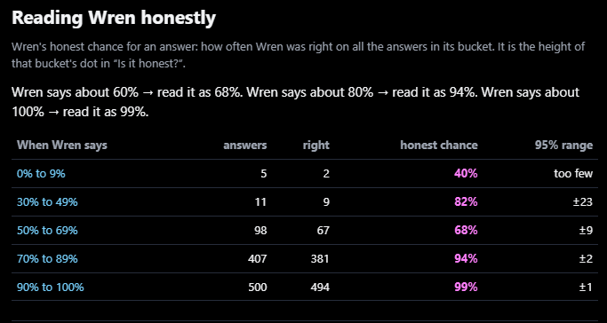
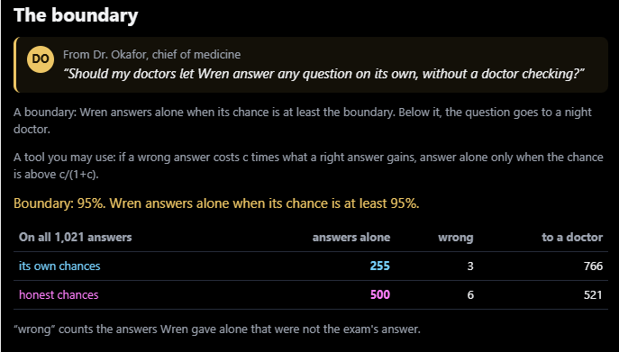
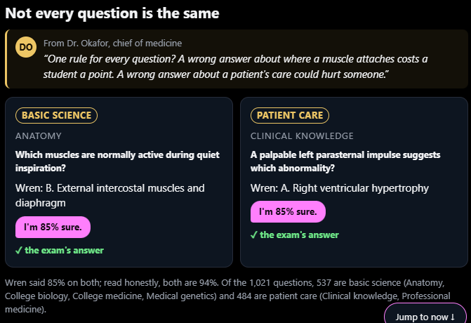
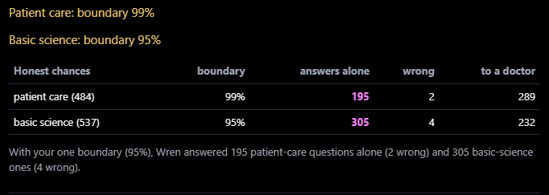
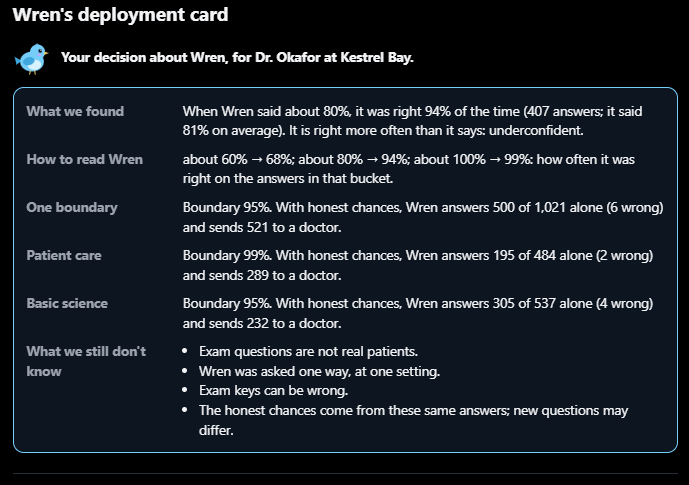
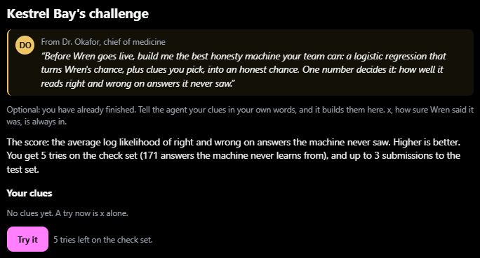
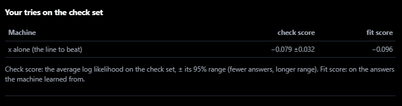
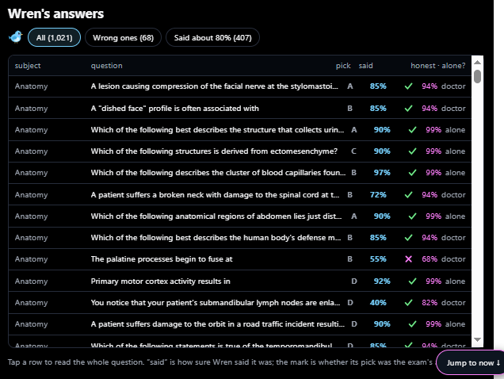